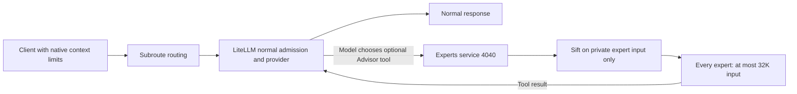

# Subroute: simpler code, fewer failure paths, cooperative Sift

## Standing reliability and acceptance rules, 2026-10-26

The owner requires **if upstream succeeds, downstream must succeed**, and **acceptance tests must pass after every implementation**. [AGENTS.md](AGENTS.md#hard-rules-preserve-upstream-success-and-pass-acceptance) owns the rules; the [acceptance procedure](docs/operations/acceptance.md) defines evidence, commands and completion gates. They apply to all existing goals and future increments. Older accounting fail-closed instructions and historical passing releases do not override them. Existing unresolved acceptance, deployment ownership and the current user's no-commit/no-push/no-production-promotion limits remain in force.

- Ask: align project docs and instructions with these two hard rules, assess the current design honestly, and preserve unrelated dirty work.
- Acceptance for this documentation increment: canonical rules cover request semantics, observational-storage isolation, optional dependencies, attribution and emergency repairs; active entry points link to them; conflicting accounting/architecture guidance is corrected or explicitly historical; the changed documents pass scoped consistency and local-link validation. Existing protocol/fault acceptance is reported separately from documentation checks and live compatibility.
- Current design assessment: the intended LiteLLM-owned protocol core supports the rule, but current behavior is not universally proven. Staging's full usage outbox caused pre-dispatch 503s. A single-method emergency repair was applied to that container; current checkout contains the repaired method, but image recreation acceptance remains open. Selected-Advisor failure/continuation, storage-delay bounds, all provider/tool translations and actual client terminal delivery require their own matching acceptance. These are gaps to resolve, not accepted exceptions to upstream-success preservation.
- Remaining runtime work: preserve the accounting repair in a reproducible staging image and verify after recreation; cover full-capacity outbox/storage recovery and delivery without telemetry-induced failure or excess delay; retain the existing live provider/Advisor gates. No documentation edit closes those runtime obligations or authorizes provider calls or production promotion.
- Documentation acceptance, 2026-10-26: the canonical rules, active entry points, accounting guide and architecture description are aligned. Scoped local-link/anchor and acceptance-reference validation passed, with no newly broken links; whitespace checks passed. The separate locked Python 3.13.11 / LiteLLM 1.106.2 non-live run completed at **1,108 passed, 7 failed, 2 skipped, 35 live deselected**. All seven failures are the existing omitted-model Images routing discrepancy recorded in [TECH_DEBT.md](TECH_DEBT.md#image-default-model-routing-acceptance-2026-10-26). Runtime source/tests were not changed or weakened. The docs-only gate passes; the shared runtime acceptance gate remains failed, and no live/deployment acceptance is claimed. Receipts: `.runs/reliability-contract-20261026/docs-validation.json` and `.runs/reliability-contract-20261026/nonlive-final.txt`.

## Current model-name routing request, 2026-10-25

- Ask: accept any requested model name, use a compatible configured target when one exists, and otherwise use the user's saved routing-desk default.
- Acceptance: configured target aliases and exact full/bare provider IDs resolve without exposing private Advisor deployments; unknown or ambiguous IDs follow the current saved default in alias, force and off modes. Preserve `auto`, existing media routing, request payloads and caller-visible model identity. Empty/non-string model values remain HTTP 400. Unsupported operations and payloads retain their explicit validation errors.
- Implementation: the existing routing control plane indexes configured selectable deployments and resolves incoming names before LiteLLM dispatch. There is no new provider transport, service, dependency, external model discovery or provider retry. Existing LiteLLM fallbacks still own provider execution failures.
- Evidence: baseline routing suite **150 passed**; final focused routing, real proxy HTTP, response identity, audio, image and reasoning suite **397 passed**, no skips, 85 warnings. The 18 new proxy HTTP cases cover unknown names and bare/full provider IDs through Chat, Responses and Messages, streamed and non-streamed, with provider fixtures. See `.runs/model-request-routing/final.txt` and `tests/test_codex_proxy_http.py::test_arbitrary_model_names_through_real_proxy`. Gateway port 4000 `default` text/tool/continuation preflight and native CLI smoke passed; these establish the review route, not deployment of this change.
- Review: independent CLI review withdrew its reported fallback defect after directly exercising `resolve()` for unknown and ambiguous names in all modes. It inspected configured-name isolation and speech normalization. A final explicit-provider reasoning regression ensures explicit provider IDs preserve caller settings while unknown-name default routing inherits saved policy.
- Integration: the active chat "Monitor gateway errors for one hour" owns the concurrent custom Responses-tool compatibility repair in this same routing file. Its five new cases initially failed during a recheck (398 passed, 5 failed). After that owner's source repair landed, combined verification passed **403 tests**, no skips, 85 warnings; receipt: `.runs/model-request-routing/integrated.txt`. Its changes were preserved.
- Remaining: production model-name routing is now live and verified, as recorded below. Staging on port 4005 still rejects unknown model names with HTTP 404 and does not have the model-name routing index. Coordination/rollout approval requested in this chat remains unanswered. Preserve the other chat's staging repair and the existing shared integration/publication gates below; do not mark the full gateway rollout complete.
- Runtime checkpoint, 2026-10-25: read-only inspection found production's source file contains this routing change, but the other chat's production restart exposed dependency drift: installed LiteLLM **1.103.0** versus the project's locked **1.106.2** (staging has 1.106.2). Production startup fails importing `litellm.llms.anthropic.pass_through` from the current Messages shim. The two live probes disconnected before completion, so neither establishes routing acceptance. See `.runs/model-request-routing/runtime-drift.json`. No restart or production mutation was performed by this thread. Coordination and activation approval was requested because the existing shared-service no-independent-restart rule still applies. Next: reconcile the affected runtime with the locked version through the deployment owner, then execute live unknown-name/default and configured-provider-ID checks.
- Production recovery and acceptance, 2026-10-25: the deployment owner replaced the failed container with the verified runtime. Production now reports LiteLLM **1.106.2**, and the router file's SHA-256 matches the locally tested source (`60e0eed57185cd19977405b82bf5d74819bef4ec4471cdb275a3ba699e4e3385`). The nine cases in `.runs/model-request-routing/live-suite.json` all passed against real port 4000 providers: unknown-name requests across Chat, Responses and Messages with/without streaming, bare/full provider IDs under the saved force policy, and a forced-function-call plus completed continuation using an unknown name. Provider deployment IDs were mapped to `/model/info` and matched the saved default `mimo-v2.6-pro`; caller-visible identities, terminal streaming events, marker output and unchanged saved policy were verified. This thread performed no service mutation. Staging's subsequent synthetic unknown-name request returned **404**, confirming its separate rollout is still required. Live alias/off policy switching remains unperformed; all three policy modes are covered locally without changing shared runtime policy.

Status: active
Owner: repository owner; execution and evidence maintained by the working agent
Set: 2026-10-23

## Outcome

Design priority: a simple, reliable and stable architecture. Remove unnecessary decisions and moving parts before adding mechanisms. Keep the ordinary request path short and predictable; every retained safeguard must prevent a demonstrated failure.

1. Make Subroute substantially easier to understand and maintain by reducing code complexity and independent policy owners.
2. Deliver a net reduction in maintained production source and remove complex or duplicated logic that creates failures.
3. Keep Sift only at the experts service on port 4040 for explicitly chosen Advisor calls. Every expert, including Gemini and Codex, has a **32,000-token input ceiling**. Output is separate from this ceiling. Retain Gemini. Normal model requests use routing and LiteLLM/provider admission without gateway compaction or injected guidance.
4. After completing the agreed changes, commit and push the scoped implementation. Preserve unrelated local work and verify the pushed revision; source publication does not by itself establish production rollout.

## Intended request flow

LiteLLM owns the supported tool orchestration. Normal gateway ports 4000 and 4005 do no Sift work. Advertising the optional native Advisor tool on supported Messages requests preserves caller content and ordinary tools; consultation occurs only when the model chooses it. Chat Completions and Responses retain their normal dispatch semantics until explicit tool support is verified.

## Why

The gateway has accumulated overlapping compaction paths, compatibility repairs and lifecycle responsibilities. More code and more decisions per request increase the chance that a local fix breaks another protocol or environment. Simplification must remove a named failure mechanism and preserve required behavior.

## Source of truth

- Resolved owner decision: **32K means input only, for all expert types; keep Gemini**. The owner's follow-up was "All sorts of experts, keep 32k only". This supersedes the earlier pending input-versus-total question and any historical combined-context acceptance interpretation. Codex's separate 1,024 output request remains; Gemini keeps its CLI generation behavior. No combined 32K limit is promised or required.
- This file owns the active simplification contract. [AGENTS.md](AGENTS.md) owns durable engineering constraints; [README.md](README.md) describes supported behavior; [TECH_DEBT.md](TECH_DEBT.md) records deferred debt.
- The [previous goal and checkpoints](docs/goal/archive/GOAL-2026-10-23-before-simplicity.md) are historical. This new priority supersedes their execution order, not their evidence or unresolved acceptance gates.
- The [design-review receipt](.runs/design-review-20261023-evidence/README.md) supports starting hypotheses only. Its tests do not complete this goal or establish release readiness.
- Latest cross-chat refinement, 2026-10-23: Sift runs only at experts port 4040, whose real context ceiling remains 32K. Short, quick expert calls should reduce quota use. The owner stated this in the tool-owning chat and authorized direct coordination here.
- Owner refinement, 2026-10-23: remove Sift from normal target traffic and retain it for optional Advisor input only. This deliberately supersedes earlier requirements for normal-path 32K/2x optimization and virtual 4M context delivery; it does not declare those paths removed or deployed.

## Parallel ownership

- The other chat, "Diagram traffic payload changes", owns removing automatic gateway Advisor consultation and exposing the explicitly model-invoked Advisor tool. Preserve its working changes; do not reinstate that automatic path or duplicate its implementation.
- The owner also authorized "Improve MiniMax 3.1 routing" to coordinate its tested direct MiniMax alias and model-card corrections. Preserve that work. Include its stable source handoff in any shared gateway integration; do not treat a fallback response as native MiniMax evidence.
- This chat owns the remaining simplifications, starting with removing normal-path Sift work and keeping the Advisor-only selection boundary clear. Shared callback registration, context metadata and deployment changes must be reconciled with the other chat's current changes before integration. No independent restart of shared services while that integration is unresolved.

## Acceptance criteria

- [x] Capture a reproducible starting baseline: repository revisions, dirty-file scope and source hashes, affected behavior, known failures, and exact check commands. Include relevant standalone Sift source when changed.
- [x] Measure before/after nonblank, noncomment production-source lines consistently, with explicit file scope and per-module totals. Report tests/docs separately. Deliver a net production-source reduction across the affected maintained code; moving, vendoring or generating the same code elsewhere does not count as removal. No arbitrary percentage quota or code golf.
- [x] Remove duplicated decisions or failure-prone paths, with clear ownership and a simpler normal request flow. Each delivered slice identifies its requirement, existing mechanism, failure mechanism removed, behavior preserved and verification. Smaller files alone are insufficient.
- [x] Remove normal-target Sift callbacks, compaction-specific pre-counting, target-budget recovery and long-history instruction injection. Keep required provider-boundary translation and validation. Normal routing must not execute Sift, consult an Advisor automatically, or inject behavioral guidance.
- [x] Keep Sift confined to a private copy of explicitly chosen Advisor input at experts port 4040, with one owner for its budget, bounded CPU admission, audit and failure handling. Advisor selection or compaction must never modify the original target request. No new gateway-managed tool loop, framework, registry or hidden provider work. Verified by [expert-only hook configuration](config/litellm.experts.yaml:100), [native selected-tool Router regression](tests/test_advisor_plugin.py:153), [private-copy transport regression](tests/test_expert_transport.py:131), [boundary, cancellation and failure tests](tests/test_expert_sift.py:221), and [normal dispatch with Sift unavailable](tests/test_sift_simplification.py:48). This does not claim live provider 32K enforcement or shared staging rollout.
- [x] Cover Chat Completions, Anthropic Messages and Responses where supported: normal content/tool/output-limit preservation, native admission at and beyond provider capacity, normal dispatch independent of Sift availability, and no hidden additional calls. Test Advisor-only compaction success, unsupported/irreducible/busy/error outcomes, truthful audit, cancellation and terminal accounting at that boundary. Document exclusions. Verified in the passing locked non-live suite by [normal protocol preservation and Sift-independent dispatch](tests/test_sift_simplification.py:26), [native capacity boundary](tests/test_context_window.py:24), [output-limit translation](tests/test_codex_output_contract.py:55), [three-protocol Sift HTTP success/failure matrix](tests/test_expert_sift.py:643), and [Advisor cancellation accounting](tests/test_usage_accounting_protocols.py:357). Exclusions are documented in [README behavior](README.md:61) and the active goal. These checks exercise pinned LiteLLM locally with provider stubs; live provider enforcement and shared staging remain under criterion 60.
- [x] Align client context metadata, launch settings and documentation with actual selected-provider capacity or explicit client-side compaction. Retire normal-path virtual 4M intake/32K optimization promises. Oversized normal requests must receive normal provider/LiteLLM admission behavior; do not silently shorten them or fabricate completion.
- [ ] Maintain one authoritative deployed Sift version with explicit, reviewed gateway patch provenance and a repeatable comparison against its upstream pin. Verify relevant standalone and gateway checks before any replacement; never blindly substitute upstream main. The upstream pin remains `e8dc791ba76d99012a3cd43e6114c01faedeeb6a`. Current checkout, staging Gateway/Experts, and the production Gateway bind mount match all five normalized files checked (four vendored Sift files plus `expert_sift.py`). Production `subroute-experts-1` remains on `f7b82d8-local` and matches three of five; `litellm_proxy.py` and `expert_sift.py` differ. The configuration regression in `tests/test_litellm_config.py` now also asserts that the six private Experts YAML routes equal `EXPERT_MODELS`; 57 focused config/Sift tests and the full non-live suite passed after adding it. This protects future builds, not the currently running production image. A fresh normalized config audit found staging Gateway and Experts match checkout, but production Experts has nine aliases instead of six, including retired Gemini 3.1/3.6/3.7 routes ([receipt](.runs/goal-simplicity-20261025/experts-config-runtime-audit-20261025.json)); no provider call or production change was made. Do not promote production before criterion 60; retain this criterion open. See the [initial runtime audit](.runs/goal-simplicity-20261025/deployment-sift-hash-audit.json), [staging rollout audit](.runs/goal-simplicity-20261025/deployment-after-staging-rollout-20261025.json), and [latest normalized upstream/runtime hash comparison](.runs/goal-simplicity-20261025/sift-upstream-runtime-after-image-isolation-20261025.json); this receipt reflects the dedicated staging image tag.
- [ ] Pass affected regression checks before/after structural changes and obtain independent source and behavioral review.
  Distinguish existing baseline failures from regressions.
  The complete focused selection for routing, usage-accounting and Advisor fallback passed **85 tests, no deselections, 26 warnings** under locked Python 3.13.11/LiteLLM 1.106.2 with the documented offline tokenizer cache.
  The bridge suite passed **50 tests, 1 POSIX-only skip**; its HTTP proxy suite passed **14 tests** including the public Responses streaming fallback boundary.
  Initial Python setup failures are documented and corrected.
  The read-only CLI source review is recorded, but did not execute tests.
  A separate bounded read-only CLI behavioral review checked the test assertions and identified that the protocol matrix did not assert output-token values; added the missing Messages, Responses, translated Chat and missing-usage assertions, then passed all 22 tests in [the accounting protocol module](tests/test_usage_accounting_protocols.py:199) under locked Python 3.13.11/LiteLLM 1.106.2.
  Re-ran the wider routing/accounting/Advisor selection after the assertion change: 85 passed, 26 warnings ([receipt](.runs/goal-simplicity-20261025/review-focused-recheck-after-output-assertion-20261025.txt)).
  The complete locked non-live suite then passed 1,062 tests, 2 skipped, 35 live deselected, and 198 warnings in 99.58 seconds ([receipt](.runs/goal-simplicity-20261025/full-nonlive-after-output-token-20261025.txt)); live staging remains outside that evidence.
  The POSIX descendant-cleanup test was strengthened to require a child-ready marker and a SIGTERM exit marker; the isolated Linux case passed ([receipt](.runs/goal-simplicity-20261025/bridge-descendant-assertion-linux-20261025.txt)), the Windows bridge module passed 50 with one platform skip, and the complete non-live suite passed again at 1,062/2 skipped/35 deselected after this test change ([receipt](.runs/goal-simplicity-20261025/full-nonlive-after-descendant-assertion-20261025.txt)).
  This closes the local behavioral-review subtask only.
  The review limits and receipt are recorded in [the simplicity follow-up](docs/evals/simplicity-followup-2026-10-23.md).
  The direct native Advisor accounting installer also now has a regression-tested idempotence guard: its pre-fix double-install test failed, the 86-test focused selection passed after the fix, and the complete non-live suite passed 1,063 tests with 2 skipped and 35 live deselected ([focused](.runs/goal-simplicity-20261025/advisor-install-idempotence-focused-20261025.txt), [full](.runs/goal-simplicity-20261025/full-nonlive-after-advisor-install-idempotence-20261025.txt)).
  After the allowlist/configuration invariant was added, the current locked non-live suite again passed 1,063 tests, 2 skipped, 35 live deselected, and 198 warnings with exit 0 ([focused config/Sift](.runs/goal-simplicity-20261025/expert-sift-config-invariant-20261025.txt), [full suite](.runs/goal-simplicity-20261025/full-nonlive-after-expert-sift-config-invariant-20261025.txt)).
  Criterion 60 remains open for successful public Advisor output, full request-to-terminal accounting, and remaining integration acceptance.
  Staging proves the direct MiniMax target route, the 4040 Sift rejection/compaction boundary, and bounded forced-Codex Advisor/provider attempts.
  The latter returned provider usage but public Messages responses exhausted `max_tokens` with empty text; see [the v6 response receipt](.runs/goal-simplicity-20261025/forced-advisor-live-v6.txt) and [its numeric accounting ledger](.runs/goal-simplicity-20261025/forced-advisor-v6-accounting.txt).
  The staging Antigravity bridge is healthy but `/v1/status` reports `authenticated: false`, so the Gemini route still requires sign-in before it can be tested.
  Do not promote production until the live acceptance gap is resolved.
- [ ] Reconcile README/runtime behavior and record reduction, independent review, actual validation, deployment state and remaining limitations here. Mark done only when every criterion has evidence.

## Constraints and invariants

- LiteLLM owns public protocols, streaming, standard provider adapters, retries and standard provider orchestration. Keep necessary workarounds narrow, with concrete capability-gap evidence and retirement conditions.
- Sift owns deterministic history selection and a truthful audit for Advisor input only. Subroute owns routing/request policy and explicit optional-work budgets; LiteLLM and the provider retain native capacity admission. Keep these responsibilities separate.
- Preserve caller output limits, original target instruction/tool semantics, bounded ingress, provider capacity checks and bounded resource/cancellation cleanup. Experts port 4040 is the sole Sift boundary, with a 32,000-token input ceiling for every expert. Keep expert calls concise; generation does not subtract from that input ceiling. Separate this owner-authorized removal of normal-path behavior from unrelated structural refactors.
- No silent content loss, fabricated completion, hidden retry/fallback/provider spending, or estimated usage presented as provider usage.
- Keep Docker Compose, required protocol/media/Relay behavior, production/staging database and saved-state isolation, credential boundaries, and unrelated local work. Advisor becomes an explicit optional tool as authorized by the owner. Remove obsolete or duplicate code with evidence; dropping other supported capabilities requires an explicit owner decision.
- Favor small functions, ordinary configuration and existing mechanisms. No new service, dependency, store or abstraction without a current requirement. Count code moved across repositories in the reduction ledger.

## Non-goals and escalation

- Do not resume unrelated GPU/gaming, product-pilot, Relay expansion or benchmark campaigns to satisfy this goal. Historical unmet gates remain unmet.
- No broad rewrite, cosmetic LOC target, or automatic production restart or paid evaluation campaign. The owner has authorized execution of this goal; scope ordinary implementation and verification to the affected paths.
- Escalate an actual conflict with required capabilities, irreversible data/credential changes, missing authority, or a concrete external dependency. Do not weaken acceptance to match an incomplete implementation.

## Execution record

Current next actions: checkpoint `53681a7` has been committed and pushed to `codex/simplify-gateway`. Follow-up lifecycle and private Sift audit fixes pass 981 selected non-live tests (two environmental skips, 35 live deselections). Staging and experts run immutable image `24f4c0d751fe`; production is unchanged. A separately reviewed 256-output-token Messages scenario completed with closed accounting. Both earlier live expert probes showed Sift compaction and input as reported below 32,000; Codex passed the full response check, Gemini failed the exact-answer marker. A later diagnostic confirmed lifecycle JSON preceded `EXPERT_OK`, but did not reconstruct that original failure. The current working tree uses a native schema envelope for plain Gemini text and rejects blank no-tool answers; seven focused cases pass. Independent review found no confirmed no-tool regression and noted blank tool-enabled text remains unguarded. On 2026-10-25, one bounded request against the current Gemini schema path returned HTTP 200, terminal `stop`, exact `EXPERT_OK`, and no lifecycle metadata; the Sift headers reported 33,213 input tokens compacted to 15,863 forwarded. The sanitized provider response is in [live response receipt](.runs/goal-simplicity-20261023/gemini-envelope-live/live-response.json). The runner then exited with `NameError` while writing its post-call receipt, so there is no authoritative runner receipt or full pre/post configuration comparison; [recovery evidence](.runs/goal-simplicity-20261023/gemini-envelope-live/postflight-recovery.json) records what is verified and what remains unknown. The missing constant is fixed and the replay guard passed locally; the consumed claim prevented a retry. This closes only the schema-envelope response scenario, not the remaining goal criteria. Publish the scoped follow-up, then continue the full-goal acceptance audit. The input-only 32K definition for every expert is resolved.

Current approach: remove normal-path Sift and instruction injection, retain bounded Advisor-only compaction, reconcile client capacity claims, then independently verify behavior and source reduction. Earlier work consolidating normal-target Sift hooks is superseded and is not accepted delivery. Other candidates remain explicit startup, reproducible staging promotion, accurate Sift provenance and experimental-selector isolation/shared validated state; investigate them only when they do not overlap the Advisor workstream. This is not a mandate to rewrite every subsystem.

Progress:
- Goal contract written; previous goal preserved intact.
- Advisor-only Sift direction and parallel ownership recorded from the owner's latest instructions. Earlier partial normal-path refactoring remains unaccepted and must be reconciled without overwriting concurrent work.
- Normal Sift module and three callbacks removed; required Qwen translation retained. Desktop capacity and client compaction now use 256,000 / 204,800. README and fork provenance aligned.
- The scoped [implementation and validation record](docs/evals/sift-advisor-only-2026-10-23.md) records the original baseline, 352 net production-source lines removed, exact checks, known integration failures and exclusions. Concurrent Advisor edits are excluded from that reduction.
- The tool-owning chat implemented Sift only at experts port 4040. Independent boundary checks and the final combined suite pass; the owner has resolved the 32K input-only contract, while live provider staging acceptance remains open.
- Automatic Advisor execution is removed from normal dispatch; the supported Anthropic Messages target receives one concise native tool only when a saved expert is configured. Ranker, frequency, analytics, ONNX assets, dependencies, controls and their obsolete test suites were removed. A fresh complete non-live run classified the current failures and verified their repairs. Older version-specific results remain historical, rather than being retroactively declared pre-existing.
- The owner resolved the expert budget as **32K input-only for every expert, with Gemini retained**; generation is separate. The Antigravity CLI has no output-token control, while Codex 4040 requests `max_output_tokens=1024`; one bounded live GPT-6 Luna probe enforced a 16-token output stop and returned an incomplete result. Other Codex models remain unverified. Live provider proof that each expert respects the 32K input ceiling remains open. Do not present this input ceiling as a combined input/output cap.

Validation and runtime evidence: an earlier affected-suite checkpoint passed 271 Python checks and 5 desktop checks; its [command](.runs/goal-simplicity-20261023/advisor-only/final-validation.ps1) and [receipt](.runs/goal-simplicity-20261023/advisor-only/tests-final-integration.txt) remain historical. The previous recorded integrated run passed **979 tests, with 2 skipped and 35 live tests deselected**. Source hashes were stable across that run. Both host-skipped tests subsequently passed separately using owned PostgreSQL and Linux containers. Exact commands, failure classification and independent review are in the [validation record](docs/evals/sift-advisor-only-2026-10-23.md). These fixture checks do not establish live provider compatibility. Expert URL serialization and parent-fallback replay have been repaired and independently rechecked. An actual GPT-6 Luna probe verified a 16-token provider stop and truthful incomplete failure; other Codex models and near-32K requests remain unverified. Gemini lacks a native output cap. The owner has since resolved 32K as input-only for every expert, retaining Gemini; live provider verification of that input ceiling remains open. No production promotion or whole-goal acceptance is claimed.

Fresh local validation on 2026-10-24 passed **998 non-live tests**, with **2 skipped and 35 live tests deselected**, on a temporary Python 3.13.11 environment synchronized from the lockfile with LiteLLM 1.106.2. The test command was `python -m pytest -q -m 'not live' -p no:cacheprovider --basetemp=<temp> --tb=short --show-capture=no -rN --disable-warnings tests`; the temporary tokenizer cache was primed so the repository's network guard remained active. The run reported 193 warnings whose details were suppressed, so they were not classified. The focused reasoning-policy module passed 30 tests after correcting a fixture that supplied `medium` for a model whose configured supported efforts include `medium`; the rejection case now uses unsupported `ultra`. This is local test evidence only, not staging or live-provider proof.

Remaining gap: deliver the acceptance criteria above.

Integration checkpoint: the earlier 19-file coordinated source ledger records 1,693 fewer maintained source lines, including the expert hook, native Advisor replay guard, normal Codex output-limit preservation and citation-safe image captions. The [repeatable ledger](.runs/goal-simplicity-20261023/advisor-only/combined-reduction.json) records that checkpoint and excludes unrelated paths, tests, docs, configuration and build/data artifacts. The newer 20-file selected-source snapshot is recorded below. Small retained safeguards prevent reproduced failures; line count does not override required behavior.

Independent review accepted the normal Sift retirement and desktop settings. A pinned-image Compose fixture with networking disabled passed actual HTTP Chat/Messages/Responses expert compaction, irreducible-input rejection, and native target-to-expert-to-target orchestration. It preserved the original target history and called the expert once. Providers were mocked, and the temporary container was removed. This is integration evidence, not live provider compatibility.

Broader inspection found normal Messages streaming HTTP 500 when model-identity restoration wrote to a read-only framework stream property. The model-card chat repaired this by updating LiteLLM's existing mutable adapter before native serialization, with no new SSE parser or stream wrapper. Independent review and the final combined suite verify the repair. Three valid-schema counting failures also exposed that the existing compatibility shim omitted the pinned LiteLLM 1.106.2 version; the narrow version alignment passes targeted checks and independent review. Two Gemini formatter fixtures were aligned with the existing saved-expert policy without weakening their assertions. Earlier failed receipts remain preserved. These scoped results do not establish a full-suite pass.

Latest reliability continuation:
- Normal Codex output limits now reach the actual native Responses HTTP body. The strictest supplied alias is retained. The existing bridge cannot preserve limits below 16, so its Codex adapter rejects them before Codex I/O; existing native routing fallbacks still apply. No new provider transport owns this translation.
- Image requests clear Advisor only in their request policy, at the routing owner, while preserving the saved selection. Caption separators are inserted before native conversion so LiteLLM calculates the matching citation offsets. Independent review caught and rejected an earlier offset regression; the corrected case is now a maintained test.
- MCP 2.3.0 fixture attributes and the stable `default` alias expectations were aligned without weakening other assertions. Search endpoint unit tests avoid starting the production lifespan. Compose exposes the existing native local-auth opt-in without enabling it by default; README describes the pinned runtime's startup check accurately.
- The final complete non-live run passed **979 tests**, with **35 live tests deselected** and **2 host/environment skips**. Both skipped cases subsequently passed separately: isolated PostgreSQL recovery/revision/acknowledgement/environment checks, and Linux descendant-process cleanup. The source/config/test snapshot remained unchanged across the complete run (146 files). Exact commands and receipts are in the [validation record](docs/evals/sift-advisor-only-2026-10-23.md). Temporary infrastructure was removed, and shared services were not restarted.
- Native-only probes still reproduce reasoning-block loss and unsupported-operation HTTP 500s in LiteLLM 1.106.2. Their narrow compatibility repairs remain justified; retire them only when the same behavioral checks pass natively. Production promotion and live-provider coverage remain open; the 32K input-only contract is resolved, while live expert-cap verification is not.

Immutable deployment checkpoint:
- A bounded CLI worker packaged source and only three static runtime configs into the locked gateway image, preserving the existing dependency/Prisma build layers. Production's original host policy path is retained through a legacy mount; staging keeps its own state volume. All gateway roles use the same image recipe. No source/static-config binds are required by the new Compose definition.
- Parent inspection and separate nonauthor review verified 42 exact baked files, 15 configuration checks, all six buffered/streamed local HTTP protocol cases and native authentication. An owned legacy-policy fixture preserved load bytes, control writes and saved state across restart. Image and receipts are recorded under [.runs/goal-simplicity-20261023/immutable-packaging](.runs/goal-simplicity-20261023/immutable-packaging/).
- Shared staging was already crash-looping from a generated Prisma client/engine mismatch (857 restarts at recovery). The coordinated targeted recovery recreated only `gateway-staging` with the accepted pinned image. Database readiness and liveness return 200; catalog authentication returns 401/200 as expected; restart count remains zero during the 25-second observation. Policy bytes, the original state volume, 213 completed migration records and 52,481 existing usage receipts are preserved. Production and experts container IDs/images/start times are unchanged. See [recovery receipt](.runs/goal-simplicity-20261023/immutable-packaging/staging-acceptance.json).
- This is staging boot/auth/state acceptance only. It does not prove live provider behavior, expert-role rollout, sustained reliability or provider enforcement of the resolved 32K input ceiling. Production has not been promoted and the goal remains active.
- A separate [nonauthor post-recovery review](.runs/goal-simplicity-20261023/immutable-packaging/nonauthor-staging-review.md) independently verified the staging identity, health/authentication, exact policy bytes and read-only database counts, plus unchanged production/experts identities. Owned dummy candidate containers and network were removed. With the 32K input-only contract now resolved, the next dependent step is bounded real-provider acceptance, followed by separately coordinated expert/production promotion. No further broad rewrite or speculative cleanup is authorized by this checkpoint.

Ordinary-provider acceptance continuation:
- Previous goal turn classification: progress. It changed the deployment artifact and recovered staging with independently verified state preservation. This continuation then closed an independent remaining evidence gap without changing policy, restarting services or exercising experts.
- A single bounded live run on the exact staging image passed ordinary buffered Chat and streamed Responses against the saved `mimo-v2.6-pro` target. Both returned the expected answer marker and native completion terminal; retry and fallback headers were zero. Each provider response reported 17 input / 21 output tokens. This is a short-request observation, not output-cap pressure or near-context-limit proof.
- The durable ledger contains exactly two new provider inference records, one per protocol, both complete with observed usage and `openai/mimo-v2.6-pro` upstream identity. No Advisor attempt was observed. Full saved policy bytes and staging/production/experts lifecycle identities remain unchanged. See [live result](.runs/goal-simplicity-20261023/ordinary-live-smoke/live-result.json) and [accounting/state receipt](.runs/goal-simplicity-20261023/ordinary-live-smoke/live-accounting.json).
- A separate [nonauthor live-evidence review](.runs/goal-simplicity-20261023/ordinary-live-smoke/nonauthor-live-review.md) independently read both exact database attempts, the complete run-window count, unchanged policy bytes and service identities. It accepts only these two short MiMo calls. The copied temporary smoke script was removed after verifying its hash; no helper process remains running.
- The first CLI preparation worker failed with an upstream demand error after writing an unaccepted artifact. Parent repaired its terminal check; separate nonauthor review accepted the artifact and independent wall-time supervisor before execution. Failed worker receipts and rejected artifact remain preserved. No inference retry or broad evaluation campaign followed.
- Anthropic Messages live compatibility, private experts, other provider routes, context boundaries, sustained operation and production promotion remain unverified. The owner resolved the experts' 32K ceiling as input-only for every expert, retaining Gemini. Gemini CLI cannot enforce an output cap, so this contract does not promise a combined input/output limit. The next work is bounded live-provider verification under the resolved contract; do not replace missing evidence with speculative cleanup, repeated smoke calls or weaker acceptance.
- 2026-10-25 client-capacity checkpoint: `config/active_model.json` selects `mimo-v2.6-pro`; LiteLLM and Desktop configure a conservative 256K window with client compaction at 204.8K. Xiaomi's current public spec lists 1M context and 128K max output for this model. `desktop/npm test` passed 5/5, and `tests/test_litellm_config.py` passed 15/15 with LiteLLM's offline cost map enabled. These checks verify saved/generated settings, not already-running client sessions or native admission beyond provider limits; existing sessions still need relaunch. The exact evidence and first offline-test invocation failure are in the [client metadata checkpoint](docs/evals/simplicity-followup-2026-10-23.md#client-context-metadata-checkpoint-2026-10-25).

Follow-up evidence: [published report](docs/evals/simplicity-followup-2026-10-23.md). At the 2026-10-23 report checkpoint, the selected production-source ledger recorded **1,639 fewer maintained source lines**, then its 20-file refresh recorded **1,437 fewer**. An earlier 2026-10-25 snapshot recorded **1,403 fewer**. The latest refresh records **1,390 fewer** (Python -1,287, JavaScript -62, markup/style -41) with the same baseline and selected 20-file scope. Because the full `usage_accounting.py` file now includes later outbox and installer-idempotence additions, those added lines are conservatively included and are not attributed to the simplification. See the [refreshed ledger](.runs/goal-simplicity-20261025/simplicity-current-source-2026-10-25.json) and its [repeatable counter](.runs/goal-simplicity-20261025/refresh-source-ledger.py). One plain-text schema-envelope answer passed a bounded live exact-marker scenario; the earlier failed Gemini response and broader expert acceptance remain open. Whole-goal and production acceptance are not claimed.

Current continuation, 2026-10-25: the latest full current-worktree non-live suite passed **1,004 tests**, with **2 skipped, 35 live tests deselected and 193 warnings**. Warnings remain mainly Pydantic/LiteLLM notices, including Responses usage serializer warnings not fully attributed. The prior 998-test receipt remains historical; the latest [full run](.runs/goal-simplicity-20261023/pytest-final-context-sift-20261025.txt) includes the current test additions. A selected 58-test context/Advisor/Sift/accounting suite passed, and the final `usage_complete` assertion was rechecked by its isolated test. Exact scope and results are in [the test continuation receipt](.runs/goal-simplicity-20261023/expert-sift-error-accounting-tests-20261025.txt).

The removed context-window test asserted automatic Advisor ranking/frequency and target-gateway compaction failure skipping, behavior the current goal explicitly retires. Replacement tests cover native model-selected Advisor behavior, no selection/no expert call, normal protocol dispatch with Sift unavailable, private-copy expert compaction, mapped failure outcomes, the single 25,600-to-32,000 relaxation, bounded busy/cancellation handling and model-level cancellation accounting. An independent read-only CLI review accepted the current assertions while noting the fake expert router manually invokes the parent accounting hook: this is not real HTTP/4040 or provider-accounting proof. See [review event receipt](.runs/goal-simplicity-20261023/sift-accounting-review-exact-20261025.jsonl) and the retained [initial accounting-test failure](.runs/goal-simplicity-20261023/sift-accounting-cancel-first-failure-20261025.txt).

This closes a local coverage gap only. The selected-model context fixture proves configured LiteLLM admission at 256,000/256,001, not current provider-capacity enforcement. The 32K compaction count uses a deterministic fixture counter. A later direct Gemini 4040 request passed its answer, payload-integrity, Sift-audit, and provider-reported input checks; that request had no exact accounting-grant correlation and was not a model-selected Advisor cycle. Real HTTP/4040 cancellation/accounting, the combined model-selected-plus-large-Sift path, remaining protocol/context acceptance, production behavior after promotion, staging acceptance beyond the existing immutable-image checks, and production promotion remain open. Staging, experts, and production currently contain identical Sift source hashes. A later read-only process/config check below confirms which config each process selects, but not actual callback invocation or behavior. Preserve the current dirty worktree and continue with bounded acceptance that closes one of these specific gaps; do not repeat the already accepted direct Gemini request or mark the whole goal complete from local tests.

Ledger correlation checkpoint: the accepted direct Gemini 4040 response lacks exact accounting linkage. Its public `x-litellm-call-id` is not the UUID created by `UsageAccounting.local_trace()` when no accounting grant is supplied; exact-ID queries were empty, and the bounded staging window contained unrelated concurrent MiniMax rows. No provider-attempt count is claimed for that response. See [sanitized correlation result](.runs/goal-simplicity-20261023/gemini-envelope-live/live-ledger-correlation.json). The already accepted model-selected Advisor flow has separate end-to-end attempt-ledger evidence; do not infer that it closes this direct-call gap.

Additional direct Gemini 4040 acceptance, 2026-10-23: the independently reviewed [combined live receipt](.runs/goal-simplicity-20261023/gemini-final-live/live-response.json) records one POST to the unchanged synthetic payload, HTTP 200/`stop`, exact `EXPERT_OK`, no retries, Sift estimated input 33,213 and forwarded input 15,863, and provider-reported input/output 17,075/41 (17,116 total). The independent reviewer recomputed the acceptance gates and verified the experts and staging containers still matched the reviewed immutable image with zero restarts; production remained unchanged. This verifies that one direct Gemini request's provider-reported input was below 32,000 and that Sift delivered its audit headers. It does not prove billing, exact provider-side internal-call count, native model selection, or accounting correlation. The separate model-selected Advisor receipt closes the orchestration/accounting path only for its small request. Treat these as complementary receipts, not one combined acceptance. Keep the prior failed and metadata-leakage receipts as failures; the later accepted request does not erase them.

Earlier Sift provenance snapshot, 2026-10-25: the prior checkout and Experts image comparison is preserved in [the earlier recheck receipt](.runs/goal-simplicity-20261023/sift-provenance-recheck-20261025.txt). Its `litellm_proxy.py` checkout hash predates the current source hash and its container inventory predates the current image. Treat it as historical, not as the current runtime comparison.

Large model-selected Advisor/Sift staging acceptance, 2026-10-25:
- Preparation and gate evidence: the new synthetic 101-message acceptance harness passed 17/17 offline MockTransport/socket-blocked checks. A separate local LiteLLM 1.106.2 Router request against the repository HTTP fixture observed `UsageAccounting.async_pre_call_deployment_hook` call type `anthropic_messages`; the temporary receipt-store warning from that isolated probe is not accounting evidence. The independent CLI reviewer returned `Verdict: READY` for one Mimo staging request only. Its review and artifact hashes are recorded in [.runs/goal-simplicity-20261023/model-selected-large-advisor-20261025/nonauthor-review.md](.runs/goal-simplicity-20261023/model-selected-large-advisor-20261025/nonauthor-review.md).
- The one-shot supervisor stopped before the public POST. The child reported `attempted_post_count=0` because staging's live routing state was `minimax-flash-direct` while this reviewed payload requires `mimo-v2.6-pro`; the saved Advisor remained Gemini Subscription. Before/after policy and runtime identities were unchanged. No target or Advisor provider request was made, no 4040 POST or Sift audit was observed, and no accounting rows are attributable to this attempt. Preserve the consumed attempt and receipts under the same artifact directory; do not change staging routing to make this artifact pass. See the [public preflight receipt](.runs/goal-simplicity-20261023/model-selected-large-advisor-20261025/public-receipt.json) and [supervisor result](.runs/goal-simplicity-20261023/model-selected-large-advisor-20261025/runtime-result.json).
- The supervisor's timestamp-only read-only ledger window also included seven concurrent MiniMax `/v1/chat/completions` rows, three still pending. Those rows are unrelated to the blocked Messages probe and make the full-window ledger unsuitable as acceptance evidence. The receipt preserves this contamination; do not attribute those rows to this request.
- This does not close large model-selected-plus-Sift acceptance. Any new live attempt needs an owner-coordinated staging route matching its reviewed target and a ledger cohort query that excludes unrelated protocols or correlates the request. Production remains unchanged.

Messages stream close-settlement fix, 2026-10-25:
- A focused regression reproduced a provider receipt remaining `pending` when the wrapped Messages source raised during `aclose()`. The observer now runs `finish(...)` in a `finally` around source closure, so settlement is attempted and the close exception still propagates when settlement succeeds. The new test calls the installed LiteLLM Messages wrapper with a controlled source and verifies the interrupted outcome and observed token facts.
- Verification: five focused close/cancellation tests passed; a 12-module usage/accounting, Advisor, context, routing and Sift regression run passed 290 tests; `git diff --check` passed. An independent read-only CLI reviewer accepted the bounded fix and test. Ruff is not installed in the selected environment.
- Correction: the initial protocol-test run omitted this repository's documented tokenizer-cache environment, so its network guard caught an attempted `o200k_base` download. The previously deselected case passes when `TIKTOKEN_CACHE_DIR` and `CUSTOM_TIKTOKEN_CACHE_DIR` point to `.runs/goal-simplicity-20261023/tokenizer-cache` and `TEMP` points to `.runs/goal-simplicity-20261023/tmp`; the full relevant run has no deselections or failures. This is a command setup correction, not an outstanding test prerequisite.
- This is local behavioral evidence only. It does not close real HTTP/4040 cancellation/accounting or large model-selected Advisor/Sift staging acceptance. Production and shared staging state were not changed.

Advisor accounting correlation checkpoint, 2026-10-25:
- Added request/attempt correlation for future private expert Sift audit. The gateway adopts a UUID `x-litellm-call-id` only for its local admin trace, ignores client-provided IDs for virtual-key requests, and forwards root plus attempt UUIDs only on Advisor deployments at the exact Experts base URL. Experts strips these reserved values from provider-bound carriers and uses a validated request-local copy for the Sift audit line. This does not retroactively correlate the previously accepted direct Gemini call.
- The installed LiteLLM Router plus captured HTTP-handler test observes both headers on the actual outbound request and confirms neither appears in its JSON body. Interleaved Experts-hook tests check per-request audit pairing; absent, split and malformed fields fail safely. The fixture does not exercise an Experts receiver followed by a real upstream provider. The independent CLI review accepted this local change only and recorded that UUIDs are not authenticated identity; Compose loopback and bearer declarations do not establish runtime enforcement. See [bounded review](.runs/goal-simplicity-20261023/advisor-correlation-20261025/independent-review.md).
- The affected suite passed 66 checks, and the latest complete non-live suite passed 1,011 with 2 skipped and 35 live tests deselected. `git diff --check` passed. These remain local checks, not staging acceptance. No shared service was restarted and production remains unchanged.
- The 2026-10-23 20-file selected source ledger recorded **1,437 fewer** maintained source lines (Python -1,334, JavaScript -62, markup/style -41), including the additional audited correlation source. The earlier 2026-10-25 snapshot recorded **1,403 fewer**; the latest refresh records **1,390 fewer** (Python -1,287; JavaScript -62; markup/style -41) with the same baseline and file scope; the entire current `usage_accounting.py` file is included, so its later outbox and installer-idempotence additions conservatively reduce the measured net deletion. See the [current ledger](.runs/goal-simplicity-20261025/simplicity-current-source-2026-10-25.json), [refresh script](.runs/goal-simplicity-20261025/refresh-source-ledger.py) and [prior snapshot](docs/evals/receipts/simplicity-current-source-2026-10-23.json).
- Remaining: exact correlation through a model-selected large Sift staging request, real provider-side boundary/accounting evidence, open cross-protocol/context acceptance, and production promotion. The route-matched staging attempt previously stopped before POST; this change does not satisfy that gate.

Staging source-parity recheck, 2026-10-25:
- Fresh read-only inspection confirms `gateway-staging` is running image `sha256:2d3076d83d415a2066532b4c69cf0921fe1667f0452e377a83ba53116390005d`, with zero restarts, current target `minimax-flash-direct`, policy version 2093, and saved Advisor `gemini-subscription`.
- The running image does not contain the current local correlation edits: container and working-tree SHA256 differ for `usage_accounting.py`, `expert_sift.py`, and `sift/litellm_proxy.py`. Therefore, a live request to the current staging service would not verify those edits. I made no route change, inference request, or restart. See [runtime/source recheck](.runs/goal-simplicity-20261023/advisor-correlation-20261025/runtime-recheck.json).
- The prior reviewed Mimo large-request artifact remains invalid for this staging policy and correctly has zero POSTs. The next staging gate requires a coordinated reviewed integration image and a matching request/ledger cohort; production remains unchanged.

Production/staging Compose isolation increment, 2026-10-25:
- Gateway aliases now use `EXPERTS_BASE_URL`, routing production to `experts:4040` and staging to `experts-staging:4040`. Compose gives production and staging separate networks containing their gateway, PostgreSQL, Experts, Antigravity, and SearXNG services. Staging Antigravity has its own three persistent volumes; Experts staging has no published host port. Each gateway waits for its Experts `/health/liveliness` check. The host GET to the current Experts endpoint returned 200; this is endpoint discovery, not acceptance of a newly deployed container.
- The production and staging gateways still receive the same read-only Codex auth file and shared gateway/Experts/accounting credentials. The staging Antigravity volumes start without an authorized login; initialize that account independently before Gemini staging use. These shared credentials and login requirements are documented in README. No containers were created, recreated, or restarted.
- Verification: `docker compose config --quiet` passed; the affected config, accounting, and transport selection passed 60 tests; the final non-live suite passed **1,014**, with 2 skipped and 35 live tests deselected (193 warnings). The suite ran in an isolated locked test/music/search environment using the existing tokenizer cache after the primary `.venv` refused a dependency update. This remains local source evidence; Compose reachability, independent staging login, and live staging behavior are unverified.
- The CLI review returned useful static findings and exposed two defects: production PostgreSQL was reachable on the shared default network, and Experts dependencies waited only for process start. The changes now use environment-only gateway networks and health-based Experts dependencies. The reviewer’s prescribed nested CLI child failed before inference with `Error finding codex home: Could not find home directory`; therefore the independent nonauthor review gate remains open. A running-container connectivity test is also outstanding.
- Remaining: reconcile this Compose integration with the other Advisor workstream, obtain the required independent review, provision staging’s separate Antigravity login, verify the new network topology after coordinated rollout, and then resume route-matched correlated staging acceptance. Do not promote or restart shared services to bypass those gates.

SearXNG readiness and deterministic test setup, 2026-10-25:
- The independent Compose review found that gateway startup waited only for SearXNG process start. Both SearXNG services now check the image's `/healthz` endpoint and both gateways wait for `service_healthy`. The official SearXNG route returns `200 OK` in the currently running pinned image; the exact `wget --quiet --tries=1 --spider` command also passed inside that container. This is an app-readiness check, not evidence that external search engines return results.
- The config test now checks both healthchecks and dependency conditions. `tests/test_litellm_config.py` passed 17 tests in isolation. `tests/conftest.py` fixes LiteLLM's bundled model-cost map for test processes, avoiding an import-time remote refresh that the socket guard correctly blocked when this module ran alone. No tests depend on remote cost-map refresh.
- Final local verification after these edits: `docker compose config --quiet` passed, `git diff --check` passed, and the full suite passed 1,014 with 37 skipped and 193 warnings. The earlier 1,014/2-skipped/35-deselected result remains the output of its separately recorded invocation; this later run did not deselect live tests explicitly.
- The bounded read-only CLI source review of `dynamic_router.py`, `usage_accounting.py`, and `advisor_plugin.py` completed with exit code 0. It confirmed import-time route registration and LiteLLM private-method patches; it also found the advisor fallback guard can suppress recovery after target failures. Retention is justified by concrete source-described protocol gaps, but removal requires native framework capability and Router-level behavior evidence. The review is source-only, not a runtime verdict. See [source review JSONL](.runs/goal-simplicity-20261023/source-review-20261025/nonauthor-review.jsonl). The separate Compose review is likewise source-level and records shared credentials and host/outbound reachability limits.
- No containers were created, recreated, or restarted. Remaining gates are coordinated Compose rollout and network verification, separate staging Antigravity login, route-matched correlated large Advisor/Sift acceptance, and the goal's remaining cross-protocol/provider-capacity evidence. Production remains unchanged.
- Updated the English and Chinese README model notes to remove the unsupported claim that all Target requests retain a Subroute-owned 256K capacity, and to state that Gemini staging requires its own Antigravity authorization. The documented 256K desktop setting remains explicitly a client profile with client-side compaction, not a provider capacity guarantee.

Client-window and runtime-parity recheck, 2026-10-25:
- Clarified `desktop/agents.cjs` and `desktop/README.md`: the 256K launch window is a conservative client setting with 80% client-side compaction, not a provider-native capacity claim. The current OpenRouter catalog lists about 1.05M context for the configured MiniMax M3.1 Flash route and its MiMo Pro/GPT-6 Luna fallbacks; that catalog metadata is not runtime admission evidence. `npm test` in `desktop/` passed 5 tests.
- Read-only Docker inspection shows the current staging gateway and Experts use image `subroute-advisor-correlation:f7b82d8-local`, image ID `sha256:e5a155b6237b9f17d14378ad92e1791f1535adbafa0531744dca5ee2d7c244ec`, started 2026-10-25 05:06 UTC with zero restarts and no source bind mounts. All four Sift files in the Experts image match the current checkout after UTF-8 and CRLF-to-LF normalization; their raw byte hashes differ because the line endings differ. The normalized `usage_accounting.py` and `plugins/expert_sift.py` hashes still differ from the image, so this does not establish full source/image parity. The per-file Sift comparison is in the [current provenance receipt](docs/evals/receipts/sift-upstream-comparison-2026-10-25.json). The new `experts-staging` and `searxng-staging` Compose services are not running. Production was not changed. The sibling MiniMax handoff reports 43 accepted tests, but no current staging window or operator; no live request was sent.
- Docker network inspection further shows the production and staging gateways, the shared Experts and Antigravity services, both PostgreSQL containers, and production SearXNG are all members of `subroute_default`. Staging currently names `experts`, `antigravity`, and `searxng`, so the intended production/staging network split exists in source Compose but is not active in the running topology. This proves shared network membership and potential cross-reachability, not a successful connection between services. I made no connectivity probe or runtime change.
- Remaining live gate: coordinate an immutable image containing the reviewed current source and direct MiniMax configuration, confirm an authorized staging window and separate Antigravity login, then run the correlated large Advisor/Sift acceptance once and independently verify its accounting and policy state. Until that condition is met, local tests cannot close the staging criterion.

Sift provenance and gateway boundary verification, 2026-10-25:
- The [current receipt](docs/evals/receipts/sift-upstream-comparison-2026-10-25.json) compares all four vendored files to pinned Sift commit `e8dc791ba76d99012a3cd43e6114c01faedeeb6a` and to `/app/src/sift` in `subroute-experts-1`. Each runtime file matches the worktree after UTF-8 and CRLF-to-LF normalization. Three files are documented gateway patches; `__init__.py` matches upstream. Raw hashes differ only from line-ending representation. The Experts container has no source bind mount and shares image ID `sha256:e5a155b6237b9f17d14378ad92e1791f1535adbafa0531744dca5ee2d7c244ec` with the staging gateway.
- A separate [normalized runtime/source comparison](.runs/goal-simplicity-20261023/responses-boundary-fullcheck-20261025/runtime-source-parity.json) finds mismatches in `usage_accounting.py`, `plugins/advisor_plugin.py`, and `plugins/expert_sift.py`; Sift file parity is not full application-source parity.
- A fresh read-only runtime check compared the four normalized Sift files inside `subroute-experts-1`, `subroute-gateway-staging-1`, and `subroute-gateway-1`; all 12 hashes match the current checkout. Experts starts with `/app/config/litellm.experts.yaml`, which selects `subroute.plugins.expert_sift.expert_sift_hook`. Staging and production start with `/app/config/litellm.yaml`, whose callback lists do not include Sift. This confirms process/config selection only; module loading and hook invocation remain unverified.
- Focused gateway boundary checks passed **76 tests** using the locked Python 3.13.11 environment: `tests/test_expert_sift.py`, `tests/test_sift_simplification.py`, `tests/test_sift_active_cycle_recovery.py`, `tests/test_target_sift_softfail.py`, `tests/test_advisor_plugin.py`, `tests/test_usage_accounting.py`, and `tests/test_usage_accounting_protocols.py`. The [final command output](.runs/goal-simplicity-20261023/sift-boundary-20261025/tests-sift-boundary-002609.txt) is retained. The first attempt had three setup errors because its basetemp parent was absent and one token-estimation failure because the `o200k_base` cache was unavailable under the network guard; the [failure note](.runs/goal-simplicity-20261023/sift-boundary-20261025/initial-failure.txt) records the environment causes. The rerun used the existing local tokenizer cache. No provider call, standalone Sift suite, image change, or deployment was performed.
- This closes the Sift provenance criterion only. Full Sift boundary/provider acceptance, normal-request admission at provider capacity, cross-protocol success/failure evidence, and coordinated staging verification remain open.

Advisor alias mapping review correction, 2026-10-25: the bounded source-only review observed that production code reads `ADVISOR_MODEL_NAMES` keys but not its values. Repository-wide reference inspection found that `tests/test_litellm_config.py::test_experts_port_exposes_only_bounded_advisor_aliases` uses the alias-to-provider-model values as an explicit oracle for gateway/Experts config parity. The values are therefore not dead data; removing them or converting the mapping to a set would weaken a real drift check. The focused check passed 1 test; output is in [.runs/goal-simplicity-20261023/sift-boundary-20261025/tests-advisor-alias-contract-002835.txt](.runs/goal-simplicity-20261023/sift-boundary-20261025/tests-advisor-alias-contract-002835.txt). No source change was warranted.

Experts correlation trust boundary, 2026-10-25:
- Source inspection found that the current untracked `expert_sift.py` accepted any well-formed UUID pair as Sift audit correlation. That was weaker than `UsageAccounting`, which trusts a root call ID only for LiteLLM's authenticated `PROXY_ADMIN` master-key auth. The previous committed Experts hook used the same master-auth check (`b539b74`); this aligns the current file with the established accounting owner rather than adding a new identity mechanism.
- Restored the narrow check: Sift correlation is retained only for a `UserAPIKeyAuth` with `PROXY_ADMIN` role and LiteLLM's master-key alias. All reserved headers are still stripped from provider-facing carriers for every auth context, and the caller's original nested request remains unmodified. An independent source review found no bypass and identified last-write-wins behavior for duplicate case-variant headers as an uncovered ambiguity. Added fail-closed duplicate handling and regression coverage for virtual-key users, non-master admins, and conflicting case-variant IDs. The existing concurrent master-correlation test proves the authorized path remains paired.
- Two red tests reproduced the original behaviors before their fixes: untrusted valid UUIDs reached Sift, and duplicate case variants overrode a correlation value. The final affected selection passed **79 tests, 1 deselected** across the seven Sift/Advisor/accounting modules. The deselected Responses receipt case attempted to fetch absent `o200k_base`; the repository network guard rejected it. No provider call was made. See [final boundary output](.runs/goal-simplicity-20261023/sift-boundary-20261025/tests-correlation-final.txt), [red regression summary](.runs/goal-simplicity-20261023/sift-boundary-20261025/correlation-red-regressions.md), and the [independent source review](.runs/goal-simplicity-20261023/sift-boundary-20261025/correlation-independent-review.jsonl).
- This hardens audit attribution locally but does not close Advisor/Sift end-to-end acceptance: the current Experts image has older `usage_accounting.py` and `expert_sift.py`, actual HTTP receiver-to-provider behavior is not exercised, and coordinated staging rollout/provider acceptance remain open. No service was restarted and no live request was sent. Keep the Sift boundary and staging criteria unchecked.

Full non-live regression recheck, 2026-10-25:
- Ran the current working tree with the locked Python 3.13.11 environment using `python -m pytest -q -p no:cacheprovider --basetemp .runs/goal-simplicity-20261023/sift-boundary-20261025/full-nonlive-final -m 'not live' --deselect 'tests/test_usage_accounting_protocols.py::test_actual_native_and_translated_protocol_receipts[responses-True-completed-True-None-False]'`. Result: **1,017 passed, 2 skipped, 36 deselected, 192 warnings** in 98.61 seconds. This includes the new Expert Sift trust-boundary regressions and all existing local protocol fixtures.
- Thirty-five live-marked tests were excluded by `-m 'not live'`; the one additional Responses accounting parameter was excluded because its missing-usage path needs the absent local `o200k_base` tokenizer and network protection correctly blocks a download. No live provider request was made. Full output is [tests-full-nonlive-final.txt](.runs/goal-simplicity-20261023/sift-boundary-20261025/tests-full-nonlive-final.txt).
- This is current local regression evidence, not staging/provider acceptance. The Experts runtime source mismatch, separate staging authorization, real 4040 receiver-to-provider boundary, and all remaining goal criteria stay open.

Advisor fallback after successful consultation, 2026-10-25:
- A new Router-level regression reproduced that the Advisor selection guard suppressed all parent fallback after selection, including recovery from a target failure occurring after a successful expert response. LiteLLM 1.106.2 passes the request kwargs as the eighth positional argument to its common fallback utility; the regression exercises `Router.async_function_with_fallbacks`, the native Advisor handler, and local target/expert stubs.
- The guard now preserves configured target fallback after a non-Advisor target failure while removing only the native Advisor tool from the copied fallback request. Caller tools and the original request remain intact. Native Advisor provider failures still fail closed, and the guard also fails closed when it cannot identify the request kwargs safely.
- The transport regression previously only proved that consultation was not repeated; because the fallback attempt itself was not captured, it could pass when a provider fallback failed. It now allows the native Advisor handler on the primary request and stubs the provider function only for the fallback, proving that the configured fallback completes and does not receive the Advisor tool. The focused Advisor/transport set passed **24 tests**.
- Verification: the latest full non-live run passed **1,017 tests, with 2 skipped and 36 deselected** (35 live-marked cases plus the Responses accounting case requiring the absent local `o200k_base` tokenizer), with 193 warnings. `git diff --check` passed for the changed Python files. The command and evidence record are in [Advisor fallback verification](.runs/goal-simplicity-20261023/advisor-fallback-postselection-20261025.md).
- No live request, staging call, restart, or deployment was performed. This closes a local Router fallback gap only; independent review of this new change and the remaining cross-protocol, provider-capacity, Experts receiver-to-provider, coordinated staging, and publication gates remain open. The five unchecked acceptance criteria above remain unchecked.

Configured-capacity HTTP rejection, 2026-10-25:
- The pre-existing LiteLLM Router test checks equality at the configured 256,000-token boundary and rejection at 256,001. The existing public-proxy HTTP fixture covers ordinary Chat Completions, Messages, and Responses dispatch. Their evidence was separate, so it did not show that an over-capacity request is rejected before provider dispatch at the HTTP boundary.
- Added a parameterized HTTP test for all three protocols using LiteLLM's actual proxy routes, `enable_pre_call_checks`, fixture deployment metadata with a one-token input ceiling, and a provider-dispatch recorder. Every request is rejected with a context-capacity error and records no provider dispatch. The check runs against LiteLLM's configured admission metadata; it does not claim to measure the real provider's native capacity.
- Baseline before the test change: `tests/test_context_window.py` and `tests/test_sift_simplification.py` passed 9 tests. An intermediate instrumentation change altered the existing fixture's provider-call counter and caused five unrelated assertions to fail; the counter's original meaning was restored and the new test now uses a separate optional recorder.
- Final affected command: `.tmp-venv-experts-route/Scripts/python.exe -m pytest -q -p no:cacheprovider --basetemp .runs/goal-simplicity-20261023/native-admission-20261025/final tests/test_codex_proxy_http.py tests/test_context_window.py tests/test_sift_simplification.py`. Result: **19 passed, 46 warnings**. Output is in [native-admission test receipt](.runs/goal-simplicity-20261023/native-admission-20261025/tests-final.txt).
- Full non-live recheck after this test addition passed **1,020 tests, 2 skipped, 36 deselected, 193 warnings** in 98.55 seconds. The 36 deselections are the live-marked cases and the Responses receipt parameter that requires the unavailable tokenizer; no provider request was made. Output is in [final full non-live receipt](.runs/goal-simplicity-20261023/native-admission-20261025/full-nonlive-reviewed.txt).
- The read-only CLI reviewer found the original generic `context` substring assertion could admit an unrelated validation error and noted a redundant counter assertion. The test now requires LiteLLM's explicit `ContextWindowExceededError` and keeps one isolated dispatch recorder. The three cases passed after that change; final focused output is in [reviewed affected-suite receipt](.runs/goal-simplicity-20261023/native-admission-20261025/tests-final-reviewed.txt). The reviewer did not execute tests or inspect the post-fix version, so this is review feedback followed by parent repair and behavioral verification, not independent acceptance of the repaired assertion.
- This strengthens local configured-capacity admission and no-hidden-dispatch evidence. Actual provider capacity, staging traffic, Experts receiver-to-provider behavior, and coordinated staging acceptance remain unverified; no acceptance checkbox changed.

In-process Experts HTTP boundary, 2026-10-25:
- Added `tests/test_expert_sift.py::test_experts_http_compacts_before_single_provider_dispatch`. It posts to LiteLLM's actual in-process `/v1/messages` proxy route with `ExpertSiftHook` registered and the `codex-advisor` custom handler configured. The only provider-side stub is `call_codex_streaming_collect`; no external provider or running 4040 container is called.
- The fixture sends a long text history plus a system instruction and latest question. The handler receives fewer messages while retaining the system instruction and latest question, the caller's 64-token output limit is preserved, and exactly one mocked provider collector call occurs. The HTTP response includes Sift audit headers. The test independently recomputes the original and provider-bound input estimates with the LiteLLM Router and requires exact agreement with the two reported header values.
- Independent read-only CLI review confirmed the proxy route, callback and custom handler wiring, and the bounded mock boundary. The reviewer noted that both audit recomputations use LiteLLM's same estimator, so this proves estimate consistency, not provider tokenization or serialized wire usage. It also noted that the caller-object non-mutation assertion across HTTP is weak; the existing direct-hook regression remains the authoritative in-process copy-preservation check. Receipts are in [HTTP integration review](.runs/goal-simplicity-20261023/expert-http-boundary-20261025/reviews/http-integration-review.jsonl) and [audit count review](.runs/goal-simplicity-20261023/expert-http-boundary-20261025/reviews/audit-count-review.jsonl).
- Initial fixture probes correctly returned 413 when all history was encoded as one oversized active turn; the fixture was changed to ordinary alternating user/assistant history. A subsequent 400 exposed a missing `allowed_openai_params` in the synthetic deployment; this was added to match the real route configuration. These were fixture setup failures, not product failures.
- Focused Experts, transport, proxy HTTP, and accounting checks passed **63 tests, 1 deselected, 38 warnings**. The one deselected Responses receipt parameter requires the unavailable `o200k_base` tokenizer; an attempt without that exclusion failed only at this environment dependency, as already documented.
- The final full non-live suite passed **1,021 tests, 2 skipped, 36 deselected, 193 warnings** in 98.33 seconds. Output is in [Experts HTTP full non-live receipt](.runs/goal-simplicity-20261023/expert-http-boundary-20261025/full-nonlive-final.txt).
- This raises local confidence for the Experts Messages request path and truthful estimate propagation only. Provider HTTP behavior, live `/v1/messages` at port 4040, Gemini/Sift response behavior, coordinated staging and production remain unverified; no acceptance checkbox changed.

Cross-protocol extension, 2026-10-25:
- Parameterized the same in-process HTTP test over Chat Completions, Anthropic Messages and Responses. Each route preserves the system instruction, latest question and caller output limit, compacts before exactly one stubbed provider dispatch, and reports counts matching LiteLLM's configured estimator.
- This exercises direct requests to the configured expert alias through each HTTP protocol. It does not exercise LiteLLM's native Messages Advisor tool-selection cycle, the running Experts receiver on port 4040, provider wire tokenization, or real provider capacity. The existing direct-hook tests cover private-copy preservation; explicit native selection and receiver-to-provider evidence remain open.
- Focused Experts, transport, proxy HTTP and accounting checks passed **65 tests, 1 deselected, 38 warnings** in 17.15 seconds. The excluded Responses receipt case needs the unavailable local `o200k_base` tokenizer. Output is in [cross-protocol focused receipt](.runs/goal-simplicity-20261023/expert-http-boundary-20261025/focused-cross-protocol-final.txt).
- Full non-live recheck passed **1,023 tests, 2 skipped, 36 deselected, 193 warnings** in 100.22 seconds. Thirty-five live-marked tests and the same tokenizer-dependent Responses receipt case were deselected. Output is in [cross-protocol full non-live receipt](.runs/goal-simplicity-20261023/expert-http-boundary-20261025/full-nonlive-cross-protocol-final.txt).
- These results establish local protocol-route and regression evidence with stubbed provider work only. Live Experts HTTP behavior, Gemini/Sift response behavior, coordinated staging and production remain unverified; no acceptance checkbox changed.
- A second read-only CLI review confirmed the three public in-process routes and found the HTTP test's caller-nonmutation assertion only compared a local list, not the serialized payload received by the server. Removed that weak assertion; the direct-hook private-copy test remains the relevant mutation check. The three HTTP protocol cases plus that private-copy regression passed **4 tests, 18 warnings** after the review. Output is in [post-review focused receipt](.runs/goal-simplicity-20261023/expert-http-boundary-20261025/review-repaired-focused.txt).
- The 1,023-test full run preceded this assertion-only cleanup. No application source changed afterward; the changed four-test selection passed post-cleanup. The independent review receipt is in [cross-protocol test review](.runs/goal-simplicity-20261023/expert-http-boundary-20261025/reviews/cross-protocol-test-review.jsonl).

Native Messages Advisor-to-Sift composition, 2026-10-25:
- Extended `tests/test_advisor_plugin.py::test_native_litellm_tool_consults_only_after_model_selects_it` with selected and not-selected cases. The installed LiteLLM `AdvisorOrchestrationHandler` is exercised; the target executor is scripted to return either an Advisor `tool_use` or ordinary text. The not-selected case requires one target call and zero expert/Sift calls.
- In the selected case, a fake `ExpertRouter` invokes the real `ExpertSiftHook` and real Sift compaction implementation on long advisor context. The test requires the order target tool selection → Sift → target continuation, preservation of the full original history, and the matching `tool_use`/`tool_result` with the returned advice in the continuation request. Target/provider responses and expert routing remain stubbed; the token counter is deterministic character length divided by four, not LiteLLM or provider tokenization.
- The read-only CLI reviewer confirmed the selection order, real Sift hook path and matching continuation result, and identified missing full-history preservation evidence. Added the history-prefix assertion after review; the focused Advisor/Sift tests then passed **42 tests, 20 warnings**, and the full suite below passed on that version. Review limits remain: this is not model-driven selection, a real expert Router, the port-4040 service, or provider dispatch. Receipt: [native Advisor/Sift focused tests](.runs/goal-simplicity-20261023/expert-http-boundary-20261025/native-advisor-sift-focused-final.txt); [independent review](.runs/goal-simplicity-20261023/expert-http-boundary-20261025/reviews/native-advisor-real-sift-review.jsonl).
- One initial focused attempt failed because the test double conflated LiteLLM's `experts/codex-luna-advisor` route with the `codex-luna-advisor` alias seen by the hook. The test now records these separately; the failure and correction are preserved in [preflight receipt](.runs/goal-simplicity-20261023/expert-http-boundary-20261025/native-advisor-sift-preflight.txt).
- The final full non-live run after these test changes passed **1,023 tests, 2 skipped, 36 deselected, 193 warnings** in 100.04 seconds. The 36 deselections are 35 live-marked cases plus the Responses accounting case needing unavailable local `o200k_base`. Output: [final non-live regression](.runs/goal-simplicity-20261023/expert-http-boundary-20261025/full-nonlive-native-advisor-final.txt).
- This adds local native-handler branch, real Sift compaction, and continuation-shape evidence. It does not close the actual Experts receiver/provider, live capacity, or coordinated staging gates; no acceptance checkbox changed.
- Public `/v1/messages` Advisor-to-Sift callback bridge, 2026-10-25: inspection of installed LiteLLM 1.106.2 showed its Messages handler runs `async_pre_request_hook` before discovering registered interceptors, while the proxy pre-call mutation was not carried into LiteLLM's rebuilt request. `AdvisorPlugin` now keeps the selected model in an instance-local `ContextVar`, consumes it once in the pre-request callback, and clears it on unsupported call types and Advisor subcalls. This fixes a concrete framework-boundary gap rather than duplicating tool construction in another route.
- The public HTTP test now observes the actual callback sequence without test-only tool removal: it snapshots the user-semantic fields before and after `async_pre_call_hook`, requires `None` and no mutation or Advisor tool, then records `async_pre_request_hook` adding exactly one tool and LiteLLM's interceptor seeing it. The target and ExpertRouter are still scripted. It proves the local framework bridge, not provider dispatch or port-4040 compatibility. Receipt: [callback review](.runs/goal-simplicity-20261023/expert-http-boundary-20261025/reviews/followup-hook-proof.jsonl).
- Single injection owner, 2026-10-25: `async_pre_call_hook` now validates policy/request state and stores the selected model in the request-local `ContextVar`, then returns `None`; `async_pre_request_hook` is the only tool-construction point. Direct tests run both hooks in one async context, and dynamic-routing tests assert no tool is added before pre-request. This removes a redundant first construction that LiteLLM discarded when rebuilding Messages kwargs. The public HTTP test also covers target-only completion when Advisor is not selected and the expert request method is unavailable.
- The single-injection focused Advisor/Sift/proxy/dynamic-routing selection passed **79 tests, 34 warnings**. The full non-live suite passed **1,027 tests, 2 skipped, 35 live tests deselected, 194 warnings** in 99.45 seconds using the repository's existing tokenizer cache. The initial rerun without those documented cache variables failed one unrelated accounting case before reaching the suite; it attempted a tokenizer download and the network guard blocked it. That environment failure is preserved, then cleared by rerunning with `TIKTOKEN_CACHE_DIR`, `CUSTOM_TIKTOKEN_CACHE_DIR`, `TEMP`, and `TMP` set to existing local paths. Receipts: [focused regression](.runs/goal-simplicity-20261023/expert-http-boundary-20261025/single-injection-focused-repair.txt), [full non-live regression](.runs/goal-simplicity-20261023/expert-http-boundary-20261025/full-nonlive-single-injection.txt), and [initial failure](.runs/goal-simplicity-20261023/expert-http-boundary-20261025/full-nonlive-pre-request-repair.txt).
- The independent reviewer found one evidence gap in the first single-injection test revision: the public HTTP test did not compare pre-call request fields. Added semantic snapshots excluding LiteLLM's internal `litellm_logging_obj`; the final two public HTTP branches passed **2 tests** afterward, and a read-only CLI recheck confirmed the repair. The full suite preceded this assertion-only instrumentation. Receipts: [focused assertion check](.runs/goal-simplicity-20261023/expert-http-boundary-20261025/precall-assert-focused-final.txt), [final independent recheck](.runs/goal-simplicity-20261023/expert-http-boundary-20261025/reviews/single-injection-final-recheck.jsonl).
- The independent review reconfirmed the three structural risks and their narrow preservation reasons: import-time routes precede LiteLLM catch-all behavior and guard unsupported operations; accounting observes usage and terminal states before LiteLLM strips or estimates them; Advisor patches prevent a selected consultation from replaying during parent fallback. It also called out concrete framework coupling, including a private Responses fallback method without a signature check and positional Router argument index 7. Source review does not establish whether every workaround is still necessary on the deployed version. No acceptance checkbox changed; live receiver/provider, staging and production behavior remain open.
- A read-only runtime inventory found `subroute-gateway-staging-1` and `subroute-experts-1` on the same local image ID `sha256:e5a155b6237b9f17d14378ad92e1791f1535adbafa0531744dca5ee2d7c244ec`, with zero restarts; `subroute-gateway-1` remains on the older `subroute-gateway:advisor-ranker-v1` image ID `sha256:2d3076d83d415a2066532b4c69cf0921fe1667f0452e377a83ba53116390005d`. Normalized hashes for `advisor_plugin.py`, `usage_accounting.py` and `expert_sift.py` match between staging and Experts, but all three differ from the current worktree. No `subroute-experts-staging-1` container exists. This is a concrete rollout/source parity gap, not proof of runtime failure. No service was restarted and no request was sent. Evidence: [read-only runtime source parity](.runs/goal-simplicity-20261023/expert-http-boundary-20261025/runtime-source-parity.txt).
- Client context alignment checkpoint, 2026-10-25: all desktop profiles launch the explicit `auto` alias with a configured 256,000-token window and compact at 204,800; LiteLLM config applies the same 256,000 input/context metadata to the auto target and its declared fallback targets. Docs state this is configured client-side compaction, not a universal provider-capacity claim, and direct normal requests remain subject to LiteLLM/provider admission. The config test enforces per-route context policy, the Router boundary test accepts 256,000 and rejects 256,001, and public HTTP tests reject over-capacity Chat, Messages and Responses requests before provider dispatch. Focused locked-environment validation passed **31 Python tests, 34 warnings**, and the desktop launch tests passed **5 tests**. A first attempt under system Python 3.14 failed because it lacked pinned LiteLLM 1.106.2 and its pytest basetemp parent was absent; the invocation diagnosis is preserved, and the locked Python 3.13.11 rerun passed. Receipts: [focused Python checks](.runs/goal-simplicity-20261023/context-alignment-20261025/focused-tests.txt), [desktop launch checks](.runs/goal-simplicity-20261023/context-alignment-20261025/desktop-tests.txt), and [wrong-environment diagnostic](.runs/goal-simplicity-20261023/context-alignment-20261025/host-env-diagnostic.txt). This is configuration and local admission evidence, not provider-side proof of effective context or staging rollout.
- HTTP compaction-failure boundary, 2026-10-25: added a three-protocol test through LiteLLM's in-process public routes. An injected `unsupported_content` compaction failure returns HTTP 422, preserves the protocol-standard error type/message, logs the exact LiteLLM-estimated input count and 25,600-token target, and prevents the configured Codex provider function from being called. The test deliberately does not claim Sift-specific fields survive LiteLLM's public error normalization; they are verified in the service log instead. Independent CLI review confirmed the HTTP route coverage and exact log-count assertion, while limiting the no-dispatch claim to the configured Codex call. Focused Advisor/Sift/transport/accounting checks passed **78 tests, 26 warnings**; the full non-live suite passed **1,030 tests, 2 skipped, 35 deselected, 194 warnings** in 104.31 seconds. Receipts: [focused boundary checks](.runs/goal-simplicity-20261023/expert-http-boundary-20261025/expert-boundary-integration-final.txt), [full non-live check](.runs/goal-simplicity-20261023/expert-http-boundary-20261025/full-nonlive-compaction-failure.txt), [independent review](.runs/goal-simplicity-20261023/expert-http-boundary-20261025/reviews/compaction-failure-http-recheck.jsonl), and [first assertion diagnostic](.runs/goal-simplicity-20261023/expert-http-boundary-20261025/reviews/compaction-failure-chat-diagnostic.txt). This exercises the local LiteLLM app with provider work stubbed; it does not verify the deployed listener on port 4040 or live provider capacity, so the Experts-boundary and staging criteria remain open.
- Advisor fallback signature coupling, 2026-10-25: replaced hard-coded positional index 7 with `inspect.signature(method).bind(...).arguments["kwargs"]` when the single-use Advisor tool must be removed from a target fallback. If the installed private method cannot be bound or does not expose a request dictionary, the original exception is re-raised, preserving the no-reconsultation safety behavior. Added positional and keyword invocation coverage that asserts the fallback sees only the caller tool and preserves every other request field without mutating the original. The independent CLI source review confirmed the installed method signature and found no defect; it noted the direct marker test is complemented by the existing real orchestration fallback test. Focused Advisor and dynamic-routing checks passed **45 tests, 20 warnings**; full non-live passed **1,032 tests, 2 skipped, 35 deselected, 194 warnings** in 99.73 seconds. Receipts: [focused tests](.runs/goal-simplicity-20261023/advisor-fallback-signature-20261025/advisor-dynamic-tests-final.txt), [full non-live suite](.runs/goal-simplicity-20261023/advisor-fallback-signature-20261025/full-nonlive-final.txt), and [independent source review](.runs/goal-simplicity-20261023/advisor-fallback-signature-20261025/reviews/signature-binding-review.jsonl). This reduces one framework call-shape dependency but does not prove the deployed LiteLLM instance or staging fallback behavior; the staging criterion remains open.

Responses streaming fallback boundary, 2026-10-25:
- Added a Router-level wrapper test for three outcomes: pre-output fallback delegation with arguments intact, post-output rethrow of the original provider exception, and post-output preservation of `MidStreamFallbackError` when no original exception exists.
- Added a public in-process `/v1/responses` HTTP regression using LiteLLM's Router, a configured primary/fallback pair, and a stubbed provider stream. A failure before the first output reaches the fallback model and completes; a failure after a real partial content chunk makes no second model call and emits no `response.completed`. Focused HTTP cases passed **2 tests, 6 warnings** in 8.21 seconds; the earlier dynamic-routing and public-protocol selection passed **37 tests**.
- After these changes, the locked Python 3.13.11 / LiteLLM 1.106.2 full non-live run passed **1,037 tests, 2 skipped, 35 deselected, 198 warnings** in 100.15 seconds. The 35 live-marked tests were deselected. Output: [full non-live receipt](.runs/goal-simplicity-20261023/responses-boundary-fullcheck-20261025/full-nonlive-with-router-boundary.txt); focused output: [Router HTTP cases](.runs/goal-simplicity-20261023/responses-boundary-fullcheck-20261025/router-http-focused.txt).
- Independent read-only CLI review accepted the HTTP/Router boundary and confirmed the provider is stubbed. It noted that the test calls the guard installer directly, so module callback registration remains outside its proof; it also checks absence of `response.completed` and fallback calls, not a specific terminal error event or all SSE headers. Review: [HTTP/Router review receipt](.runs/goal-simplicity-20261023/responses-boundary-fullcheck-20261025/independent-http-router-review.jsonl). No real provider, shared service, restart, or deployment was involved. This adds local fallback-boundary evidence only; the live provider and coordinated staging criteria remain open.

Runtime source parity recheck, 2026-10-25:
- Re-read normalized hashes and container identities for the four Sift files plus `usage_accounting.py`, `advisor_plugin.py`, and `expert_sift.py`. All four Sift files match the worktree in Experts, staging, and production. Experts and staging share image `sha256:e5a155b6237b9f17d14378ad92e1791f1535adbafa0531744dca5ee2d7c244ec` and have matching hashes for the three application files, but those hashes differ from the worktree. Production is on image `sha256:2d3076d83d415a2066532b4c69cf0921fe1667f0452e377a83ba53116390005d`; its read-only `/app/src` bind mount matches the worktree for the three files.
- All three containers report zero restarts. This confirms Sift source parity, but not that each configured hook loaded or ran. Staging and Experts application source parity remains open; no service request, restart, or deployment was performed. Hashes and mount evidence: [runtime source parity receipt](.runs/goal-simplicity-20261023/responses-boundary-fullcheck-20261025/runtime-source-parity.json).

Antigravity blank structured-answer rejection, 2026-10-25:
- Reproduced that a tool-enabled `{"kind":"text","text":""}` decision returned an empty successful answer in both completion and streaming; whitespace-only text also passed, and streaming emitted chunks. The regression fixtures now cover the empty tool-enabled decision in both modes. The text-decision guard rejects `not decision["text"].strip()` regardless of whether tools were offered, before any stream chunk is yielded; valid text remains unchanged.
- Focused `tests/test_antigravity_handler.py` passed **80 tests, 1 warning** on the final test snapshot. The red reproduction and final focused output are in [blank-text receipts](.runs/goal-simplicity-20261023/blank-tool-text-20261025/).
- The independent read-only LiteLLM CLI review found no acceptance-changing defect. It confirmed the shared completion path, empty stream behavior and exact nonblank text preservation. It noted that no-tools whitespace rejection is not separately tested in streaming; the final regression focuses on tool-enabled empty text in both modes, while existing no-tools tests cover whitespace rejection on ordinary completion.
- One broad run initially reported **154 failed, 893 passed, 2 skipped, 36 deselected** because its `CUSTOM_TIKTOKEN_CACHE_DIR` pointed at a directory without `cl100k_base`; the network guard correctly blocked the attempted tokenizer download. The logged callback-cap warnings were incidental, not the failure cause. The original full-run output was overwritten by the corrected final receipt, so its count is preserved in this note; the exact cache-miss/network-guard stack remains in [diagnostic trace](.runs/goal-simplicity-20261023/blank-tool-text-20261025/client-stream-one-long.txt). Using the repository's populated `.runs/goal-simplicity-20261023/tokenizer-cache`, `tests/test_client_stream_contracts.py` passed **22 tests**, the previously deselected Responses accounting case passed **1 test**, and the final complete non-live suite passed **1,041 tests, 2 skipped, 35 live tests deselected, 198 warnings** in 99.82 seconds. Final output: [full non-live run](.runs/goal-simplicity-20261023/blank-tool-text-20261025/full-nonlive-final.txt).

Sift busy admission Retry-After boundary, 2026-10-25:
- Extended the in-process HTTP compaction-failure regression across Chat Completions, Anthropic Messages, and Responses for both unsupported content and a saturated Sift semaphore. Busy must return 429 with `Retry-After: 1`, avoid compaction and provider dispatch, and emit no success audit headers. The first run exposed a real protocol discrepancy: LiteLLM 1.106.2's Anthropic Messages exception conversion dropped `HTTPException.headers`, while Chat and Responses retained the header.
- The semaphore-full branch now raises LiteLLM `ProxyException` with the same busy message/status and retry header. The adapter comment records the framework version, failure mechanism, and retirement condition. No other compaction, cancellation, or slot-release path changed. Focused Sift/Advisor/transport/accounting tests passed **61 tests, 38 warnings**; the final complete non-live suite passed **1,044 tests, 2 skipped, 35 live tests deselected, 198 warnings** in 100.08 seconds. Receipts: [focused busy and boundary tests](.runs/goal-simplicity-20261023/blank-tool-text-20261025/sift-boundary-final.txt), [full non-live run](.runs/goal-simplicity-20261023/blank-tool-text-20261025/full-nonlive-after-busy.txt), and [independent CLI review](.runs/goal-simplicity-20261023/blank-tool-text-20261025/busy-review.jsonl).
- The independent read-only CLI review found no acceptance-changing defect and confirmed the tests cover all three protocol routes, preserved no-compaction/no-provider behavior, and existing cancellation slot retention. It flagged `litellm.proxy._types.ProxyException` as a private LiteLLM import, documented as the compatibility cost of the narrow 1.106.2 adapter. The tests establish in-process behavior with provider dispatch stubbed; they do not verify the deployed 4040 listener, a live provider, or staging. Existing open Sift/Experts/staging criteria remain open.

Sift error outcomes over public protocol adapters, 2026-10-25:
- Extended the in-process Experts HTTP failure matrix to Chat Completions, Anthropic Messages, and Responses for `unsupported_content` (422), `active_too_large` after the bounded relaxation (413), generic compaction error (400), and busy admission (429). Assertions cover protocol error type/message, logged input count and reason where compaction ran, no configured provider dispatch, no `x-sift-*` success headers, and no successful `sift_request` audit log. Messages uses status-specific public error types, including `request_too_large` for 413 and `rate_limit_error` for busy.
- The first assertion pass caught two missing observations: Messages error type on busy and absence of the success audit log. Both assertions were added, then a separate read-only CLI review accepted the corrected coverage and found no remaining acceptance-changing gap. One earlier assertion run also exposed the Messages 413/400 error-type mapping; that failed receipt is retained alongside the final receipt.
- The focused 12-case HTTP matrix passed **12 tests, 18 warnings**; the full affected Sift/normal-routing/accounting group passed **67 tests, 38 warnings**; the final locked Python 3.13.11 / LiteLLM 1.106.2 non-live suite passed **1,050 tests, 2 skipped, 35 live tests deselected, 198 warnings** in 99.55 seconds. Receipts: [final HTTP matrix](.runs/goal-simplicity-20261023/sift-error-http-coverage-20261025/recheck.txt), [earlier failed assertion run](.runs/goal-simplicity-20261023/sift-error-http-coverage-20261025/focused.txt), [affected test group](.runs/goal-simplicity-20261023/sift-error-http-coverage-20261025/final-boundary.txt), [full non-live suite](.runs/goal-simplicity-20261023/sift-error-http-coverage-20261025/full-nonlive.txt), and [independent re-review](.runs/goal-simplicity-20261023/sift-error-http-coverage-20261025/review-fix/review.jsonl).
- The protocol fixtures stub the final Codex provider call. These results establish local adapter behavior and no-dispatch handling, not real 4040 service execution, provider compatibility, staging rollout, or production readiness. Acceptance criteria covering Experts runtime and staging remain open.

Advisor correlation across the local Experts HTTP route, 2026-10-25:
- Added `tests/test_expert_transport.py::test_gateway_advisor_ids_cross_experts_http_and_reach_sift`. The gateway LiteLLM Router constructs the Anthropic `/v1/messages` request; a captured transport hands its body and headers to the configured LiteLLM proxy `TestClient`, where the actual `ExpertSiftHook` runs before a stubbed Codex Advisor provider. Assertions prove case-insensitive caller-ID replacement, root/attempt ID pairing in Sift's audit, compaction from 958 estimated tokens to at most the 512-token target, preservation of system instructions and the latest user message, no mutation of the original message list, the 64-token output limit, and exactly one stubbed provider dispatch.
- Independent CLI review found that the first mixed-case header assertion could pass if the header were absent; replaced it with normalized header and uniqueness assertions, added the Sift input/forwarded token comparison, then reran the focused test, affected suite (**92 passed, 8 warnings**) and complete locked non-live suite (**1,056 passed, 2 skipped, 35 live tests deselected, 198 warnings; 105.65 seconds**). `git diff --check` reported no whitespace errors.
- This crosses the local LiteLLM receiver route but still stubs the gateway's inbound proxy route, outbound network transport and final Codex provider call. It does not verify a running port-4040 service, provider compatibility or coordinated staging; all four remaining acceptance criteria stay open.
- Follow-up review requested an explicit “input exceeds target” assertion. Tightened it to `input_tokens > target_tokens >= forwarded_tokens`; the exact test passed again, and the independent read-only re-review confirmed this proves above-target input was reduced to the configured budget. The 1,056-test full suite preceded this final assertion-only tightening; the final tightened test was rerun individually, not as another full-suite run.

Responses fallback hook compatibility guard, 2026-10-25:
- The previous structural review identified that `_install_responses_fallback_boundary()` replaced LiteLLM's private `Router._aresponses_fallback_attempt` without checking the installed call shape. A regression first failed because a short-signature replacement was accepted and installed.
- The installer now fails with a clear `RuntimeError` if the hook is missing, cannot bind the six-position call shape used by the pinned Router, or is not an async generator. The request-time wrapper behavior is unchanged. The tests cover missing, short-signature, and coroutine replacements, while the existing Router/HTTP cases retain pre-output fallback and reject replay after output.
- Parent inspection of the locked environment confirms LiteLLM 1.106.2 exposes the expected six-argument async generator; the receipt includes its signature and source. The focused dynamic-routing, proxy HTTP, and auto-routing suite passed **162 tests, 38 warnings**. The full non-live suite passed **1,054 tests, 2 skipped, 35 live tests deselected, 198 warnings** in 100.21 seconds; the added coroutine-shape regression also passed in the focused rerun. The independent read-only CLI review found the guard structurally sound and identified the missing coroutine test, which was added. Receipts: [red regression](.runs/goal-simplicity-20261023/responses-fallback-signature-20261025/red.txt), [focused suite after review](.runs/goal-simplicity-20261023/responses-fallback-signature-20261025/affected-after-review.txt), [full non-live suite](.runs/goal-simplicity-20261023/responses-fallback-signature-20261025/full/nonlive.txt), [independent review](.runs/goal-simplicity-20261023/responses-fallback-signature-20261025/review/review.jsonl), and [installed hook evidence](.runs/goal-simplicity-20261023/responses-fallback-signature-20261025/installed-hook.txt).
- This hardens startup compatibility detection for one LiteLLM workaround; it does not remove the private-method dependency or establish deployed behavior. No service restart, provider request, or production promotion occurred. The four unchecked acceptance criteria remain open.

Responses usage completion boundary, 2026-10-25:
- A live Responses probe through the isolated Gateway returned a completed answer with zero input/output usage although LiteLLM's nested Codex provider attempt recorded usage. Added an explicit provider-usage requirement for the Codex Responses bridge, matching the existing Anthropic Messages contract; when provider usage is absent, buffered Responses now fail with 502 and streamed Responses never emit `response.completed`. Chat retains its existing optional-usage behavior.
- Added direct adapter and public HTTP regressions for buffered/streamed missing usage, and updated the existing synthetic Responses stream fixture to include the requested provider terminal usage. The new public regressions first failed as expected; the targeted post-fix selection passed **7 tests**. The full pinned Python 3.13.11 / LiteLLM 1.106.2 non-live suite passed **1,060 tests, 2 skipped, 35 live deselected, 198 warnings** in 99.94 seconds. Receipts: [red missing-usage reproduction](.runs/goal-simplicity-20261023/isolated-staging-20261025/responses-usage-red.txt), [focused repair](.runs/goal-simplicity-20261023/isolated-staging-20261025/responses-usage-focused.txt), [full non-live after fixture update](.runs/goal-simplicity-20261025/full-nonlive-after-fixture.txt), and [initial full-run fixture failure](.runs/goal-simplicity-20261025/full-nonlive-after-responses-usage.txt).
- The updated isolated public Responses call returned the exact marker and provider usage 16 input / 8 output. Earlier isolated Chat, Messages and Responses smoke receipts are in [protocol probe](.runs/goal-simplicity-20261023/isolated-staging-20261025/protocol_probe.jsonl); the pre-fix Responses row incorrectly showed 0/0.
- Corrected the isolated public Advisor probe evidence: the first 0/0 attempts and the two follow-up scripts labelled “1,024” all had `max_tokens=256` in the actual payload; the follow-up script changed only its result annotation.
  Do not treat those receipts as 1,024-token comparisons.
  With the payload verified at 1,024 and the same target route forced to low reasoning, the Experts listener compacted **31,593 → 25,573** tokens and its Advisor receipt recorded **25,479/47**; the target provider recorded **31,713/752**, including **747 reasoning tokens**, then returned `stop_reason=max_tokens` and no visible text.
  A separate request with payload `max_tokens=4096` and the same isolated low-effort route compacted **31,608 → 25,595**, recorded Advisor usage **25,474/60**, and the target provider recorded **31,747/735**, including **720 reasoning tokens**, with the same truncated empty response.
  Its saved response annotation still says 1,024; the inspected request source says 4,096, and that mismatch is documented in the receipt.
  In Anthropic Messages, `max_tokens` denotes a truncated response, so these probes do not establish a completed useful answer or a lost-usage defect; they establish selected live Sift/provider execution and a target response that exhausted its output budget in reasoning.
  The original isolated routing state was restored after each effort override.
  Evidence: [initial probe](.runs/goal-simplicity-20261025/forced-advisor-live.txt), [mislabelled follow-ups](.runs/goal-simplicity-20261025/forced-advisor-live-v2.txt), [verified 1,024 response](.runs/goal-simplicity-20261025/forced-advisor-live-v5.txt), [verified 4,096 response](.runs/goal-simplicity-20261025/forced-advisor-live-v6.txt), [4,096 numeric ledger and Sift logs](.runs/goal-simplicity-20261025/forced-advisor-v6-accounting.txt), and [routing restoration](.runs/goal-simplicity-20261025/isolated-routing-restored-v6.json).
  Anthropic documents `max_tokens` as truncation in its [stop-reason guidance](https://platform.claude.com/docs/en/build-with-claude/handling-stop-reasons).
- Short-context live control: forced the same Advisor with a 4,096-token limit, low reasoning, and a one-question synthetic message. Sift ran without compaction (66 estimated/forwarded tokens); Advisor provider usage was 65/40, target first attempt 125/46, and final target attempt 218/751 with 741 reasoning tokens. Public response ended `max_tokens` with empty text. This shows the truncated final turn is not specific to the 31K history; it still does not prove whether the provider imposed an internal output ceiling or chose a long reasoning path. A first script did complete the request but lost its body because its cleanup sent `active_model` where the control API expects `model`; the fixed script recorded the second response before cleanup. The isolated routing state was restored, then the test containers were removed without deleting their volume. Receipts: [captured public response](.runs/goal-simplicity-20261025/forced-advisor-short-live-v2.txt), [numeric ledger](.runs/goal-simplicity-20261025/forced-advisor-short-v2-ledger.txt), and [restored routing state](.runs/goal-simplicity-20261025/short-probe-routing-restored.json).
- A read-only CLI review confirmed the concrete reasons to retain the three inspected hooks, but incorrectly claimed LiteLLM was unpinned and lacked hook-shape checks. `pyproject.toml` and `uv.lock` pin 1.106.2; the Responses fallback installer and accounting wrappers validate their hook shape. At the time, the Advisor fallback patch checked its signature only when invoked; the startup contract guard below now checks the minimum shape before patching. Review receipt: [independent review](.runs/goal-simplicity-20261025/independent-review.txt).
- Shared staging remains untouched because its active Gateway/Experts image is stale and its `experts` DNS resolves to production. Isolated-container probes do not replace coordinated staging E2E. No acceptance checkbox changed; the shared staging, clean target continuation, and remaining evidence gates are still open.

Receipt acknowledgement validation, 2026-10-25:
- The independent source review exposed that a non-string `attempt_id` could escape the acknowledgement route's `ValueError`/`TypeError`/`KeyError` handling. The route now rejects non-string IDs before UUID parsing; the existing endpoint regression covers `null` and integer IDs and expects HTTP 400. This does not change valid acknowledgement behavior.
- The focused endpoint test passed. The full locked Python 3.13.11 / LiteLLM 1.106.2 non-live suite passed **1,060 tests, 2 skipped, 35 live tests deselected, 198 warnings** in 99.66 seconds. Receipt: [full non-live run](.runs/goal-simplicity-20261023/usage-ack-20261025/full-nonlive.txt). The first suite attempt omitted the repository's populated tiktoken cache and the test network guard caught a tokenizer download; a separate environment invocation error is preserved at [setup failure](.runs/goal-simplicity-20261023/usage-ack-20261025/initial-basetemp-argument-error.txt). The cache-configured rerun passed; this closes only the local acknowledgement regression, not live staging or the remaining goal criteria.

Sift boundary acceptance, 2026-10-25:
- Current source and passing tests prove the Expert hook is registered only in the dedicated 4040 config, Sift runs only after native Advisor selection, the original target history remains unchanged, CPU admission/cancellation/audit failures are bounded, and normal routing dispatches with Sift unavailable. The current full-suite run includes these in-process Router/HTTP boundary tests. The older frozen Compose fixture in the eval record has different `expert_sift.py`, Experts config and Sift hook hashes, and its 30,976-token result predates the resolved 32,000 input-only contract; it is not used as proof for current source. This closes criterion 56 for source and local behavioral coverage, not live provider enforcement. Current container hashes confirm the staging Gateway and Experts run the older `f7b82d8-local` files while production matches checkout; see [deployment audit](.runs/goal-simplicity-20261025/deployment-sift-hash-audit.json). Criteria 59 and 60 remain open.
- Criterion 57 is closed on local behavioral evidence: the current complete run passed the installed LiteLLM native boundary test at 256,000 and 256,001 tokens, Chat/Messages/Responses request-preservation and output-limit tests, normal dispatch with Sift made fatal if called, and the Advisor compaction/error/cancellation/accounting matrix. Provider stubs isolate gateway behavior; they do not establish actual provider capacity or live staging compatibility.

Runtime and source-ledger reconciliation, 2026-10-25:
- README now says the 32,000-token rule uses Sift/LiteLLM estimates, leaves final admission to the provider, and has not been live-verified at the exact boundary for every expert.
- The earlier 2026-10-23 20-file source ledger was stale for five selected files. An earlier same-scope refresh reported **1,403 fewer lines** (Python -1,300; JavaScript -62; markup/style -41). The latest rerun reports **1,390 fewer** (Python -1,287; JavaScript -62; markup/style -41) with the same baseline, paths and counter. The entire shared `usage_accounting.py` file is included, so later outbox and installer-idempotence lines reduce this count conservatively and are not attributed to simplification. The new [ledger](.runs/goal-simplicity-20261025/simplicity-current-source-2026-10-25.json) and [counter](.runs/goal-simplicity-20261025/refresh-source-ledger.py) preserve the prior snapshot. Criterion 61 remains open until staging acceptance under criterion 60 is complete.

Staging source parity and live Sift boundary, 2026-10-25:
- With both integration owners confirming no remaining overlapping edits, built `subroute-gateway:goal-simplicity-20261025` and updated only `gateway-staging` plus the previously absent `experts-staging`. Both use image ID `sha256:32641d65786ea38241ed638fb4012ce2834e367534a5cdc2b1d5eb4ca8b7b33a`; four Sift hashes match checkout. Production containers and the shared `subroute-gateway:local` tag were not changed. The separate Experts staging bridge/login volume did not exist; Compose created empty volumes, and no login or provider switch was attempted.
- The first staging Gateway start retried three times because the existing healthy staging PostgreSQL container was only attached to `subroute_default`, while the rebuilt Gateway used `subroute_staging`. Connected the same database container to `subroute_staging` under the `postgres-staging` alias without restarting it or changing its volume. Gateway readiness then returned `healthy` with DB connected, and the relevant staging routing-policy fields remained unchanged: `minimax-flash-direct`, policy version 2093, Gemini Advisor, low effort.
- A bounded default Chat request through port 4005 returned HTTP 200, `stop`, the requested marker, and 233 reported tokens. On the 4040 Experts staging service, a protected-instruction request was rejected with 413 and correlated log evidence (`input_tokens=100083`, target 25600). A separate compressible Gemini request compacted from 134,783 estimated tokens to 25,547, below target 25,600; the attempted bridge call then returned 502 because `antigravity-staging` is absent. No provider usage was observed. This proves current staged Sift compaction and failure handling, not a successful live Gemini response, provider-side admission or final target completion.
- Standalone Sift tests used the exact pinned source/test snapshot with LiteLLM 1.103.0. The unfiltered run reported 63 passed and six subtest failures across four tests that assert older behavior. A compatibility run deselected those four named tests and passed 63 tests; Gateway regressions now cover opaque reasoning preservation, opaque namespace tool budgeting and Retry-After busy behavior. Current full locked non-live suite: **1,062 passed, 2 skipped, 35 live deselected, 198 warnings**. Receipts: [standalone compatibility run](.runs/goal-simplicity-20261025/sift-standalone-pinned-compatible.txt), [full non-live suite](.runs/goal-simplicity-20261025/full-nonlive-after-opaque.txt), [focused Gateway tests](.runs/goal-simplicity-20261025/sift-opaque-tool-focused-final-v2.txt), and [staging rollout audit](.runs/goal-simplicity-20261025/deployment-after-staging-rollout-20261025.json). Criteria 59, 60 and 61 remain open.

Advisor fallback startup contract, 2026-10-25:
- The source review found that the process-wide Router fallback patch relied on the `e` and `kwargs` parameter names but checked compatibility only when an Advisor-selected target failure reached the fallback path. Added a startup-time shape check before modifying any LiteLLM methods. An incompatible signature now fails startup before the Advisor selection and handler methods can be partially patched.
- The new regression first failed because the incompatible signature was accepted. Against the current checkout mounted read-only into the pinned LiteLLM 1.106.2 image, `tests/test_advisor_plugin.py` passed **22 tests** and the combined Advisor plus usage-accounting protocol selection passed **45 tests, 26 warnings**. The full non-live run initially had six relay harness environment failures because the image lacked the CLI executable and the source package for a sanitized subprocess; all other **1,059 tests passed**. Re-running with the checkout package path installed only in the ephemeral container and a no-op CLI path stub for mocked command-construction cases passed **1,065 tests, 1 skipped, 35 live deselected, 198 warnings** in 93.81 seconds. All tests used no network and did not touch shared services. Receipts: [Advisor fallback hook contract recheck](.runs/goal-simplicity-20261025/advisor-fallback-hook-contract-recheck-20261025.txt), [first full run with environment failures](.runs/goal-simplicity-20261025/full-nonlive-after-advisor-fallback-hook-contract-20261025.txt), and [corrected full non-live run](.runs/goal-simplicity-20261025/full-nonlive-after-advisor-fallback-hook-contract-20261025-rerun.txt).
- This catches a specific upstream signature drift before partial process-global mutation. It does not remove the private Router dependency or establish deployed/staging behavior. Criteria 59, 60 and 61 remain open.

Compose image tag isolation, 2026-10-25:
- A staging rebuild exposed that production and staging gateway/Experts services all named `subroute-gateway:local`. The build briefly moved that tag to the new image. Tagged the new image separately, restored `:local` to its pre-build ID `sha256:32641d65786ea38241ed638fb4012ce2834e367534a5cdc2b1d5eb4ca8b7b33a`, changed staging services to `subroute-gateway:staging`, and recreated only the two staging services. Production containers were not restarted and their image IDs did not change.
- Added a Compose regression that requires production `gateway`/`experts` to use `:local` and staging `gateway-staging`/`experts-staging` to use `:staging`. It failed against the old same-tag assertion, then `tests/test_litellm_config.py` passed **17 tests, 1 warning** and the complete non-live suite passed **1,065 tests, 1 skipped, 35 deselected, 198 warnings** in 93.59 seconds.
- Runtime receipt confirms both staging containers use image `sha256:1e46c92cae232f8f8ea065c6a609d135f94d484de73d3c87903afe5611d11812`; the checked Advisor source and Experts config hashes match checkout. Staging Gateway and Experts health endpoints returned 200. The staging Antigravity bridge remains unauthenticated (`authenticated: false`), so no live Gemini call or provider usage was produced. Receipt: [staging tag and runtime audit](.runs/goal-simplicity-20261025/staging-image-tag-isolation-runtime-20261025.json).
- The separate mutable tags prevent a future staging rebuild from changing the image Compose will select for production. This improves environment isolation, but criteria 59, 60 and 61 remain open.

Production Experts source drift review, 2026-10-25:
- Refreshed the pinned-blob and four-container comparison after the staging image update. The checkout, both staging containers and production Gateway match all five normalized files. Production Experts still differs in `src/sift/litellm_proxy.py` and `src/subroute/plugins/expert_sift.py`; receipt: [current normalized comparison](.runs/goal-simplicity-20261025/sift-upstream-runtime-after-image-isolation-20261025.json).
- The diff explains the risk: production lacks the LiteLLM 1.106.2 `ProxyException` conversion needed to preserve busy-response `Retry-After`, retains three retired Gemini aliases, and lacks the current duplicate-case-variant correlation-header rejection. Current tests cover these behaviors (`tests/test_expert_sift.py` and `tests/test_litellm_config.py`). These are confirmed runtime differences, not a recommendation to promote production before criterion 60.
- An isolated A/B regression comparison used the exact production Experts image and current staging image, disabled pytest project configuration, and checked import paths. The two duplicate-header cases, busy `Retry-After` case and bounded-alias allowlist case failed on production (**4 failed**) and passed on staging (**4 passed**). Receipts: [corrected production run](.runs/goal-simplicity-20261025/production-experts-drift-regression-20261025-confirmed.txt) and [staging comparison](.runs/goal-simplicity-20261025/staging-experts-drift-regression-20261025.txt). An earlier comparison loaded checkout code because pytest `pythonpath` took precedence; it is retained as invalid and superseded by the corrected run. The corrected ephemeral test containers were network-disabled and made no provider calls or service mutations. This verifies behavior from those image files under the tested import paths, not freshly loaded listener or live-traffic behavior.

Repeatable Sift provenance check, 2026-10-25:
- Added [`scripts/check_sift_provenance.py`](scripts/check_sift_provenance.py) to read the upstream commit from `src/sift/UPSTREAM.md`, compare the four vendored files with pinned Git blobs using CRLF-only normalization, and emit SHA-256 hashes plus unified diffs. It exits nonzero if the expected three gateway patches or identical initializer no longer match the reviewed contract.
- `python -m py_compile scripts/check_sift_provenance.py` passed, and [two offline regression tests](tests/test_sift_provenance.py) passed for CRLF-only normalization, pinned-blob comparison, unified-diff output and rejection when the observed patch contract changes. Running the checker against `D:\github\Sift` found the expected three patched files and identical `__init__.py`; receipt: [normalized source and diff result](.runs/goal-simplicity-20261025/sift-upstream-source-provenance-20261025.json). It makes no Docker/provider calls. This makes the source comparison repeatable, but does not resolve the older production Experts image, prove standalone Sift tests, or satisfy staging acceptance; criteria 59 and 60 remain open.

Sift patch-to-regression review, 2026-10-25:
- Mapped each pinned source difference in [`src/sift/UPSTREAM.md`](src/sift/UPSTREAM.md) to its maintained behavioral checks. The review found the Anthropic `tool_result` active-cycle compaction branch had no direct regression; added one asserting the latest `tool_use_id`, caller input and instruction stay intact, the loss marker is visible, and forwarded input fits target.
- The first host pytest attempt stopped during collection because `.venv` lacks LiteLLM; no tests ran in that environment. The corrected read-only, network-disabled staging-image run passed **55 tests, 20 warnings** across core active-cycle, Responses preservation, Experts Sift boundaries and Advisor transport modules. The new core module separately passed **2 tests**. Exact commands, image digest and scope limits are in the [patch review receipt](.runs/goal-simplicity-20261025/sift-provenance-patch-review-20261025.txt). Provider behavior, standalone Sift release tests and production runtime remain unverified; criterion 59 stays open because production Experts still differs.

Pinned upstream source comparison, 2026-10-25:
- In the same read-only, network-disabled LiteLLM 1.106.2 image, the pinned Sift tests `test_core.py`, `test_litellm_proxy.py` and `test_litellm_responses.py` passed against pristine commit `e8dc791ba76d99012a3cd43e6114c01faedeeb6a` (**28 passed, 11 subtests**). Against current vendored Sift, 26 passed and 4 failure reports occurred in two methods asserting fail-closed treatment of opaque stateful/media input and unknown namespace children. The subsequent gateway fork contract selection passed **6 tests** for opaque preservation, namespace budget enforcement and active-cycle recovery. Exact image, imports, commands and scope limits are in the [source comparison receipt](.runs/goal-simplicity-20261025/sift-upstream-test-source-compare-20261025.txt). This makes the behavior divergence explicit; it does not complete standalone compatibility or justify replacing the fork. Production Experts still differs in `litellm_proxy.py` and `expert_sift.py`, so criterion 59 remains open.
- A fresh read-only CLI review (profile `default`/`subroute`, configured through `127.0.0.1:4000/v1`) reconfirmed import-time route/state effects, process-wide LiteLLM patching, split per-protocol usage observation and repeated Advisor tool validation. It found no source-proven runtime defect and identified concrete behavior the patches preserve. This was source-only review and made no target or Experts provider request; the CLI review inference used the configured local 4000 route. The review output and evidence limits are recorded with the [Sift source comparison](.runs/goal-simplicity-20261025/sift-upstream-test-source-compare-20261025.txt).

Current deployment/auth gate, 2026-10-25:
- A fresh read-only status query inside the staging Antigravity container returned `ready`, `authenticated: false`, and no models. Current Gateway and Experts staging containers are running on `subroute-gateway:staging` image `sha256:1e46c92cae232f8f8ea065c6a609d135f94d484de73d3c87903afe5611d11812`; Experts is healthy and both have zero restarts. Production Gateway and Experts remain on their older image IDs, also with zero restarts. Full container names, image identities and start times are in the [current runtime-state receipt](.runs/goal-simplicity-20261025/runtime-state-current-20261025.json). During this status query no staging provider request or production mutation occurred. Earlier bounded forced-Codex Advisor requests did reach staging providers and record provider usage; their public Messages responses exhausted `max_tokens` with empty text, so they do not satisfy the completed-answer gate described above. The separate CLI source review used the configured local 4000 inference route. Staging Antigravity sign-in and a successful live Advisor/accounting round trip remain required by criterion 60.
- A fresh recheck at 2026-10-25 15:09 UTC confirms the persisted staging policy is still target `minimax-flash-direct`, Advisor `gemini-subscription`, mode `force`, version 2093; the bridge still reports `authenticated: false`. The staging Gateway/Experts remain on image `sha256:1e46c92…`, and production remains on the older digests. No policy or service state was changed. Exact recheck values are in the runtime-state receipt.
- Fresh read-only runtime comparison at 15:21 UTC confirms the staging Gateway and Experts run the same `sha256:1e46c92…` image and match checkout for all four Sift files, `expert_sift.py`, and `litellm.experts.yaml`. Production Gateway matches the five source files, while production Experts remains on `sha256:e5a155b…` and differs in `litellm_proxy.py`, `expert_sift.py`, and `litellm.experts.yaml`. The staging bridge is healthy but still unauthenticated; policy remains `minimax-flash-direct` plus forced `gemini-subscription`, version 2093. No provider request or service mutation occurred. See the [current runtime/source/auth receipt](.runs/goal-simplicity-20261025/runtime-source-auth-current-20261025.json). This strengthens the current parity diagnosis but does not close criterion 59 or the live Advisor gate in criterion 60.
- Expanded normalized parity check at 15:24 UTC compared ten current application/config files across the running images. Staging Gateway, staging Experts and production Gateway match checkout on all ten; production Experts matches only three and differs in seven, including the Expert Sift plugin, Sift LiteLLM adapter and Expert configuration. This is a selected-file comparison, not full-image equivalence. The [expanded parity receipt](.runs/goal-simplicity-20261025/runtime-application-parity-current-20261025.json) records hashes and image IDs; no provider request or runtime mutation occurred.
- The latest sanitized CLI-route preflight to `127.0.0.1:4000/v1/responses` returned its unique text marker, but did not pass the function-tool round trip: the initial forced call returned no function item; two changed follow-up shapes returned the expected function name and marker argument, then a nonmatching or incomplete final response. CLI dispatch did not start. Treat this as an unaccepted tool-path preflight, not proof that the route is unavailable or that gateway code is defective. Do not repeat an unchanged request. The [preflight receipt](.runs/goal-simplicity-20261025/codex-default-tool-roundtrip-current-20261025.json) retains the sanitized stage results.
- Re-ran the pinned-blob checker on the current checkout: it exited 0 and confirmed the expected three gateway patches plus identical `__init__.py`. The two checker tests initially had one environment failure in the locked container because it has no Git binary; the same file passed **2 tests** on host Python 3.14.0 with Windows Git. The failure and recovery are in the [provenance recheck receipt](.runs/goal-simplicity-20261025/sift-provenance-recheck-current-20261025.txt). This verifies the source-check contract, not package compatibility or production parity.

Output-limit contract recheck, 2026-10-25:
- A source check traced `output_limit=1024` in the earlier Sift log to the port-4040 Codex Expert hook's explicit `CODEX_EXPERT_OUTPUT_LIMIT`; it does not prove the caller's outer target limit was rewritten. The target Codex adapter converts public `max_tokens`, `max_completion_tokens`, and `max_output_tokens` to their minimum `max_completion_tokens` and rejects values below the provider bridge's supported minimum. Re-ran the bounded local selection `tests/test_codex_subscription.py tests/test_codex_output_contract.py tests/test_expert_sift.py` under the existing locked Python 3.13.11/LiteLLM 1.106.2 environment: **71 passed, 62 warnings** in 16.93s. The tests use local provider stubs. Receipt: [output-limit contract recheck](.runs/goal-simplicity-20261025/output-limit-contract-current-20261025.txt). This confirms local translation and the separate Expert cap; it does not explain the earlier live `max_tokens`/empty-text response or establish provider-side behavior.

Native stream-hook capability recheck, 2026-10-25:
- Confirmed in installed LiteLLM 1.106.2 that the deployment streaming callback does have an indirect call site through `CustomStreamWrapper._call_post_streaming_deployment_hook`, but it runs only for the final processed chunk after chunk conversion and usage aggregation. It cannot observe intermediate provider frames or reliably distinguish provider usage from LiteLLM-added usage. The simple and iterator streaming callbacks are declared but have no call sites in this pinned source. The failure deployment hook runs before stream consumption, while the Responses success hook receives only a completed response. These hooks therefore do not settle later stream cancellation, incomplete EOF, or iteration failures. This supports retaining the narrow raw-frame and terminal-outcome wrappers; retire them when a released LiteLLM version provides exercised provider-frame observation and cancellation/failure settlement.
- The targeted accounting/protocol/Codex HTTP selection initially had one failure because `o200k_base` was missing and the test network guard correctly blocked its download. With the tokenizer-cache environment and that exact parameter explicitly deselected, **48 passed, 1 deselected, 42 warnings** in 16.85s. Tests used local HTTP fixtures/provider stubs; no provider call or service mutation occurred. Receipt: [native stream-hook capability and test recheck](.runs/goal-simplicity-20261025/native-stream-hooks-capability-20261025.txt). This supports retaining the narrow compatibility wrapper; it does not establish live staging behavior.

Advisor fallback recovery recheck, 2026-10-25:
- The earlier concern was a confirmed pre-fix defect: the Router-level regression recorded above reproduced suppression of target fallback after successful Advisor consultation, and the guard was changed to preserve the fallback while removing only the single-use Advisor tool. Re-ran the current Advisor plugin module: **22 passed, 20 warnings** under locked Python 3.13.11/LiteLLM 1.106.2. Its regression reaches the target fallback after target continuation fails, preserves caller tools and request data, and invokes the Expert exactly once. Receipt: [fallback recovery recheck](.runs/goal-simplicity-20261025/advisor-fallback-risk-current-20261025.txt). The repaired path passes local Router coverage; process-wide LiteLLM method replacement remains an upgrade risk, and this test is not live staging evidence.
- A combined post-fallback recheck of dynamic routing, usage accounting/protocols, the Advisor plugin and public Codex HTTP routes passed **101 tests, no skips or deselections, 43 warnings** in locked Python 3.13.11/LiteLLM 1.106.2. It uses local provider stubs and adds integration confidence across the repaired fallback and its HTTP/accounting boundaries; it does not close live staging acceptance. Exact command and limits: [combined focused receipt](.runs/goal-simplicity-20261025/focused-integration-after-fallback-20261025.txt).

Live Advisor test scope correction, 2026-10-25:
- The existing `test_04_gemini_advisor_and_target_live_success_after_failure` explicitly asks the target not to call tools and checks only the base response, so it did not verify Advisor selection. Renamed it to `test_04_gemini_target_live_success_after_failure`; the existing behavior and staging-policy restoration were left intact. `pytest --collect-only -k test_04` discovered the renamed case (1 of 8; no provider call). Do not count this test as Advisor evidence. A separate real selected-Advisor request and correlated terminal accounting remain open under criterion 60.

Publication state, 2026-10-25:
- The current checkout is `main` at `df7de14`, four commits behind `origin/main` at `f7b82d8`, with **103 tracked changes and 2,434 untracked status entries** (many are generated pytest fixture files and temporary artifacts; several temporary directories are unreadable). An attached `codex/advisor-correlation-integration` worktree is at published `d3d9bc4` but is not an equivalent copy of this dirty tree. Nothing was staged, committed, pushed or cleaned. Reconcile the scoped implementation on the intended branch after criterion 60; do not publish this entire working tree.

## Model catalog refresh (2026-11-05)

- Ask: Show current OpenAI and Gemini subscription models, including Terra when available, and provide a model refresh button.
- Acceptance: On the control desk, refresh obtains each provider inventory independently, shows errors without losing existing routes, and makes supported discovered models selectable and dispatchable without changing the saved policy. Verify the HTTP control boundary, route registration, provider failure, and persistence/restart behavior with fixtures; run affected regression and full non-live suite. Live provider and deployed-runtime behavior require separate authorized acceptance.
- Scope: Existing Compose gateway and subscription transports; no credential disclosure, policy changes, hidden inference calls or unrelated changes.
- Current facts: Codex local cache lists gpt-6.1-terra; Gemini bridge exposes `agy models`; current routing choices and LiteLLM deployments are static. Dynamic registration and restart persistence need verification.
- Next: Determine the pinned LiteLLM registration mechanism and provider inventory contract before implementation.
- Clarification: The Antigravity provider must offer the screenshot models: Gemini 4 Argon, Gemini 3.8 Flash, Claude Opus 5.5 and Claude Sonnet 5.5, including the shown Medium choices where supported.
- Progress: Provider catalog discovery and a refresh control are in progress; 4 focused fixture tests passed. Discovery alone is not routing acceptance. OpenAI account inventory returned GPT-5.6 Terra, while the desktop cache separately listed GPT-6.1 Terra; access must follow the connected provider response.
- Provider evidence: authenticated Antigravity `agy models` lists the four requested families and low/medium/high variants. A bounded direct bridge call using the Sonnet medium catalog ID returned HTTP 200 with content and provider usage. A bounded direct Codex GPT-6.1 Terra call reached `response.completed`. These do not establish gateway protocol acceptance.
- OpenAI catalog discovery depends on its client version. Version 0.151 returned the older set; 0.166 returned GPT-6.1 Terra and newer models for the same credentials. Refresh uses 0.166 pending a sustainable version source.
- Offline gate attempt: 1,128 passed, one failure, two skipped and 35 live deselected. The failure is an environment-dependent Advisor test: inherited EXPERTS_BASE_URL differs from its Compose fixture. The unchanged failing test passes with EXPERTS_BASE_URL=http://experts:4040. Rerun the full final gate with that fixture setting after integration.
- Live acceptance is explicitly authorized. Antigravity staging is signed out; production is authenticated. Do not promote until applicable acceptance passes. Advisor consultation failed with HTTP 400 invalid default model; no fallback attempted.
- Final offline check for the current partial tree: 1,130 passed, 2 skipped, 35 live deselected with Compose EXPERTS_BASE_URL and the verified tokenizer cache; focused affected suite 58 passed. These checks do not accept automatic model registration or live gateway behavior.
- Registration prototype rejected and removed: it did not update the control-plane choices after refresh, could miss router registration at startup, and its fixture mocked registration rather than proving dispatch. Keep automatic registration, persistence and failure behavior open. LiteLLM `/model/new` requires enabling DB-backed models, which changes global reconciliation and has not been accepted. LiteLLM wildcard routing is a possible smaller experiment but requires explicit admission controls, restart/policy and public-protocol tests before use.
- Current deliverable is partial: refresh displays provider inventories, previously fetched entries survive a failed refresh in memory, and static Terra plus the four screenshot model families are configured. Unknown discovered models are not selectable. Deployment, push, nonauthor acceptance and live request-to-terminal gateway checks remain open. The production/staging gateways have not been modified.
- Recovery experiment: LiteLLM 1.106.2 pattern routing mapped `catalog-openai/gpt-6.1-terra` to `codex-subscription/gpt-6.1-terra`, but also mapped an unlisted name. Any wildcard solution therefore requires a server-owned persisted allowlist, explicit rejection of unlisted names even in pass-through mode, atomic updates that preserve existing selections, per-environment storage, and restart/dispatch/failure tests. No wildcard configuration has been added.
- Independent read-only review returned NOT READY on the partial tree: discovered routes are not selectable, catalog results are not persisted, and live dispatch through the new routes was not demonstrated. Its local pytest environment lacked the repository's locked LiteLLM; parent locked-environment checks above remain separate evidence. The different catalog and dispatch client versions are a risk to test; direct upstream GPT-6.1 Terra completed using the existing 0.151 dispatch User-Agent.
- Recovery increment: LiteLLM wildcard provider routes plus a validated per-environment persisted catalog now expose discovered models in the target selector without mutating LiteLLM's router at runtime. Unknown catalog-prefixed requests are rejected. Catalog names for Antigravity use an internal hex encoding to avoid LiteLLM's Claude-name heuristics, while the bridge receives the provider ID. The prior NOT READY review applies to the superseded partial tree; fresh nonauthor review and final gates are running.
- Independent review of the wildcard candidate returned NOT READY: stale removed models in the selector, missing public allowlist tests across modes, missing native Responses private-tool test, and live/browser acceptance. Repair in progress: the visible current inventory now replaces on successful refresh while historical IDs remain routable; public Chat/Responses/Messages allowlist coverage was added in all routing modes; failure-to-persist cannot report uninstalled IDs as stale.
- The new real proxy Responses private-tool fixture fails for an unknown discovered Codex slug. LiteLLM 1.106.2 `OpenAIResponsesAPIConfig.should_fake_stream` calls `supports_native_streaming`, which returns false when the slug is absent from its bundled model map. It removes `stream` and expects a buffered response although the Codex backend requires streaming. Verified `gpt-6.1-terra`, `gpt-5.6-terra`, and `gpt-6-luna` return true in the local map; a future unknown model returns false. Directly setting `stream=True` in the credential hook did not fix the failure and was reverted. The new failing test is retained. Do not deploy or push this candidate until its compatible private Responses stream and all acceptance gates pass. A model metadata or narrow native mechanism may resolve this but must not change unrelated OpenAI routes or fabricate successful output.
- Latest partial gate before the subsequent repairs: 145 focused tests passed; latest catalog suite has 13 passes and one real failing Responses fixture. Full non-live pass of 1,130 was on the prior partial tree and is stale. Staging image tag was built but no running container changed; rebuild after final edits. Staging Antigravity remains signed out. The user explicitly authorized small live provider tests and deployment/push once complete.
- 2026-11-05 continuation: reproduced the unknown-Codex private Responses failure, then used a single internal LiteLLM metadata name scoped to the Codex Responses adapter, with the real provider model preserved in the outgoing body. The previously failing proxy fixture passed. The workaround does not register the unknown provider model itself; a concurrency fixture checks two model IDs remain distinct and unrelated OpenAI metadata is unchanged. A fixture with the real usage callback confirms provider usage is retained, the target attempt remains attributed to the requested provider model, and no provider cost is invented. A reviewer found a conflicting `extra_body.model` could override the selected target; the code now rejects that conflict and a public-boundary fixture verifies no upstream dispatch. Review was on an earlier tree and must be repeated.
- An additional actual-proxy fixture found custom Responses tools had been routed through Chat, losing the native tool. The Codex hook now selects LiteLLM native Responses for custom tools and custom tool-call continuations; local fixtures verify the tool definition, argument, call ID, result, and terminal event. An authorized direct upstream GPT-6.1 Terra custom-tool request completed with one custom call and call ID; a separate non-stream private request was rejected by the upstream with HTTP 400. These direct checks are not gateway acceptance.
- Current requirements still open: final locked non-live and affected suites after all changes; independent acceptance bound to final tree; browser interaction; staging and production request-to-terminal acceptance, restart/recreation, deployment and push. Staging Antigravity remains signed out. Do not treat previous green runs or direct provider calls as current acceptance.
- Capacity regression found and repaired: the wildcard initially inherited a guessed 256,000-token context limit, and a public proxy fixture demonstrated that a request counted at 256,001 tokens was rejected before a successful provider fixture. Dynamic wildcard deployments now declare no guessed capacity; the regression passes, and explicit existing routes retain their unchanged context assertions. The current source differs from the previous reviews and requires a fresh final review and full rerun.
- 2026-11-05 final candidate local gate: locked Python 3.13/LiteLLM 1.106.2 non-live suite passed 1,147 tests, 2 skipped, 35 live deselected; desktop launcher suite passed 5. Independent nonauthor CLI review of the exact changed product/test SHA-256 files passed 54 fixture checks and found no must-fix; it explicitly left live and browser verification open. The later production comparison and publication decision are separate from that local verdict.
- Isolated Compose acceptance used image `sha256:0c555da2c9eab30334ecfaa7b790eb68e6ffc4ba34835837a79b14d8ce27e107`, separate bind-mounted routing state and the staging database. The staging Antigravity identity was signed out, so the production authenticated bridge was temporarily attached to the staging network for authorized live tests; the bridge was not restarted, and the temporary connection and test gateway were removed afterward. Refresh reported 8 OpenAI and 13 Antigravity models without changing the policy. GPT-6.1 Terra and medium Gemini 4 Argon, Gemini 3.8 Flash, Claude Opus 5.5 and Claude Sonnet 5.5 each returned the exact marker, stop, SSE terminal and provider usage through the selected gateway route. A Terra native Responses custom-tool call and continuation completed with matching model identity and call ID. Browser interaction confirmed refresh and saving the refreshed Terra choice. After complete test-container recreation, the chosen Terra and four Antigravity entries persisted, and a new Terra stream completed with marker and usage. This establishes the isolated test environment, not production promotion.
- Production comparison: running gateway image `sha256:32641d65786ea38241ed638fb4012ce2834e367534a5cdc2b1d5eb4ca8b7b33a`, Compose config hash matches checkout, but the full candidate contains existing changes outside this task to Advisor instruction injection and usage-accounting behavior. Production was not recreated while deployment scope is being clarified. Local `main` is one commit ahead and four behind `origin/main`; no force-push or destructive history operation was performed. Unrelated untracked docs/evals files are not part of this task.
- Published scoped commit `a3eb6d609cdf78b275b2407d132b5d26666ed303` to `origin/codex/model-catalog-refresh`; `origin/main` was not force-updated because the existing local and remote histories diverge with many unrelated merge conflicts. Candidate source hashes match the tested image. Production is unchanged pending the user's choice on whether to include the existing unrelated Advisor and accounting differences.
- Independent visual acceptance remains unverified: the browser surface was unavailable to the reviewer, and its isolated Electron rendering attempt did not load the page within the existing sandbox. The attempt was stopped when it proposed weakening Chromium's network sandbox; no such bypass is accepted as evidence. The author separately inspected and operated the real control desk with the approved browser tool. The isolated visual test gateway was stopped; the temporary production bridge connection had already been removed.
