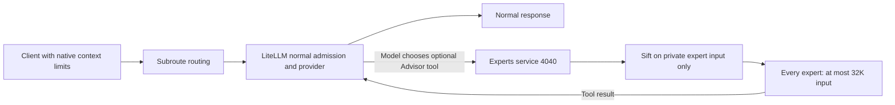

# Subroute: simpler code, fewer failure paths, cooperative Sift

Status: active
Owner: repository owner; execution and evidence maintained by the working agent
Set: 2026-10-23

## Outcome

Design priority: a simple, reliable and stable architecture. Remove unnecessary decisions and moving parts before adding mechanisms. Keep the ordinary request path short and predictable; every retained safeguard must prevent a demonstrated failure.

1. Make Subroute substantially easier to understand and maintain by reducing code complexity and independent policy owners.
2. Deliver a net reduction in maintained production source and remove complex or duplicated logic that creates failures.
3. Keep Sift only at the experts service on port 4040 for explicitly chosen Advisor calls. Every expert, including Gemini and Codex, has a **32,000-token input ceiling**. Output is separate from this ceiling. Retain Gemini. Normal model requests use routing and LiteLLM/provider admission without gateway compaction or injected guidance.
4. After completing the agreed changes, commit and push the scoped implementation. Preserve unrelated local work and verify the pushed revision; source publication does not by itself establish production rollout.

## Intended request flow

LiteLLM owns the supported tool orchestration. Normal gateway ports 4000 and 4005 do no Sift work. Advertising the optional native Advisor tool on supported Messages requests preserves caller content and ordinary tools; consultation occurs only when the model chooses it. Chat Completions and Responses retain their normal dispatch semantics until explicit tool support is verified.

## Why

The gateway has accumulated overlapping compaction paths, compatibility repairs and lifecycle responsibilities. More code and more decisions per request increase the chance that a local fix breaks another protocol or environment. Simplification must remove a named failure mechanism and preserve required behavior.

## Source of truth

- Resolved owner decision: **32K means input only, for all expert types; keep Gemini**. The owner's follow-up was "All sorts of experts, keep 32k only". This supersedes the earlier pending input-versus-total question and any historical combined-context acceptance interpretation. Codex's separate 1,024 output request remains; Gemini keeps its CLI generation behavior. No combined 32K limit is promised or required.
- This file owns the active simplification contract. [AGENTS.md](AGENTS.md) owns durable engineering constraints; [README.md](README.md) describes supported behavior; [TECH_DEBT.md](TECH_DEBT.md) records deferred debt.
- The [previous goal and checkpoints](docs/goal/archive/GOAL-2026-10-23-before-simplicity.md) are historical. This new priority supersedes their execution order, not their evidence or unresolved acceptance gates.
- The [design-review receipt](.runs/design-review-20261023-evidence/README.md) supports starting hypotheses only. Its tests do not complete this goal or establish release readiness.
- Latest cross-chat refinement, 2026-10-23: Sift runs only at experts port 4040, whose real context ceiling remains 32K. Short, quick expert calls should reduce quota use. The owner stated this in the tool-owning chat and authorized direct coordination here.
- Owner refinement, 2026-10-23: remove Sift from normal target traffic and retain it for optional Advisor input only. This deliberately supersedes earlier requirements for normal-path 32K/2x optimization and virtual 4M context delivery; it does not declare those paths removed or deployed.

## Parallel ownership

- The other chat, "Diagram traffic payload changes", owns removing automatic gateway Advisor consultation and exposing the explicitly model-invoked Advisor tool. Preserve its working changes; do not reinstate that automatic path or duplicate its implementation.
- The owner also authorized "Improve MiniMax 3.1 routing" to coordinate its tested direct MiniMax alias and model-card corrections. Preserve that work. Include its stable source handoff in any shared gateway integration; do not treat a fallback response as native MiniMax evidence.
- This chat owns the remaining simplifications, starting with removing normal-path Sift work and keeping the Advisor-only selection boundary clear. Shared callback registration, context metadata and deployment changes must be reconciled with the other chat's current changes before integration. No independent restart of shared services while that integration is unresolved.

## Acceptance criteria

- [x] Capture a reproducible starting baseline: repository revisions, dirty-file scope and source hashes, affected behavior, known failures, and exact check commands. Include relevant standalone Sift source when changed.
- [x] Measure before/after nonblank, noncomment production-source lines consistently, with explicit file scope and per-module totals. Report tests/docs separately. Deliver a net production-source reduction across the affected maintained code; moving, vendoring or generating the same code elsewhere does not count as removal. No arbitrary percentage quota or code golf.
- [x] Remove duplicated decisions or failure-prone paths, with clear ownership and a simpler normal request flow. Each delivered slice identifies its requirement, existing mechanism, failure mechanism removed, behavior preserved and verification. Smaller files alone are insufficient.
- [x] Remove normal-target Sift callbacks, compaction-specific pre-counting, target-budget recovery and long-history instruction injection. Keep required provider-boundary translation and validation. Normal routing must not execute Sift, consult an Advisor automatically, or inject behavioral guidance.
- [ ] Keep Sift confined to a private copy of explicitly chosen Advisor input at experts port 4040, with one owner for its budget, bounded CPU admission, audit and failure handling. Advisor selection or compaction must never modify the original target request. No new gateway-managed tool loop, framework, registry or hidden provider work.
- [ ] Cover Chat Completions, Anthropic Messages and Responses where supported: normal content/tool/output-limit preservation, native admission at and beyond provider capacity, normal dispatch independent of Sift availability, and no hidden additional calls. Test Advisor-only compaction success, unsupported/irreducible/busy/error outcomes, truthful audit, cancellation and terminal accounting at that boundary. Document exclusions.
- [ ] Align client context metadata, launch settings and documentation with actual selected-provider capacity or explicit client-side compaction. Retire normal-path virtual 4M intake/32K optimization promises. Oversized normal requests must receive normal provider/LiteLLM admission behavior; do not silently shorten them or fabricate completion.
- [ ] Maintain one authoritative deployed Sift version with explicit, reviewed gateway patch provenance and a repeatable comparison against its upstream pin. Verify relevant standalone and gateway checks before any replacement; never blindly substitute upstream main.
- [ ] Pass affected regression checks before/after structural changes and obtain independent source and behavioral review. Distinguish existing baseline failures from regressions. Verify affected success/failure paths end to end in staging before any production promotion; unit tests and readiness alone do not establish live compatibility.
- [ ] Reconcile README/runtime behavior and record reduction, independent review, actual validation, deployment state and remaining limitations here. Mark done only when every criterion has evidence.

## Constraints and invariants

- LiteLLM owns public protocols, streaming, standard provider adapters, retries and standard provider orchestration. Keep necessary workarounds narrow, with concrete capability-gap evidence and retirement conditions.
- Sift owns deterministic history selection and a truthful audit for Advisor input only. Subroute owns routing/request policy and explicit optional-work budgets; LiteLLM and the provider retain native capacity admission. Keep these responsibilities separate.
- Preserve caller output limits, original target instruction/tool semantics, bounded ingress, provider capacity checks and bounded resource/cancellation cleanup. Experts port 4040 is the sole Sift boundary, with a 32,000-token input ceiling for every expert. Keep expert calls concise; generation does not subtract from that input ceiling. Separate this owner-authorized removal of normal-path behavior from unrelated structural refactors.
- No silent content loss, fabricated completion, hidden retry/fallback/provider spending, or estimated usage presented as provider usage.
- Keep Docker Compose, required protocol/media/Relay behavior, production/staging database and saved-state isolation, credential boundaries, and unrelated local work. Advisor becomes an explicit optional tool as authorized by the owner. Remove obsolete or duplicate code with evidence; dropping other supported capabilities requires an explicit owner decision.
- Favor small functions, ordinary configuration and existing mechanisms. No new service, dependency, store or abstraction without a current requirement. Count code moved across repositories in the reduction ledger.

## Non-goals and escalation

- Do not resume unrelated GPU/gaming, product-pilot, Relay expansion or benchmark campaigns to satisfy this goal. Historical unmet gates remain unmet.
- No broad rewrite, cosmetic LOC target, or automatic production restart or paid evaluation campaign. The owner has authorized execution of this goal; scope ordinary implementation and verification to the affected paths.
- Escalate an actual conflict with required capabilities, irreversible data/credential changes, missing authority, or a concrete external dependency. Do not weaken acceptance to match an incomplete implementation.

## Execution record

Current next actions: checkpoint `53681a7` has been committed and pushed to `codex/simplify-gateway`. Follow-up lifecycle and private Sift audit fixes pass 981 selected non-live tests (two environmental skips, 35 live deselections). Staging and experts run immutable image `24f4c0d751fe`; production is unchanged. A separately reviewed 256-output-token Messages scenario completed with closed accounting. Both live expert probes showed Sift compaction and input as reported below 32,000; Codex passed the full response check, Gemini failed the exact-answer marker. Preserve that failure and investigate missing answer evidence before another probe. Publish this scoped follow-up, then continue the remaining full-goal acceptance audit. The input-only 32K definition for every expert is resolved.

Current approach: remove normal-path Sift and instruction injection, retain bounded Advisor-only compaction, reconcile client capacity claims, then independently verify behavior and source reduction. Earlier work consolidating normal-target Sift hooks is superseded and is not accepted delivery. Other candidates remain explicit startup, reproducible staging promotion, accurate Sift provenance and experimental-selector isolation/shared validated state; investigate them only when they do not overlap the Advisor workstream. This is not a mandate to rewrite every subsystem.

Progress:
- Goal contract written; previous goal preserved intact.
- Advisor-only Sift direction and parallel ownership recorded from the owner's latest instructions. Earlier partial normal-path refactoring remains unaccepted and must be reconciled without overwriting concurrent work.
- Normal Sift module and three callbacks removed; required Qwen translation retained. Desktop capacity and client compaction now use 256,000 / 204,800. README and fork provenance aligned.
- The scoped [implementation and validation record](docs/evals/sift-advisor-only-2026-10-23.md) records the original baseline, 352 net production-source lines removed, exact checks, known integration failures and exclusions. Concurrent Advisor edits are excluded from that reduction.
- The tool-owning chat implemented Sift only at experts port 4040. Independent boundary checks and the final combined suite pass; the hard 32K combined ceiling and live provider staging acceptance remain open.
- Automatic Advisor execution is removed from normal dispatch; the supported Anthropic Messages target receives one concise native tool only when a saved expert is configured. Ranker, frequency, analytics, ONNX assets, dependencies, controls and their obsolete test suites were removed. A fresh complete non-live run classified the current failures and verified their repairs. Older version-specific results remain historical, rather than being retroactively declared pre-existing.
- The hard 32K combined expert context criterion remains open. The Antigravity CLI help has no output-token control; Codex 4040 now sends `max_output_tokens=1024`, and a bounded live GPT-6 Luna probe enforced exactly 16 output tokens before reporting incomplete. Other Codex models remain unverified. The current Sift input ceiling and requested Codex output bound must not be represented as a provider-enforced total-context cap.

Validation and runtime evidence: an earlier affected-suite checkpoint passed 271 Python checks and 5 desktop checks; its [command](.runs/goal-simplicity-20261023/advisor-only/final-validation.ps1) and [receipt](.runs/goal-simplicity-20261023/advisor-only/tests-final-integration.txt) remain historical. The latest complete non-live run passes **979 tests, with 2 skipped and 35 live tests deselected**. Source hashes are stable across that run. Both host-skipped tests subsequently passed separately using owned PostgreSQL and Linux containers. Exact commands, failure classification and independent review are in the [current validation record](docs/evals/sift-advisor-only-2026-10-23.md). These fixture checks do not establish live provider compatibility. Expert URL serialization and parent-fallback replay have been repaired and independently rechecked. An actual GPT-6 Luna probe verified a 16-token provider stop and truthful incomplete failure; other Codex models and near-32K requests remain unverified. Gemini lacks a native output cap. Clarification is pending on whether the owner's 32K ceiling is input-only or combined input/output; do not weaken that criterion without the answer. No production promotion or whole-goal acceptance is claimed.

Remaining gap: deliver the acceptance criteria above.

Integration checkpoint: the current coordinated source ledger records 1,693 fewer maintained source lines, including the expert hook, native Advisor replay guard, normal Codex output-limit preservation and citation-safe image captions. The [repeatable ledger](.runs/goal-simplicity-20261023/advisor-only/combined-reduction.json) excludes unrelated dirty work, tests, docs, configuration and build/data artifacts. Small retained safeguards prevent reproduced failures; line count does not override required behavior.

Independent review accepted the normal Sift retirement and desktop settings. A pinned-image Compose fixture with networking disabled passed actual HTTP Chat/Messages/Responses expert compaction, irreducible-input rejection, and native target-to-expert-to-target orchestration. It preserved the original target history and called the expert once. Providers were mocked, and the temporary container was removed. This is integration evidence, not live provider compatibility.

Broader inspection found normal Messages streaming HTTP 500 when model-identity restoration wrote to a read-only framework stream property. The model-card chat repaired this by updating LiteLLM's existing mutable adapter before native serialization, with no new SSE parser or stream wrapper. Independent review and the final combined suite verify the repair. Three valid-schema counting failures also exposed that the existing compatibility shim omitted the pinned LiteLLM 1.106.2 version; the narrow version alignment passes targeted checks and independent review. Two Gemini formatter fixtures were aligned with the existing saved-expert policy without weakening their assertions. Earlier failed receipts remain preserved. These scoped results do not establish a full-suite pass.

Latest reliability continuation:
- Normal Codex output limits now reach the actual native Responses HTTP body. The strictest supplied alias is retained. The existing bridge cannot preserve limits below 16, so its Codex adapter rejects them before Codex I/O; existing native routing fallbacks still apply. No new provider transport owns this translation.
- Image requests clear Advisor only in their request policy, at the routing owner, while preserving the saved selection. Caption separators are inserted before native conversion so LiteLLM calculates the matching citation offsets. Independent review caught and rejected an earlier offset regression; the corrected case is now a maintained test.
- MCP 2.3.0 fixture attributes and the stable `default` alias expectations were aligned without weakening other assertions. Search endpoint unit tests avoid starting the production lifespan. Compose exposes the existing native local-auth opt-in without enabling it by default; README describes the pinned runtime's startup check accurately.
- The final complete non-live run passed **979 tests**, with **35 live tests deselected** and **2 host/environment skips**. Both skipped cases subsequently passed separately: isolated PostgreSQL recovery/revision/acknowledgement/environment checks, and Linux descendant-process cleanup. The source/config/test snapshot remained unchanged across the complete run (146 files). Exact commands and receipts are in the [validation record](docs/evals/sift-advisor-only-2026-10-23.md). Temporary infrastructure was removed, and shared services were not restarted.
- Native-only probes still reproduce reasoning-block loss and unsupported-operation HTTP 500s in LiteLLM 1.106.2. Their narrow compatibility repairs remain justified; retire them only when the same behavioral checks pass natively. Production promotion, live-provider coverage and the owner's 32K input-versus-total decision remain open.

Immutable deployment checkpoint:
- A bounded CLI worker packaged source and only three static runtime configs into the locked gateway image, preserving the existing dependency/Prisma build layers. Production's original host policy path is retained through a legacy mount; staging keeps its own state volume. All gateway roles use the same image recipe. No source/static-config binds are required by the new Compose definition.
- Parent inspection and separate nonauthor review verified 42 exact baked files, 15 configuration checks, all six buffered/streamed local HTTP protocol cases and native authentication. An owned legacy-policy fixture preserved load bytes, control writes and saved state across restart. Image and receipts are recorded under [.runs/goal-simplicity-20261023/immutable-packaging](.runs/goal-simplicity-20261023/immutable-packaging/).
- Shared staging was already crash-looping from a generated Prisma client/engine mismatch (857 restarts at recovery). The coordinated targeted recovery recreated only `gateway-staging` with the accepted pinned image. Database readiness and liveness return 200; catalog authentication returns 401/200 as expected; restart count remains zero during the 25-second observation. Policy bytes, the original state volume, 213 completed migration records and 52,481 existing usage receipts are preserved. Production and experts container IDs/images/start times are unchanged. See [recovery receipt](.runs/goal-simplicity-20261023/immutable-packaging/staging-acceptance.json).
- This is staging boot/auth/state acceptance only. It does not prove live provider behavior, expert-role rollout, sustained reliability or the unresolved combined 32K budget. Production has not been promoted and the goal remains active.
- A separate [nonauthor post-recovery review](.runs/goal-simplicity-20261023/immutable-packaging/nonauthor-staging-review.md) independently verified the staging identity, health/authentication, exact policy bytes and read-only database counts, plus unchanged production/experts identities. Owned dummy candidate containers and network were removed. The next dependent step is the owner's pending 32K budget decision, followed by bounded real-provider acceptance and separately coordinated expert/production promotion. No further broad rewrite or speculative cleanup is authorized by this checkpoint.

Ordinary-provider acceptance continuation:
- Previous goal turn classification: progress. It changed the deployment artifact and recovered staging with independently verified state preservation. This continuation then closed an independent remaining evidence gap without changing policy, restarting services or exercising experts.
- A single bounded live run on the exact staging image passed ordinary buffered Chat and streamed Responses against the saved `mimo-v2.6-pro` target. Both returned the expected answer marker and native completion terminal; retry and fallback headers were zero. Each provider response reported 17 input / 21 output tokens. This is a short-request observation, not output-cap pressure or near-context-limit proof.
- The durable ledger contains exactly two new provider inference records, one per protocol, both complete with observed usage and `openai/mimo-v2.6-pro` upstream identity. No Advisor attempt was observed. Full saved policy bytes and staging/production/experts lifecycle identities remain unchanged. See [live result](.runs/goal-simplicity-20261023/ordinary-live-smoke/live-result.json) and [accounting/state receipt](.runs/goal-simplicity-20261023/ordinary-live-smoke/live-accounting.json).
- A separate [nonauthor live-evidence review](.runs/goal-simplicity-20261023/ordinary-live-smoke/nonauthor-live-review.md) independently read both exact database attempts, the complete run-window count, unchanged policy bytes and service identities. It accepts only these two short MiMo calls. The copied temporary smoke script was removed after verifying its hash; no helper process remains running.
- The first CLI preparation worker failed with an upstream demand error after writing an unaccepted artifact. Parent repaired its terminal check; separate nonauthor review accepted the artifact and independent wall-time supervisor before execution. Failed worker receipts and rejected artifact remain preserved. No inference retry or broad evaluation campaign followed.
- Anthropic Messages live compatibility, private experts, other provider routes, context boundaries, sustained operation and production promotion remain unverified. The pending owner decision is unchanged: is the experts' 32K ceiling input-only or input plus output? Gemini CLI cannot enforce an output cap. There is no further assignable implementation in this slice without resolving that required contract; do not replace the missing decision with speculative cleanup, repeated smoke calls or weaker acceptance.

Follow-up evidence: [published report](docs/evals/simplicity-followup-2026-10-23.md). Current selected production-source ledger: **1,639 fewer maintained source lines**, including the narrow accounting/audit fixes and excluding unrelated outbox/Relay work. Gemini exact-answer acceptance remains open; whole-goal and production acceptance are not claimed.
