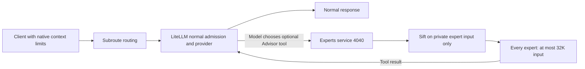

# Subroute: simpler code, fewer failure paths, cooperative Sift

Status: complete for scoped source and staging/private-expert delivery; production promotion excluded
Owner: repository owner; execution and evidence maintained by the working agent
Set: 2026-10-23

## Outcome

Design priority: a simple, reliable and stable architecture. Remove unnecessary decisions and moving parts before adding mechanisms. Keep the ordinary request path short and predictable; every retained safeguard must prevent a demonstrated failure.

1. Make Subroute substantially easier to understand and maintain by reducing code complexity and independent policy owners.
2. Deliver a net reduction in maintained production source and remove complex or duplicated logic that creates failures.
3. Keep Sift only at the experts service on port 4040 for explicitly chosen Advisor calls. Every expert, including Gemini and Codex, has a **32,000-token input ceiling**. Output is separate from this ceiling. Retain Gemini. Normal model requests use routing and LiteLLM/provider admission without gateway compaction or injected guidance.
4. After completing the agreed changes, commit and push the scoped implementation. Preserve unrelated local work and verify the pushed revision; source publication does not by itself establish production rollout.

## Intended request flow

LiteLLM owns the supported tool orchestration. Normal gateway ports 4000 and 4005 do no Sift work. Advertising the optional native Advisor tool on supported Messages requests preserves caller content and ordinary tools; consultation occurs only when the model chooses it. Chat Completions and Responses retain their normal dispatch semantics until explicit tool support is verified.

## Ownership and resolved decisions

- **32K means input only for every expert; retain Gemini.** Output is separate. Codex keeps its separate 1,024 output request; Gemini has no invented CLI output cap. Historical combined-context questions are resolved, not blockers.
- This file owns intent and acceptance; AGENTS.md owns engineering constraints, README.md supported behavior, and TECH_DEBT.md deferred debt.
- The coordinated Advisor and MiniMax changes are included in published `53681a7` and `70ee280` on `codex/simplify-gateway`. Preserve unrelated local outbox, Relay orchestration, sidecar and Electron work. Shared service operations remain with this chat after coordination.
- The [original goal](docs/goal/archive/GOAL-2026-10-23-before-simplicity.md) and [complete execution history through 70ee280](docs/goal/archive/GOAL-2026-10-23-through-70ee280.md) remain historical evidence. They do not reinstate normal-path 4M intake, normal Sift, automatic consultation or combined 32K acceptance.

## Acceptance criteria

- [x] Capture a reproducible starting baseline: repository revisions, dirty-file scope and source hashes, affected behavior, known failures, and exact check commands. Include relevant standalone Sift source when changed.
- [x] Measure before/after nonblank, noncomment production-source lines consistently, with explicit file scope and per-module totals. Report tests/docs separately. Deliver a net production-source reduction across the affected maintained code; moving, vendoring or generating the same code elsewhere does not count as removal. No arbitrary percentage quota or code golf.
- [x] Remove duplicated decisions or failure-prone paths, with clear ownership and a simpler normal request flow. Each delivered slice identifies its requirement, existing mechanism, failure mechanism removed, behavior preserved and verification. Smaller files alone are insufficient.
- [x] Remove normal-target Sift callbacks, compaction-specific pre-counting, target-budget recovery and long-history instruction injection. Keep required provider-boundary translation and validation. Normal routing must not execute Sift, consult an Advisor automatically, or inject behavioral guidance.
- [x] Keep Sift confined to a private copy of explicitly chosen Advisor input at experts port 4040, with one owner for its budget, bounded CPU admission, audit and failure handling. Advisor selection or compaction must never modify the original target request. No new gateway-managed tool loop, framework, registry or hidden provider work.
- [x] Cover Chat Completions, Anthropic Messages and Responses where supported: normal content/tool/output-limit preservation, native admission at and beyond provider capacity, normal dispatch independent of Sift availability, and no hidden additional calls. Test Advisor-only compaction success, unsupported/irreducible/busy/error outcomes, truthful audit, cancellation and terminal accounting at that boundary. Document exclusions.
- [x] Align client context metadata, launch settings and documentation with actual selected-provider capacity or explicit client-side compaction. Retire normal-path virtual 4M intake/32K optimization promises. Oversized normal requests must receive normal provider/LiteLLM admission behavior; do not silently shorten them or fabricate completion.
- [x] Maintain one authoritative deployed Sift version with explicit, reviewed gateway patch provenance and a repeatable comparison against its upstream pin. Verify relevant standalone and gateway checks before any replacement; never blindly substitute upstream main.
- [x] Pass affected regression checks before/after structural changes and obtain independent source and behavioral review. Distinguish existing baseline failures from regressions. Verify affected success/failure paths end to end in staging before any production promotion; unit tests and readiness alone do not establish live compatibility.
- [x] Reconcile README/runtime behavior and record reduction, independent review, actual validation, deployment state and remaining limitations here. Mark done only when every criterion has evidence.

## Constraints and invariants

- LiteLLM owns public protocols, streaming, standard provider adapters, retries and standard provider orchestration. Keep necessary workarounds narrow, with concrete capability-gap evidence and retirement conditions.
- Sift owns deterministic history selection and a truthful audit for Advisor input only. Subroute owns routing/request policy and explicit optional-work budgets; LiteLLM and the provider retain native capacity admission. Keep these responsibilities separate.
- Preserve caller output limits, original target instruction/tool semantics, bounded ingress, provider capacity checks and bounded resource/cancellation cleanup. Experts port 4040 is the sole Sift boundary, with a 32,000-token input ceiling for every expert. Keep expert calls concise; generation does not subtract from that input ceiling. Separate this owner-authorized removal of normal-path behavior from unrelated structural refactors.
- No silent content loss, fabricated completion, hidden retry/fallback/provider spending, or estimated usage presented as provider usage.
- Keep Docker Compose, required protocol/media/Relay behavior, production/staging database and saved-state isolation, credential boundaries, and unrelated local work. Advisor becomes an explicit optional tool as authorized by the owner. Remove obsolete or duplicate code with evidence; dropping other supported capabilities requires an explicit owner decision.
- Favor small functions, ordinary configuration and existing mechanisms. No new service, dependency, store or abstraction without a current requirement. Count code moved across repositories in the reduction ledger.

## Non-goals and escalation

- Do not resume unrelated GPU/gaming, product-pilot, Relay expansion or benchmark campaigns to satisfy this goal. Historical unmet gates remain unmet.
- No broad rewrite, cosmetic LOC target, or automatic production restart or paid evaluation campaign. The owner has authorized execution of this goal; scope ordinary implementation and verification to the affected paths.
- Escalate an actual conflict with required capabilities, irreversible data/credential changes, missing authority, or a concrete external dependency. Do not weaken acceptance to match an incomplete implementation.

## Current evidence and next actions

| Scope | Verified state | Remaining limit |
| --- | --- | --- |
| Published source | `53681a7` and `70ee280` pushed and independently checked. Callback/plain-answer follow-up `20995ff3b08914bb365a6b4a139186d59be0ebe7` is pushed and independently verified. [Current report and portable receipts](docs/evals/simplicity-completion-2026-10-23.md). | Remote branch and local HEAD independently matched; scoped checkout was clean. Closing documentation is recorded separately. |
| Reduction and regressions | Published f7 snapshot: 1,641 fewer maintained lines over 21 explicit paths. The 2026-10-25 correlation follow-up remeasured that same scope at 1,543 fewer lines; its full non-live suite passed 999, with two skips and 35 live deselections. Five desktop checks previously passed. | Counts apply to declared source scope and checked snapshots, not a repository-wide reduction or all-provider guarantee. |
| Normal protocols | Native HTTP fixtures preserve content/tools/limits, reject native capacity overflow and work without Sift. Short real Chat/Responses and reviewed Messages completion passed. | No all-provider or broad benchmark claim. |
| Private experts | Nine aliases have 32,000 input policy and offline real-counter/private-copy proof. Real Codex passed; final same-payload Gemini acceptance passed exact answer, trusted headers and reported input 17,075. | Earlier failed harness and intermediate missing-header result remain failed. Selected-route evidence is not universal near-limit compatibility. |
| Native optional consultation | One real Messages request with auto tool choice completed target to expert to target; independent SQL/log review found one expert HTTP consultation and all five correlated rows terminal, no retries/fallbacks or policy changes. | Two bridge rows are not additional provider work. No internal CLI-call count, billing or ordinary-prompt consultation-frequency claim. |
| Failure ownership | Native success/error/cancellation/concurrency fixtures inspect every receipt; completed executor/expert records survive later cancellation. Forged audit metadata is rejected. | Fixture usage is synthetic; live cancellation/billing is not established. |
| Runtime | Staging and experts: immutable image `a99773d74df3`, authenticated catalogs, zero restarts, preserved policy. Production lifecycle unchanged on older image `2d3076d83d41` with host source/config mounts. | Production's loaded behavior is separately unverified; no automatic production restart. Integration image preserves unrelated local outbox work and is not an exact selected-Git image. |
| Sift provenance | Current pinned comparison: three patched files and one identical file against `e8dc791ba76d99012a3cd43e6114c01faedeeb6a`. No upstream replacement or fresh standalone test claim. | Standalone parity is required before any future replacement. |
| Existing ingress bounds | Independent before/after review confirms retained native context/media/bridge/accounting bounds. The old Sift raw limit measured parsed tokens, not HTTP bytes. | No generic pre-parse public body-byte cap was configured in either inspected baseline; this pre-existing debt is recorded in TECH_DEBT.md. |

Closure for the published scope: independent [requirement-by-requirement audit and publication verification](docs/evals/simplicity-final-audit-2026-10-23.md) support all ten criteria within this source/staging scope. The implementation is published as `20995ff`; this final documentation records acceptance without claiming production activation. No required implementation or staging work remained for that delivery. Production promotion, exact selected-Git-image deployment and the separately recorded ingress hardening remain outside that completed delivery.

## Post-closure correlation follow-up

The user requested further improvement and extensive testing against the same reliability criteria. A separate Advisor request/attempt correlation slice is in progress; it does not retroactively change the evidence or acceptance scope above. Its code, test results, independent review, candidate image identity and limits are recorded in [Advisor correlation follow-up](docs/evals/advisor-correlation-2026-10-25.md).

Current follow-up state: implementation commit `b539b74` and evidence commits are published on `origin/codex/advisor-correlation-integration`; the remote branch SHA was independently verified equal to local HEAD, and `origin/main` remains at `f7b82d8`. The updated 21-path ledger reports 1,543 fewer maintained lines. The full non-live suite passed 999, with 2 skipped and 35 live deselected; the candidate image was built locally and its source hash checked. Staging remains on the previous image with zero restarts. The real Experts auth/callback/header-to-Sift-log path remains unverified until a staging window is available. Do not count this follow-up as deployed or staging-accepted.
