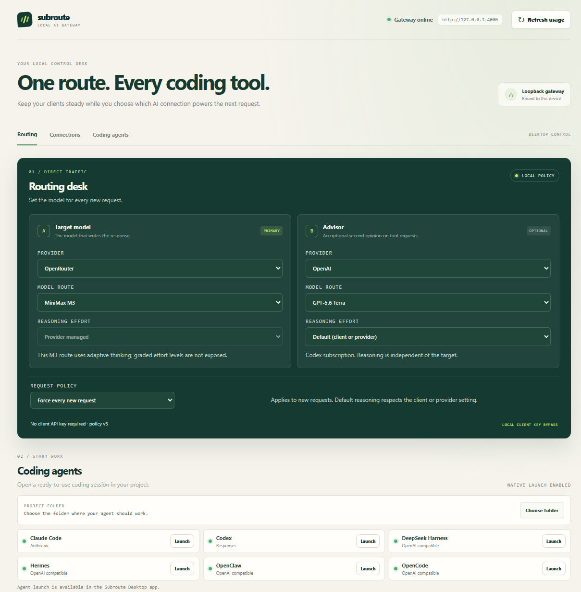

<div align="center">
  <h1>Subroute</h1>
  <h3>Keep your coding tools steady. Choose your AI route in one place.</h3>
  <p>A local AI gateway and desktop control desk for developers who work across AI subscriptions, API providers, and local models.</p>
  <p><a href="#english">English</a> · <a href="#简体中文">简体中文</a></p>
</div>

<p align="center">
  <a href="artifacts/subroute-electron.png"></a>
</p>
<p align="center"><sub>Electron desktop · model routing and agent launch / Electron 桌面端 · 模型路由与 Agent 启动</sub></p>

<a id="english"></a>


## Codex Advisor skill

The former **Luna Advisor Escalation** skill has moved to the central [Northstar package](https://github.com/stancsz/northstar/tree/main/skills) and is now called **Codex Advisor**. Install the four-skill Northstar package for `northstar`, `codex-qa`, `codex-subagents` and `codex-advisor`. See the [installation guide](https://github.com/stancsz/northstar/blob/main/docs/misc/install.md) and [Codex Advisor instructions](https://github.com/stancsz/northstar/blob/main/skills/codex-advisor/SKILL.md).

Subroute still owns the `experts` service, provider authentication and gateway runtime. Moving the skill does not move or deploy those services. Historical advisor evaluations below describe the Subroute revisions at which they were recorded.

The dedicated `experts` endpoint exposes GPT-6 Luna, GPT-6 Sol, GPT-6 Astra, GPT-6.1 Sol and Gemini 3.8 Flash through Advisor aliases. The Northstar skill uses one GPT-6.1 Sol call by default. Its optional text council makes one independent Gemini 3.8 Flash review at low reasoning effort, then one Sol call that gives its own verdict and assesses Gemini's review. There is no retry or model fallback. Sol accepts user images for screenshot-backed advice; optional Advisor-directed Pi source reading remains caller orchestration, not backend tool execution. See [image-input verification and limits](docs/evals/advisor-image-input-2026-09-30.md).

## The problem

Your coding tools remember an endpoint and model. Your AI provider, account, or preferred route can change. Updating every client each time is tedious and makes it harder to know which connection will handle the next request.

**Subroute gives compatible clients one local endpoint. Set the model to `auto` for prioritized automatic routing.**

## What you get

| | Value in your workflow |
| --- | --- |
| **One steady endpoint** | Keep compatible coding clients pointed at `http://127.0.0.1:4000/v1` while you change the selected route. |
| **A route you can see and change** | Choose a configured provider and model from the shared browser or desktop control desk. |
| **Clear connection status** | See which sources are configured, need setup, or report usage. Missing quota data stays unavailable instead of being guessed. |
| **Local-first control** | Run the gateway on your machine with Docker Compose. Electron adds a native shell and optional coding-agent launch helpers. |

## How it works

```text
Your coding tools
       │  OpenAI-compatible API · model: auto
       ▼
Subroute on 127.0.0.1:4000
       │  MiniMax M3 → Gemini 3.8 Flash → Codex Luna
       ▼
First provider to complete the request
```

LiteLLM handles the public API protocols, streaming, and standard provider adapters. Subroute adds the local routing policy, configured subscription integrations, provider status, and control desk. Electron uses the same control desk as `/control`; it does not run the gateway.

The [durable usage guide](docs/operations/usage-accounting.md) describes provider receipts, customer attribution, protected Cloudflare transfer, recovery and remaining limits. Its [acceptance record](docs/goal/usage-accounting.md) covers the 2026-10-11 serving release, real API calls and durable transfer into both Cloudflare environments.

Observed streams settle usage through their parser and close observer. LiteLLM's duplicate completion callbacks do not write those receipts again, including the native Responses callback that runs in a separate event loop. A version-bounded formatter repair also lets LiteLLM count tool arrays whose JSON Schema omits `items`, without changing the schema sent to the provider. Context checks and Sift share that repaired counter. See the [staging verification](docs/evals/counting-and-receipts-2026-10-15.md).

The `auto` route also uses Sift to recover oversized Chat Completions and
Anthropic Messages requests before advisor/provider checks. Instructions, tool
schemas, output limits, the active task, and tool-call/result structure stay
exact. If active tool-result text leaves too little context, Sift replaces only
as many large results as necessary with labeled, lossy excerpts while retaining
result IDs. Omitted output is explicitly marked as incomplete and can be
recovered by rerunning the tool or opening its source. Older history also
becomes labeled, lossy excerpts. The input target is the
minimum of the route's input limit, compaction threshold and context window
minus requested output, less 8,192 tokens for later gateway guidance. An omitted
Chat output limit reserves 65,536 tokens without changing provider defaults.
Sift accepts up to 1M estimated input tokens and permits two concurrent CPU jobs.
It adds no provider call, persistence or retry. The response exposes
`x-sift-compacted`, `x-sift-estimated-input-tokens` and
`x-sift-estimated-forwarded-tokens`. Small requests keep their original messages;
unsupported media, oversized required context and excess intake fail explicitly.
Responses API state is not compacted. The client still owns its saved history,
so an oversized conversation is compacted again on subsequent requests.

## Get started

Make credentials available as environment variables for the providers you plan to use, then start the production gateway from the repository root:

```powershell
python scripts/fetch_advisor_ranker.py
docker compose build gateway
docker compose up -d gateway
```

Open the control desk at [http://127.0.0.1:4000/control](http://127.0.0.1:4000/control), choose a configured route, then point a compatible coding tool to:

```text
Base URL: http://127.0.0.1:4000/v1
Model:    auto
```

To enable the LiteLLM Admin UI, set `GATEWAY_MASTER_KEY` in the local `.env` file and recreate the gateway. This also requires API clients to send `Authorization: Bearer <GATEWAY_MASTER_KEY>`. The UI uses `UI_USERNAME` and `UI_PASSWORD` (Compose defaults: `admin` and `password`). Without a master key, the loopback API accepts requests without a bearer token, but Admin UI login is unavailable.

`auto` tries MiniMax M3 first, then Gemini 3.8 Flash through the subscription integration, then Codex Luna through the subscription integration if the preceding provider returns an error. Selecting MiniMax, OpenRouter, or either Xiaomi MiMo route also enables ordered fallback across those routes, with GPT-6 Luna last. A provider failure can still incur cost. Other fixed model aliases remain fail-closed. Available models are listed in this checkout's [`config/litellm.yaml`](config/litellm.yaml).

Gemini 4 Argon is available as the selectable `gemini-subscription-argon` target and gateway Advisor through the authenticated Antigravity CLI, in production and staging. Advisor requests use the existing 32K input budget; target requests retain Subroute's 256K context budget. It supports low, medium and high reasoning effort and does not join `auto` or Advisor fallback chains. Live target/advisor requests have verified response compatibility; provider availability can still vary.

Speech routes are available through LiteLLM. MiniMax TTS uses LiteLLM's standard `POST /v1/audio/speech` endpoint with model `minimax-tts` and `MINIMAX_API_KEY`:

```json
{"model":"minimax-tts","input":"Hello from Subroute.","voice":"alloy"}
```

MiMo ASR uses its documented Chat Completions format, not LiteLLM's standard `/v1/audio/transcriptions` format. Send `POST /v1/chat/completions` with model `mimo-v2.5-asr`, and put an OpenAI `input_audio` block (`format` and base64 `data`) in a user message. `asr_options` can be passed as an additional request parameter. Subroute preserves this explicit ASR model and audio payload, even when the control desk forces another model, and skips the saved advisor for that speech request. Set `XIAOMI_TOKENPLAN_API_KEY` to enable MiMo routes. MiMo TTS models continue to use Xiaomi's Chat Completions format at `/v1/chat/completions`; put the spoken text in an `assistant` message and specify output options in `audio`.

### Use the Electron app

With the gateway running, launch the desktop control desk:

```powershell
cd desktop
npm install
npm start
```

On first launch, connect it to a responding loopback Subroute gateway. Desktop stores the gateway address locally, not provider API keys. Its optional agent launcher starts supported coding CLIs with session-only Subroute settings. See [desktop/README.md](desktop/README.md).

### Keep production and staging separate

Compose exposes production on `127.0.0.1:4000` and staging on `127.0.0.1:4005`. Staging has its own database and routing policy, while model/provider configuration is shared:

```powershell
docker compose up -d gateway-staging
```

## Routing, without surprises

Codex subscription targets request provider reasoning summaries and preserve them separately from answer text and tool calls. Claude-compatible clients receive standard `thinking` blocks and `thinking_delta` events when the provider returns a summary. The selected reasoning effort is retained. A client's output limit still covers thinking and answer output together.

Claude Code requests to Xiaomi and other OpenAI-compatible backends use LiteLLM's Chat Completions bridge. Native Anthropic/MiniMax Messages and subscription handlers retain their existing transports. A narrow streaming callback fixes LiteLLM 1.101.0/1.103.0 duplicating an unsigned thinking opener into the first delta, only when those two values match exactly. Signed thinking, redacted blocks, tool arguments, actual newlines and literal code escapes remain intact. The provider-adapter regression matrix is in `tests/test_thinking_format.py`; local wire fixtures verify protocol behavior without provider spending. Provider-generated literal `\n` text is preserved, since decoding it indiscriminately would corrupt code and signed thinking.

Those versions also duplicate signed thinking signatures and collapse multiple/redacted reasoning blocks in Chat-to-Messages conversion. The existing adapter receives separate thought/signature fragments with explicit boundaries; buffered assembly preserves each block and trailing signature fragments. MiniMax Chat uses its native `reasoning_split: true` option to keep thinking out of visible answer text. Native Messages frames remain unchanged.

For Codex clients using Responses with a Chat backend, a separate version-bounded patch repairs LiteLLM's item and part lifecycle. Reasoning and message items have unique indices, complete openers (including the required reasoning `summary` array), and matching terminal snapshots; reasoning summaries remain separate from answer content. It keeps LiteLLM's transport, typed events, usage and opaque replay data. Native Responses handlers retain their own lifecycle. Remove these workarounds when the upgraded dependency passes `tests/test_client_stream_contracts.py`; `tests/test_live_coding_clients.py` checks actual Claude Code and Codex tool turns directly through standalone Subroute on staging port 4005, with an optional local-forwarder run. See the [verification report](docs/evals/claude-code-thinking-format-2026-10-06.md) for fixture versus live coverage.

Those LiteLLM versions also mix the argument fragments of interleaved parallel Chat tool calls when converting them to Messages. Subroute applies a version-bounded shim to the existing async Chat chunk splitter: reasoning/text before tools remains live, and the suffix beginning at the first tool is held until the provider finishes. Tool calls are assembled by their original index, all inputs are validated before exposure, and the suffix's content order is preserved. LiteLLM still emits the public protocol. No extra provider calls occur. The shim leaves native Messages and public Chat/Responses streams alone; remove it when an upgraded LiteLLM passes the interleaved-tool regression. See `src/subroute/thinking.py` for the verified gap and retirement condition.

Actual Claude Code, Codex, OpenCode and Cline CLI formatting tests run directly against standalone Subroute. Across MiniMax, OpenRouter, MiMo Pro, Codex subscription and Gemini subscription, they verify real file-tool execution and replay, separate thinking, complete stream lifecycles, Unicode, literal code escapes, Markdown and unchanged files. The live tests require `SUBROUTE_RUN_LIVE_TESTS=1`, use isolated client settings and restore staging policy. Non-live Python socket connections to cloud addresses and known deployed gateway ports are rejected; advisor fallback fixtures explicitly mock both provider lanes. See the [20-combination receipt](docs/evals/subroute-standalone-format-2026-10-06.json). Recorded upstream overload and generated-content failures remain visible alongside bounded recovery checks; these samples do not guarantee provider availability or flawless output. Native terminal folding and Cline VS Code/Desktop rendering are unverified.

All OpenAI target and Advisor routes use GPT-6 or newer: Luna, Sol, Astra and GPT-6.1 Sol. GPT-6.1 Sol is available as the target alias `codex-gpt-6.1-sol`. GPT-5.6 Terra and the GPT-5.6 Luna reserve route have been removed; saved selections migrate to GPT-6 Sol and GPT-6 Luna respectively. These are selectable models, not a model lock. New routing state defaults to OpenRouter and GPT-6.1 Sol/low. `ACTIVE_MODEL` and `ADVISOR_MODEL` override initialization; persisted state takes precedence on subsequent starts, including explicitly disabled advisors, saved effort and frequency. Saved policies migrate once to the sole ranked selection path while preserving those choices. Production retains its saved `force` mode; staging retains its own policy.

The routing desk offers **Speed: Fast** when the target is an OpenAI subscription model. It saves `fast_mode` in the target policy and sends `service_tier: "fast"` only for requests routed to that target. The Codex subscription endpoint currently rejects that spelling, so the narrow subscription transport translates it to the equivalent `priority` tier. The advisor, explicit model requests in alias/off mode, `auto`, and image/audio routes do not inherit the saved target speed. Fast mode uses more OpenAI subscription allowance. Existing saved policies default to Standard, and changing the target clears Fast mode. Remove the transport translation when the subscription endpoint accepts `fast` directly.

- **`alias`** is the default. It resolves `default` using the saved route. `auto` always uses the prioritized provider chain.
- **`force`** applies the selected route to known model requests except explicit `auto` requests and image generation.
- **`off`** leaves model dispatch to LiteLLM.
- **Advisor** is selected independently for Chat Completions, Responses, and Anthropic Messages. Choose an advisor and reasoning effort, then use **Advisor frequency**: **Less often ~30% / Balanced ~50% / More often ~70%**. `No advisor` disables consultation. Unsupported advisor contexts and image/audio requests remain excluded. There is one selection algorithm: a local multilingual MiniLM encoder with a logistic regression head. It makes no generative LLM or Ollama call for classification.

Local ranking favors higher estimated review priority. Selected requests receive one intended advisor consultation before the target; unselected requests cannot invoke the native advisor tool afterward. Provider failover can still produce more than one provider attempt. The percentages are approximate shares of eligible requests, not probabilities of benefit or successful advice. The previous `model`/`adaptive`/`hybrid`/`always` modes, rules and Ollama classifiers, native advisor-tool offering, and sensitivity threshold controls have been removed. Existing saved settings migrate once to ranked selection, preserving target, advisor, effort and the frequency preset. The GET policy retains fixed `advisor_trigger=adaptive` and `advisor_classifier=ranked` metadata for readers; these are no longer writable choices. POST `/api/advisor-model` accepts only `advisor_model`, `reasoning_effort`, and `advisor_sensitivity`; removed fields are rejected with 422. Explicit native advisor tools are rejected with 400 rather than silently discarded.

The gate ranks each score against the previous 256 eligible scores and uses bounded count feedback to track the target even when traffic changes. Ties use independent request-ID hashes. For one uninterrupted process/policy epoch, selected count minus target times eligible count stays between `-16*(1-target)` and `16*target+1` requests. Small samples can differ greatly from the target. It cannot identify the best requests in an unknown future batch. Counts and history are separate per gateway process and saved policy; restarting or changing policy begins a new epoch. They are not a global spending quota. The read-only loopback `/api/advisor-frequency` endpoint retains the process/policy selection counters for diagnostics. The control desk instead shows durable **advisor invoked / eligible / total** activity for **30 minutes, 1 hour or 2 hours**, plus invoked/eligible, eligible/total and invoked/total percentages from `/api/advisor-analytics?minutes=60`. Invoked counts requests whose consultation dispatch started; provider attempts and advisor-stage failures are separate. Total counts distinct logical Chat/Responses/Messages requests reaching routing, including excluded/disabled/rejected-at-routing requests, while health and authentication rejections are excluded. One row per server-owned accounting root ID in the existing PostgreSQL database keeps counts across policies/restarts and avoids counting provider fallback as another request. No prompt, credential or caller identity is stored. Analytics recording has a one-second bound and fails open; further markers for that request stop after a recording failure. Unavailable storage returns 503 for analytics. Coverage remains partial until the selected window falls entirely inside the current error-free verification epoch, including after restart or cancelled writes. Counts still include older persisted rows; this conservative warning concerns assurance of completeness. Earlier eligibility cannot be reconstructed from provider receipts and is not fabricated. Exclusions and failed ranking do not enter this denominator; a later provider failure does not undo a selection. Successful advice and provider usage are recorded separately in gateway logs.

Gateway consultation asks for at most three short bullets and about 120 words of actionable guidance. This instruction changes only the Advisor copy and is not an enforced output cap. Gemini Flash and GPT-6.1 Sol retain their existing one-step mutual provider failover; Argon is outside that chain. Provider failures and usage remain visible.

### Ranking evidence and deployment

The selected encoder is [paraphrase-multilingual-MiniLM-L12-v2](https://huggingface.co/sentence-transformers/paraphrase-multilingual-MiniLM-L12-v2), with attention-masked mean pooling, L2 normalization and a three-class logistic head. The ranking copy uses the first 6,000 characters and at most 128 tokens of the latest user turn; the target request is unchanged. The head was trained on 120 original synthetic English/Chinese/mixed requests, grouped into 19 families. Its score is expected ordinal priority, not a calibrated probability. Neither sklearn nor FastEmbed is needed at runtime.

We compared rules, installed LiteLLM heuristics, word/character TF-IDF with logistic regression/SVC, embedding prototypes and embedding logistic regression. Method selection used 25 diagnostic historical requests. On a separately frozen set of 38 requests, the selected method achieved NDCG 0.890, versus 0.845 for rules with approximate reconstructed history, 0.820 for TF-IDF logistic regression and 0.764 for the installed LiteLLM heuristic. Retrospective top-30/50/70% selection found 4/7/9 of nine high-priority requests. These are small, AI-labeled proxy evaluations, not measured downstream benefit; the 30% precision result overlaps a wide random-reference interval. Actual online selection also trades some priority for rate control. A chronological replay of those 38 frozen requests through the online gate selected 15/22/29 requests at the three targets and caught 5/7/9 high-priority requests. That cold, short sequence produced 39/58/76% observed shares, within the cumulative error bound rather than exactly the slider percentages. Hosted [JEV](https://docs.typesafe.ai/models) was considered but not called: it would add an external paid classification dependency, and offline weights were not documented. It is not claimed inferior from unmeasured results.

Provision model assets before building, using the startup commands above. The fetcher downloads two public files at a fixed revision and verifies SHA-256; the Docker image includes approximately 252 MB of assets, pinned ONNX Runtime/FlatBuffers, and the existing pinned LiteLLM base. `Dockerfile.gateway.dockerignore` restricts that build context to the two assets. No runtime download, credential lookup, new service or GPU is required. An integrity, dependency or inference failure returns 503 before base dispatch, without classifier fallback. Ranking admission waits at most one second and inference at most 8.5 seconds; a cancelled native inference retains its one-worker slot until it finishes. A measured container load took 1.94 seconds; warm inference took about 8 ms, which is a sample rather than a latency guarantee.

The reproducible evaluation entry point is `scripts/evaluate_advisor_ranking.py --help`, with isolated development dependencies in `scripts/requirements-advisor-eval.txt`. The training fixture and exported head/manifest are versioned. Private historical requests and frozen evaluation receipts remain outside the repository in the hourly automation workspace. No raw historical prompts are retained by the live gate. Production and staging use ranked selection at the saved frequency, with separately saved policies and counters. The hourly watch checks model integrity, real inference, rate control, saved settings, health and one bounded staging provider probe.

Subroute configures no automatic retries. `auto` and the listed MiniMax/OpenRouter/Xiaomi routes use explicit LiteLLM-managed fallback chains. Advisor failover is limited to Gemini 3.8 Flash and GPT-6.1 Sol. Failed provider calls and their costs remain possible and are not hidden retries.

### Generate an image

Clear image-generation intent in Chat Completions, Responses, or Anthropic Messages routes to **GPT-6 Luna through the Codex subscription** and exposes its hosted `image_generation` tool. The Images generation endpoint follows the same rule. This takes precedence over `force`, `alias`, `off`, and the request's model (including `auto`). It does not change the saved text/advisor policy and never falls back to another provider or consults the saved advisor.

For example, send `{"model":"auto","messages":[{"role":"user","content":"Generate an image of a blue robot"}]}` to `/v1/chat/completions`. The latest user turn is checked for direct English/Chinese requests such as “generate an image”, “create a logo”, “draw a cat”, or “帮我生成一张图片”. Code, quoted examples, prior turns, image analysis, and explanatory questions do not trigger it. This is a conservative local pattern matcher, not a paid semantic classifier. For unrecognized wording, explicitly supply `tools: [{"type":"image_generation"}]` in Chat/Responses. Selecting an image tool through `tool_choice` also triggers the exception; the exact function names `image_generation`, `generate_image`, and `create_image` are translated to the hosted tool. Merely listing one of those custom functions does not reroute an unrelated request.

With direct intent and no caller tool choice, the image tool is selected. The whole-message `<user_input mode="act|plan|yolo">...</user_input>` envelope used by Cline Desktop is recognized for intent detection; the original message is still forwarded unchanged. Arbitrary XML or embedded examples are not unwrapped. Explicit `auto` permits Luna to decide whether to generate or request another tool first; `none` conflicting with image intent is rejected. Conversation history, instructions, and other function tools are preserved through LiteLLM's translations. Returned function calls remain the client's responsibility.

Chat returns generated images in `choices[0].message.images` (or `delta.images` for SSE) as data URLs. Responses returns `image_generation_call.result` as base64 in its output, including the final SSE snapshot. Messages carries a Markdown image data URL in a text block, whose rendering depends on the client. Buffered and SSE conversation requests both wait for complete generation before returning image content. Captions are retained. The shared limit is one image per response, two concurrent image requests per gateway process, and 180 seconds; usage reports Luna tokens, not total image-model usage or cost.

#### Cline Desktop

Register the MCP server as `subroute-image-generation`, so Cline advertises `subroute-image-generation__generate_image`. When that function is advertised, direct image intent stays on the client tool path: the chat model requests the MCP tool and Subroute does not eagerly return an image in `delta.images`. The MCP tool's separate Images request always uses GPT-6 Luna, regardless of the selected chat model or saved routing policy. Explicit hosted `image_generation` tools still use the existing Luna route. Add a global Cline rule requiring the MCP tool for direct creation requests and a server-level `timeout: 240` in Cline's MCP settings. The longer timeout covers the image endpoint's 180-second generation deadline and the MCP HTTP client's 190-second deadline; the default Cline timeout is 60 seconds.

Cline Desktop's OpenAI-compatible chat renderer does not display Subroute's `delta.images` field as an inline picture. Configure its MCP settings to launch `src/subroute/image_mcp.py` with this checkout's Python environment to add the `generate_image` tool. The tool calls the existing local `/v1/images/generations` endpoint and returns the PNG/JPEG/WebP through FastMCP's native image content, which Cline can render inline. After generation, expand Cline's collapsed `Worked for … and made … tool calls` activity to view the image result; the assistant's final text may only acknowledge the image. Keep the gateway available on `127.0.0.1:4000` and restart Cline Desktop after changing the MCP settings. Cline may ask to approve `generate_image` when it is first used. This is a client-specific bridge; the OpenAI and Anthropic API paths stay unchanged. See the [Cline Desktop image delivery evaluation](docs/evals/cline-image-delivery-2026-09-30.md).

For an Images API response, use `POST /v1/images/generations`:

```json
{
  "model": "codex-luna",
  "prompt": "A small blue circle on a white background",
  "n": 1,
  "size": "auto",
  "quality": "low",
  "response_format": "b64_json"
}
```

Decode `data[0].b64_json` to obtain the image. This endpoint returns a complete image, with at most two concurrent image requests per gateway process and a 180-second deadline. It rejects multiple images, URL responses, streaming, and legacy `style`/`user` parameters. Use `size: "auto"` or omit it: the subscription tool does not honor exact pixel dimensions, so fixed sizes are rejected before dispatch. For PNG outputs, `size` reports the dimensions read from the actual image bytes. Provider options are forwarded to the tool; provider support may vary. `luna_usage` is the reported Responses usage, and `image_usage` is unavailable unless supplied separately by the provider; neither is an estimate of total image-generation cost.

The gateway does not implement the Images edit/variation endpoints. Fixed dimensions are also rejected for explicit hosted image tools. See the [intent-routing verification](docs/evals/luna-image-intent-2026-09-29.md) for protocol evidence and the narrow LiteLLM compatibility workarounds.

## Know the limits

Target routes, including `auto`, Auto fallbacks, subscription routes and existing local routes, retain a **256,000-token context budget** and **204,800-token (80%) client compaction trigger**, with scope `total`. The optional `qwen3.8-27b` route has its own 73,728-token window, 65,536-token input cap, 4,096-token output cap and 65,536-token default Sift target. For the budget sweep, set `metadata.sift_target_tokens` per request to 49,152, 32,768, 24,576 or 16,384; the server removes that control field before forwarding. Advisor routes use a separate **32,000-token input/context cap** and **25,600-token compaction target**. When the Advisor copy exceeds 32,000 tokens, Subroute makes one MiniMax M3 compaction call, then one GPT-6 Luna compaction call if MiniMax fails, cannot handle the input modality, or leaves the summary over budget. MiniMax output is capped at 8,192 tokens; Luna uses the Codex subscription endpoint's upstream-managed output limit because that endpoint rejects caller output caps. Both calls have bounded timeouts. The summary replaces prior conversation turns only in the Advisor copy; message-level system/developer instructions and the latest user turn remain intact, and the main model receives its original conversation. Both attempts' provider usage and the final token estimate are recorded. If the result still exceeds budget, the request fails closed. This recovery adds provider spending only for oversized Advisor inputs. Production and staging share these declarations. LiteLLM's native pre-call checks count messages, instructions and tool definitions; Gemini Advisor consultations reuse that counter even though Gemini's target alias keeps the larger target budget. Counts are estimates, especially for attachments; provider capacity may be smaller. The YAML `model_info` blocks own gateway limits, and the Desktop launcher's native profiles own client compaction. Existing clients need the same native settings and a relaunch; gateway metadata alone does not control their conversation managers. See [client configuration](desktop/README.md#launch-agents).

### Local Qwen runtimes

The repo supports two local Qwen routes: the Compose-managed CUDA/llama.cpp `qwen3.8-27b` service, and the host-managed Ollama `desktop` route (`qwen2.5-coder`). They use different models and runtimes. See the [local Qwen setup guide](docs/operations/local-qwen.md) for GPU prerequisites, startup commands, routing, verification, and troubleshooting.

The default `docker compose up -d` stack starts the text-only Unsloth `UD-IQ3_S` GGUF server. It downloads about 12 GB of weights into the `qwen-local-models` volume on first start and listens on `127.0.0.1:8088`. The startup script pins and verifies the model revision and SHA-256, while Compose pins the llama.cpp CUDA image digest. The pinned image uses a 73,728-token context, one request slot, Q4_0 KV cache, low reasoning effort with a 512-token reasoning budget, and automatic GPU layer placement with a 1.5 GiB free-memory target. It omits the vision projector to save VRAM. Actual offload and speed depend on free GPU memory at startup. The model and image are distinct from SGLang Qwen3.8 recipes, which do not establish compatibility with this Unsloth GGUF quant.

The Qwen route accepts up to 1,000,000 estimated input tokens in Chat Completions and Anthropic Messages and uses [Sift](https://github.com/stancsz/sift) for bounded, query-aware extractive CPU compaction when a request exceeds 65,536 estimated tokens by default; a request can select a lower target with `metadata.sift_target_tokens` (for example 49,152, 32,768, 24,576 or 16,384). Sift runs as a native LiteLLM Proxy callback after the routing callback; LiteLLM still owns the public protocols and provider transport. It preserves the original instruction prefix, latest user request and tool-call/result structure. If active tool-result text leaves too little context, Sift replaces only as many large results as necessary with conspicuously marked, lossy excerpts while retaining tool IDs; rerun the tool or open its source to recover omitted details. When a long agent tool loop under one request exceeds the target, it retains up to four recent cycles when they fit and selects quoted excerpts from older cycles. Completed groups of four cycles use fixed task-anchored excerpts. When the current four-cycle group fits, its messages append verbatim behind that prefix until the next group boundary. Otherwise it keeps up to four recent complete prior turns when they fit. Selected older lines carry their immediate neighbors so a failure line retains local diagnostic context. Excerpts stay in chronological order under a hard caller-counted token budget. Older Anthropic thinking blocks are omitted from extracted evidence; active cycles stay exact unless their tool-result text must be compacted to fit. The omission is lossy and reported in internal request metadata and `x-sift-*` response headers; no second provider call is made. Subroute repairs LiteLLM 1.101.0/1.103.0's shared tool-schema formatter so arrays without `items` count as unconstrained arrays; both Sift and the router's context check use it without changing provider requests. Remove this version-bounded repair once the deployed counter handles the schema. Claude Code can place a system entry inside its message list after a user entry. LiteLLM preserves that position, but this Qwen GGUF template requires every system entry at the beginning. The local Anthropic route moves those entries to the initial instruction prefix without changing their role or content; remove this translation when the client or template accepts the original ordering. Requests with oversized instructions/tool calls, non-text active content requiring compaction, or unsupported compaction protocols fail before inference. This is a 1M-token intake limit, not a claim that the model attends to 1M tokens. Query-aware selection cannot guarantee retention of facts with no matching terms. An earlier Sift 0.4.0 probe reported only 57 cached tokens on adjacent tool turns. With the fixed-boundary Sift 0.5.0 revision, a staging 34/35/36-cycle sequence reported 0/20,765/23,045 cached tokens and 17.22/4.15/3.86-second responses. Group rollover or oversized tool results can still reset the cache; these are selected results, not a general latency guarantee. Sift 0.6.0 additionally weights rare query terms and follows bounded identifiers between related evidence lines; a staging changed-policy query returned the current timestamp through both protocol surfaces while a 34/35/36-cycle probe still reused 20,759 and 23,039 prompt tokens on appended turns. Sift 0.7.0 keeps a bounded verbatim index of the first named test failures from historical tool output when space permits. A six-trace forced-5K replay retained one selected baseline failure on 74/74 compacted tool turns, up from 14/74 on 0.6.0; live newest- and earliest-failure probes still reused over 21K and 23K prompt tokens on appended turns. Clients can still compact earlier to save CPU work. The Desktop launcher currently fixes its `auto` profile at 256,000 tokens; choosing a model in the gateway does not change that client-side profile. A true 1M-token Qwen3.8 context requires YaRN and far more KV memory than the single 16 GB GPU can keep resident. See [the Claude Code domain acceptance run](docs/evals/qwen-claude-domains-and-sift-2026-10-15.md).

Sift 0.8.0 keeps a denser extractive index of exact failed-test identifiers within the same historical cache boundary. It covered 28/28 distinct failed-test names across six private trace replays at a forced 5K budget, compared with 24/28 for 0.7.0. A live fixed-boundary probe reused 21,362 and 23,642 prompt tokens on appended turns. Two offline traces showed a slight decrease in serialized prefix overlap, so cache reuse across query changes and group rollover is not guaranteed. The gateway supports a default target of 65,536 estimated input tokens and per-request sweep targets of 49,152, 32,768, 24,576 or 16,384; the model supports 65,536 input tokens plus its 4,096-token output cap.

For Claude Code, set `ANTHROPIC_BASE_URL` to `http://127.0.0.1:4000`, set `ANTHROPIC_API_KEY` to the gateway's configured master key, and launch `claude --model qwen3.8-27b`. Use routing mode `alias` or `off` so the explicit model reaches the local service. The repeatable staging tasks are in `tests/acceptance/qwen_claude/`.

A stable endpoint does not make providers interchangeable. Tool use, streaming, vision, context size, reasoning options, and subscription access depend on each route. The Antigravity Gemini subscription integration supports text, PCM WAV/MP3 audio input and schema-constrained tool calls (audio and client tools cannot be combined). The sidecar sends prompts through the CLI's NDJSON stdin protocol, so long prompts do not consume OS command-line argument space. The client executes returned tool calls; the subscription sidecar does not execute them. The agent's internal finish control ends one runtime turn. In tool mode, Subroute reads AGY's native `structured_output` and checks its echoed schema; it never extracts decisions from prose. Automatic choice with parallel calls permitted can return one explicit JSON batch of up to eight calls. Every declared name and input is validated before exposing any tool. Mixed answers/tools, malformed results, undeclared calls, oversized batches, parallel opt-out violations, additional runtime turns and unexpected local tool execution fail closed. Provider usage is preserved. It does not support vision. Stream requests are returned as SSE after the CLI has completed the response, so tokens are not progressively streamed.

The Codex subscription endpoint rejects client output-token caps. Subroute omits `max_tokens` and `max_output_tokens` on that provider route, so the Codex backend chooses its own output limit. Gemini Subscription also uses backend-managed output limits: its CLI exposes no output-token cap, so client caps are not enforced. This applies to buffered and SSE responses, including Anthropic Messages. Subroute preserves the completed response and actual provider usage rather than truncating output to imply that a cap was honored. Tool schemas must be self-contained; remote schema references are rejected before provider dispatch.

The gateway binds to loopback by default. Keep it on your machine unless you intentionally configure and secure a different network boundary.

Audio requests use Chat `input_audio`, route explicitly to Gemini Subscription and disable the saved advisor for that request, including in Force mode. The saved policy stays intact. At most two files and 20 MiB combined are accepted. Messages/Responses audio is rejected rather than dropped. The read-only [music MCP](docs/misc/music-listening-mcp.md) sends original audio to Google through this route; it does not perform DSP or certify mixing quality.

MCP refusals and transport failures return structured `isError` results, never successful listening reports. An explicit audio filter refusal may be retried by LiteLLM up to twice with the same question and files; persistent refusal remains visible, with no word deletion or model fallback. MCP reports the retry count; recovered responses label usage as final-attempt-only, while earlier failed-attempt usage remains in gateway/sidecar logs. The fixed 60-task sample reached at least 58/60 under this bound, which is not a guarantee for future traffic. See [filter candidates and evidence](docs/misc/gemini-content-filter-candidates.md); there is no verified complete keyword blacklist or zero-error guarantee.

The optional music client pins Mutagen 1.47.0 to inspect MP3 stream metadata from the uploaded byte snapshot; header-derived durations are labelled estimates. Verified refusal usage is preserved when available. These checks do not certify full decoding or perceptual accuracy.

## Project notes

- [Architecture and ownership](docs/misc/architecture.md)
- [Gemini music-listening MCP: two working tools and remaining mixing limits](docs/misc/music-listening-mcp.md)
- [Product direction](docs/northstar/README.md)
- [Gateway configuration](config/litellm.yaml)
- [Desktop app details](desktop/README.md)

---

<a id="简体中文"></a>

## 简体中文

<div align="center">
  <h2>让编码工具保持不变，在一个地方切换 AI 路由。</h2>
  <p>Subroute 是面向开发者的本地 AI 网关与桌面控制台，支持将已配置的 AI 订阅、API 服务和本地模型接入同一套编码工作流。</p>
</div>

### 要解决的问题

编码工具会记住 API 地址和模型，而你使用的 AI 服务、账号或首选模型可能会变化。每次切换都要逐个修改客户端，既麻烦，也不容易确认下一次请求会发给哪个服务。

**Subroute 为兼容的客户端提供一个本地固定入口。使用 `auto` 按优先级自动路由。**

### 它能带来什么

| | 工作中的实际价值 |
| --- | --- |
| **一个稳定入口** | 兼容的编码工具始终连接 `http://127.0.0.1:4000/v1`，切换服务时无需逐个修改客户端。 |
| **路由清晰可控** | 在浏览器或桌面控制台中，选择已经配置好的服务和模型。 |
| **连接状态可见** | 查看哪些服务已配置、需要设置，或能提供用量数据。服务未提供的额度不会被猜测或伪装成可用。 |
| **本地优先** | 使用 Docker Compose 在本机运行网关。Electron 桌面端提供原生界面和可选的编码 Agent 启动功能。 |

### 工作方式

```text
你的编码工具
       │  OpenAI 兼容 API · 模型：auto
       ▼
Subroute（127.0.0.1:4000）
       │  MiniMax M3 → Gemini 3.8 Flash → Codex Luna
       ▼
第一个成功完成请求的服务
```

LiteLLM 负责公开 API 协议、流式传输和标准服务适配。Subroute 负责本地路由策略、已配置的订阅集成、服务状态和控制台。Electron 与网页 `/control` 使用同一套控制界面；网关本身由独立的 Compose 服务运行。

### 快速开始

先为要使用的服务准备环境变量凭据，再在仓库根目录启动生产网关：

```powershell
docker compose up -d gateway
```

打开[路由控制台](http://127.0.0.1:4000/control)，选择已经配置好的路由，再将兼容的编码工具指向：

```text
API 地址： http://127.0.0.1:4000/v1
模型：     auto
```

要启用 LiteLLM 管理界面，请在本地 `.env` 设置 `GATEWAY_MASTER_KEY` 并重新创建网关。此时 API 客户端也必须发送 `Authorization: Bearer <GATEWAY_MASTER_KEY>`。管理界面使用 `UI_USERNAME` 和 `UI_PASSWORD`（Compose 默认值为 `admin` 和 `password`）。未设置主密钥时，本机 API 不要求 bearer token，但无法登录管理界面。

`auto` 首先尝试 MiniMax M3；若服务返回错误，则依次尝试 Gemini 3.8 Flash 订阅和 Codex Luna 订阅。选择 MiniMax、OpenRouter 或任一 Xiaomi MiMo 路由时，也会按这些服务的顺序回退，并以 GPT-6 Luna 作为最后选项。失败的上游尝试仍可能产生费用。其他固定模型别名仍在失败时返回错误。当前模型见本仓库的 [`config/litellm.yaml`](config/litellm.yaml)。

语音路由通过 LiteLLM 提供。MiniMax TTS 使用 LiteLLM 标准 `POST /v1/audio/speech`，模型为 `minimax-tts`，凭据使用 `MINIMAX_API_KEY`：

```json
{"model":"minimax-tts","input":"Hello from Subroute.","voice":"alloy"}
```

MiMo ASR 使用其 Chat Completions 格式，不是 LiteLLM 标准 `/v1/audio/transcriptions` 格式。调用 `POST /v1/chat/completions`，模型设为 `mimo-v2.5-asr`，并在 user 消息中传入 OpenAI `input_audio` block（`format` 和 base64 `data`）。也可附加 `asr_options`。Subroute 会保留显式 ASR 模型与音频，即使控制台强制了其他模型也不会改路由；本次语音请求不会调用保存的 advisor。设置 `XIAOMI_TOKENPLAN_API_KEY` 即可启用 MiMo 路由。MiMo TTS 仍使用 Xiaomi 的 `/v1/chat/completions` 格式：将待播文本放入 `assistant` 消息，并通过 `audio` 指定输出选项。

### 使用 Electron 桌面端

先启动网关，再运行桌面控制台：

```powershell
cd desktop
npm install
npm start
```

首次启动时，将桌面端连接到有响应的本地 Subroute 网关。桌面端只在本地保存网关地址，不保存服务 API 密钥。可选的 Agent 启动器会使用仅对本次会话生效的 Subroute 配置来启动受支持的编码 CLI。详见 [desktop/README.md](desktop/README.md)。

### 隔离生产与预发布环境

Compose 将生产环境绑定到 `127.0.0.1:4000`，预发布环境绑定到 `127.0.0.1:4005`。两者使用独立的数据库和路由策略，但共享模型与服务配置：

```powershell
docker compose up -d gateway-staging
```

### 路由行为

OpenAI 的 Target 和 Advisor 均使用 GPT-6 或更新版本：Luna、Sol、Astra 和 GPT-6.1 Sol。Target 可通过 `codex-gpt-6.1-sol` 选择 GPT-6.1 Sol。GPT-5.6 Terra 与 GPT-5.6 Luna reserve 路由已移除；已保存的旧选择分别迁移到 GPT-6 Sol 与 GPT-6 Luna。

Gemini 4 Argon 可通过已认证的 Antigravity CLI 作为 `gemini-subscription-argon` Target 使用，支持 low、medium、high 三档 reasoning effort。当前路由沿用 256K context budget，不加入 `auto` 或 Advisor fallback；CLI 已确认模型可用，完整响应兼容性仍需 live request 验证。

当 Target 选择 OpenAI Subscription 模型时，路由控制台可选择 **Speed: Fast**。该设置只作用于按当前策略路由到 Target 的请求，不作用于 Advisor、显式模型请求（alias/off 模式）、`auto` 或图片/音频特殊路由。Fast 会更快消耗订阅额度；旧策略默认为 Standard，更换 Target 会清除 Fast 设置。Codex 订阅端点目前拒绝 `service_tier: "fast"`，网关仅在该传输层将其转换为等价的 `priority`，待端点直接支持 `fast` 后移除。

- **`alias`** 是默认模式，根据已保存的路由解析 `default`。`auto` 始终使用按优先级排列的服务链。
- **`force`** 将所选路由应用到已知模型的推理请求，显式使用 `auto` 和图片生成请求除外。
- **`off`** 将模型分发交由 LiteLLM 处理。
- **Advisor（顾问模型）** 独立选择。选择顾问后，Anthropic Messages API 请求会启用咨询；GPT-6 Luna 可与其他已配置顾问一样选择。选择 Gemini 3.8 Flash 或 GPT-6.1 Sol 后，服务失败时会以相同 reasoning effort 尝试另一模型。选择 `No advisor` 则关闭。

Subroute 默认关闭通用自动重试。Gemini 音频请求仅在 Antigravity 明确返回 `provider_content_filter` 时由 LiteLLM 最多重试两次；普通 502、超时、文本请求和其他模型仍不重试。`auto` 以及文档列出的 MiniMax/OpenRouter/Xiaomi 路由由 LiteLLM 按顺序切换服务；Advisor 只在 Gemini 3.8 Flash 和 GPT-6.1 Sol 之间切换。MCP 会报告音频重试次数；恢复响应中的 usage 仅统计最后一次 provider 调用，早先失败调用的 usage 保留在 gateway/sidecar 日志。

### 使用边界

Chat、Responses 和 Messages 中明确的图片生成意图，以及 Images generation endpoint，均优先于 Force/alias/off 和 `auto`，使用 Codex Subscription GPT-6 Luna 的 `image_generation` 工具。只检查最新用户消息中的直接中英文请求，例如 “generate an image”“draw a cat”“帮我生成一张图片”；不扫描历史消息、代码、引用示例或图片分析。这是本地保守规则，不调用额外分类模型。Chat/Responses 可显式声明 hosted `image_generation` 工具；显式选择 `image_generation`、`generate_image`、`create_image` 函数也会转换到 hosted 工具。仅列出自定义函数不会改变无关请求的路由。此例外不修改已保存策略，也不调用顾问或 fallback。

Chat 通过 `message.images`/`delta.images` 返回图片 data URL；Responses 通过 `image_generation_call.result` 返回 base64；Messages 通过文本块中的 Markdown data URL 返回，能否显示取决于客户端。会保留上下文、说明文字和其他函数工具。会话接口支持完整响应和 SSE，但均等待生成完成后发送图片。Images endpoint 返回 `data[0].b64_json`，不支持流式或 URL 返回。共享限制为单张图片、每进程两个并发和 180 秒截止时间；请省略 `size` 或设为 `auto`，固定像素尺寸会被拒绝。Usage 仅为 Luna tokens，不代表完整图片费用。未实现 Images 编辑/变体端点。证据见 [图片意图路由验证](docs/evals/luna-image-intent-2026-09-29.md)。

统一入口不代表各服务能力相同。工具调用、流式传输、图像输入、上下文长度、推理选项和订阅访问能力都取决于具体路由。Antigravity Gemini 订阅集成支持文本、PCM WAV/MP3 音频输入和受 schema 约束的工具调用（音频和客户端工具不能合用）。Sidecar 通过 CLI 的 NDJSON stdin 协议传递 prompt，避免长 prompt 占用操作系统命令行参数空间。工具调用由客户端执行，订阅 sidecar 不会代为执行。内部 finish 控制结束单次 runtime turn；工具模式读取 AGY 原生 structured_output 并核对返回 schema，不从自然语言提取决定。自动选择且允许并行时，可返回单个 JSON 批次，最多八个调用，全部名称和参数验证通过后才对客户端公开。额外 runtime turns、未授权的本地工具执行及无效结果会明确失败，provider usage 保持原样。该路由不支持图像。流式请求会在 CLI 完成响应后通过 SSE 返回，不会逐 token 输出。Codex 订阅端点不接受调用方的输出 token 上限，Subroute 会在该 provider 路由中省略 `max_tokens` 和 `max_output_tokens`，由 Codex 后端选择输出上限。请根据实际选择的路由确认其能力。

Gemini 订阅同样由后端管理输出上限：CLI 不提供输出 token 上限参数，因此不会执行调用方设置的上限。这适用于普通响应、SSE 和 Anthropic Messages。Subroute 保留完整响应和真实 provider usage，不通过截断输出伪装成遵守了上限。工具 schema 必须自包含；远程 schema 引用会在 provider 调用前被拒绝。

音频请求使用 Chat `input_audio`，明确路由到 Gemini Subscription，并关闭本次请求的 Advisor，Force 模式同样适用；保存的策略不变。最多两个附件，合计 20 MiB。Messages/Responses 音频会明确拒绝，防止静默丢失。[音乐 MCP](docs/misc/music-listening-mcp.md) 经此路径将原始音频发送到 Google，不执行 DSP 或认证混音质量。

MCP 的拒绝和传输失败会返回结构化 `isError`，不会伪造成功听觉报告。明确的音频过滤拒绝可由 LiteLLM 对同一问题和文件最多重试两次；持续拒绝仍可见，不改词、不删词、不切模型。MCP 报告重试次数和最后一次调用的 usage 范围。该策略在固定 60 项抽样中达到至少 58/60，但不保证未来成功率。见 [过滤候选语境与实测](docs/misc/gemini-content-filter-candidates.md)；没有已验证的完整禁词表或零错误保证。

可选 music client 固定 Mutagen 1.47.0，从待发送字节快照检查 MP3 流元数据，头部推导时长注明估计；拒绝时有有效 provider usage 就保留。这些检查不能认证完整解码或听觉判断准确。

网关默认只监听本机回环地址。除非你主动配置并保护其他网络边界，否则请将其保留在本机使用。

### 项目文档

- [架构与职责边界](docs/misc/architecture.md)
- [Gemini 音乐听觉 MCP：两个可用入口与混音验收边界](docs/misc/music-listening-mcp.md)
- [产品方向](docs/northstar/README.md)
- [网关配置](config/litellm.yaml)
- [桌面端说明](desktop/README.md)
