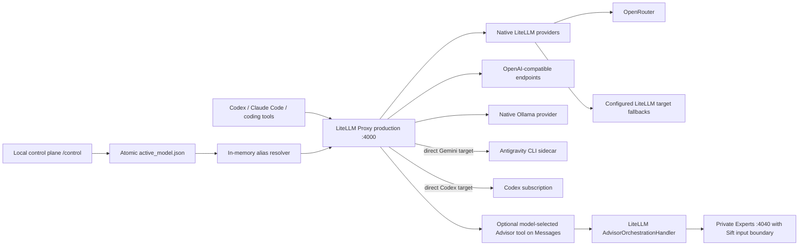

# Architecture

The hard design rule is **if upstream succeeds, downstream must succeed**. [AGENTS.md](../../AGENTS.md#hard-rules-preserve-upstream-success-and-pass-acceptance) defines the invariant and requires passing acceptance after every implementation; the [acceptance procedure](../operations/acceptance.md) defines proof. This describes intended ownership, not a claim that all deployed runtimes already satisfy it. Current gaps remain in [GOAL.md](../../GOAL.md).

LiteLLM Proxy is the only public protocol engine. Standard provider translation
stays in LiteLLM. The narrow Codex advisor adapter collects upstream Responses
SSE into a completed text response and validates terminal status and usage.

## Ownership

LiteLLM owns:

- HTTP endpoints used by coding tools
- streaming and tool-event protocol behavior
- standard provider authentication and transport
- model deployments and key selection

This repository owns:

- a small, reviewable LiteLLM configuration, including explicit target fallback chains
- explicit public model aliases
- explicit routing and validation that preserve supported upstream semantics, with no fallback chain for Advisor calls
- behavioral acceptance after every implementation, including gateway fault isolation, request/tool fidelity and completed client delivery
- a callback that injects LiteLLM's built-in Advisor tool on the Anthropic
  Messages path whenever the captured policy contains an advisor selection
- a loopback-only routing control plane that resolves `default`, or explicitly
  applies `force` mode, before LiteLLM selects a deployment

The dynamic routing callback precedes the Advisor callback. A request for
`default` resolves to the selected model; `auto` is a LiteLLM model group
whose provider errors use the configured fallback chain. Explicit fallback
chains also cover configured MiniMax, OpenRouter and Xiaomi target aliases.
Full/bare configured provider IDs resolve to selectable aliases; unknown or ambiguous names use the saved default. Private Advisor deployments are excluded.
The same request-local policy snapshot selects the target and optional expert.
The model chooses whether to invoke the advertised native Advisor tool on Messages; ordinary requests do not require expert availability. A chosen consultation has no retry/fallback chain. Preserve truthful tool failure semantics and bounded continuation; any framework path that turns optional work into an unrelated target failure remains a gateway gap until accepted.
Rewrites carry requested/resolved names, routing mode and policy version as audit metadata. Existing in-flight requests are never retargeted.

## Failure isolation

Gateway transformations must not turn successful compatible upstream behavior into schema errors, lost content/limits, malformed tools, premature timeouts or incomplete client streams. LiteLLM owns the protocol engine; each necessary compatibility shim needs a demonstrated gap, regression and retirement condition. A fallback success is separate from preservation of the original attempt.

Accounting, usage replay, logging and status presentation are observational. PostgreSQL failure, a full SQLite outbox or missing telemetry must not reject inference or replace a successful terminal response. Bound telemetry work and test its latency/failure paths. Authentication, signed identities and explicit security/budget rules remain enforced. Do not delete receipts, change routing or bypass credentials to conceal a failure.

`/health/readiness` is the gateway/database readiness probe; LiteLLM `/health`
checks each configured deployment and may report optional routes as unhealthy
while the gateway is ready. The Compose gateways limit provider-health probes
to two concurrent checks per instance and ten seconds per check. That keeps two
instances' aggregate Gemini sidecar health traffic within its four-process
limit and gives each slow deployment a bounded result.

The Codex advisor boundary preserves valid tool history by translating
Anthropic and OpenAI Chat tool exchanges into Responses input items. Advisor
injection is skipped before orchestration when the selected advisor cannot
represent that history. This keeps the executor request intact and leaves the
provider handler as the final fail-closed validation boundary.

Provider-specific Python belongs here only when LiteLLM has no native provider
or OpenAI-compatible seam. Antigravity's registered handler calls a separate
CLI bridge service, which launches at most four external CLI processes at a
time. It waits up to 0.5 seconds for a slot, then returns HTTP 429 at capacity.
Timeout and client disconnect terminate the process group and wait for cleanup
before releasing the slot. Gemini transport uses this Compose bridge. Its former
host-local direct-CLI fallback used different input framing and terminal-result
rules and is no longer supported; local tests and Compose use the same bridge
contract. Target requests use the target agent profile, including plain-text
requests; only explicit advisor consultations use the concise advisor profile.
Tool schemas support local fragment references only. Validation uses a registry
without remote retrieval so caller schemas cannot start synchronous network work.
By owner decision on 2026-09-26, this Compose-managed sidecar is an
explicit exception: it preserves the personal CLI subscription, and Gemini
API-key authentication is not allowed. The intended Compose recipe now gives production and staging separate Antigravity credential, configuration and cache volumes. Verify actual mounts rather than assuming a recipe change has been deployed. Codex
subscription requests use a narrow `CustomLLM` adapter: it requests upstream streaming,
assembles non-streaming Chat chunks
with LiteLLM's native builder, and maps streamed Chat chunks into LiteLLM's
generic custom-provider stream shape. LiteLLM still owns the public protocol
bridges. The credential callback wraps
Responses string input, while LiteLLM's native Responses transformer handles
roleless function-call items as Chat tool calls and tool results. Public
gateway HTTP conversion is covered by deterministic fixtures; historical live
staging evidence and its limits are recorded in the provider reliability evaluation.
The advisor also retains a narrow collector because its non-streaming
orchestration call needs upstream streaming. See the focused Codex adapter,
credential, and bridge tests for the current local evidence.

Gemini's public SSE path is buffered: its handler waits for the Antigravity CLI
terminal result and provider usage before yielding chunks. The terminal event
reports the provider's actual input and output counts. Model metadata therefore
labels this `buffered-sse`; it does not promise progressive token delivery.

Each request resolves one executor/advisor policy snapshot. Persisted advisor
selection takes precedence over the ADVISOR_MODEL startup default. Production
and staging use distinct mutable policy storage, PostgreSQL stores and Antigravity state volumes in the intended Docker Compose deployment. Staging and production use separate gateway image tags, while configured Codex/Experts/accounting credentials are intentionally shared. Inspect actual containers before claiming isolation or source parity: legacy mounts and container-layer hotfixes can differ from the Compose recipe. Deployment changes remain subject to the current user's authority.

## Gemini music-listening integration

The [music-listening MCP](music-listening-mcp.md) now provides two read-only
stdio tools, `analyze_audio` and `compare_audio`, through the existing Gemini
Subscription. Explicit Chat audio input overrides saved routing and disables
the advisor for that request. The existing sidecar writes original bytes into
a disposable workspace and uses native `view_file`; it checks completed reads
and rejects the CLI's false-success filter refusal. Messages/Responses audio
is rejected before LiteLLM can discard it. Limits are two files and 20 MiB
combined. No new service, database, model or API-key route is added. This sends
audio to Google, and listening observations are not professional mixing proof.
The caller owns MCP execution; existing DAW controls own future edits/renders.

## Evidence boundary

Config tests prove only the intended ownership boundary. LiteLLM startup/readiness proves only proxy/database availability. Each implementation must pass the affected behavioral acceptance on its final source. Real client/provider or deployment claims additionally require authorized task-shaped tool/stream acceptance in that runtime, including recreation for durable image changes. Missing evidence remains open; historical receipts and offline fixtures cannot certify current live compatibility.
