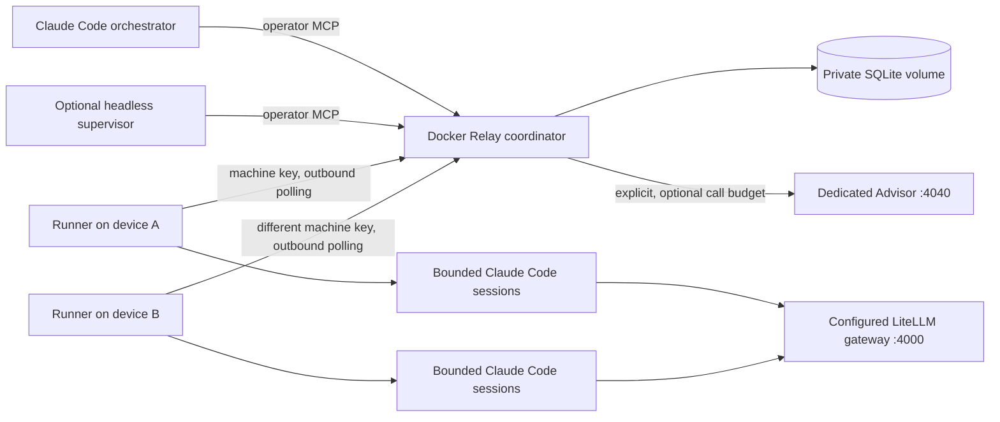

# Subroute Relay

Relay is an optional LAN work coordinator for Claude Code. Run its MCP server in Docker on one device. Run a small outbound runner on each machine with an approved workspace map. An interactive Claude Code orchestrator, or the optional headless supervisor, watches the fleet through MCP, delegates bounded tasks, examines separate review results and selects the next useful action.

This is a pilot for sessions Relay launches. It does not attach to arbitrary existing terminals, operate the Codex desktop app, or implement the Google A2A wire protocol. Agent coordination uses the official MCP Streamable HTTP transport. A machine can run several sessions concurrently when their workspace aliases point to separate directories.

For the device A server and device B Docker client setup, follow [Relay devices](relay-devices.md). The client is the outbound runner. Its image includes Claude Code, and its separate Compose file provides private state and an explicitly mounted workspace.



## What it owns

The hub owns goals, delegated authority, tasks, attempts, deadlines, lifecycle events and acceptance records. A runner owns its machine's workspace aliases, Claude installation, permitted tools, inference credentials and local execution caps. LiteLLM continues to own inference protocols, routing and provider fallbacks. Relay does not change the saved routing desk or gateway Compose stack.

The current gateway has no durable multi-machine job leases or workspace execution lifecycle. MCP supplies the tool transport, not a scheduler. These gaps justify one optional service and one private SQLite volume. The service reuses the already-used MCP SDK, HTTPX and Uvicorn rather than adding a broker or orchestration framework. SQLite is for a small LAN installation with one coordinator process, not an HA cluster. Keep one Uvicorn worker; stop the service before copying its database for backup, or use SQLite's online backup API.

The coordinator is a modular monolith: `store.py` owns transactional task rules without importing MCP, HTTP or a model client; `server.py` adapts those rules to MCP/operator and authenticated machine endpoints. Runners use that wire contract and keep local execution policy. Internal calls stay in process. The required device boundary is the only new network hop. SQLite, outbound polling and official MCP are the boring primitives that keep ownership and failure handling visible.

Replacement points are deliberately narrow. Change the configured LiteLLM address/route to change inference providers, and local runner configuration to change tools, workspace aliases and caps. The current execution adapter supports Claude Code CLI. Another agent CLI needs a compatible launch/result adapter and behavioral tests; it is not a drop-in configuration switch today. No plugin discovery, dependency-injection container, broker or speculative backend interface is required for the single shipped implementation. Keep the stable task contract while replacing an edge when a real second implementation is needed.

## Start the coordinator

From the Subroute checkout, copy [the environment template](../../sidecars/relay/.env.example) to `.env.relay`. Generate a different random token for the operator and every node, at least 32 characters each. For example, run `py -3 -c "import secrets; print(secrets.token_urlsafe(36))"` separately for each token. The template's short placeholders deliberately fail startup validation.

Set `RELAY_NODE_KEYS` to a JSON object such as `{"workstation":"<machine-specific token>","laptop":"<different token>"}`. Keep each machine's credential on that machine. The operator token grants fleet administration and task dispatch; never give it to workers. The hub reads its configuration only from its environment. Compose loads `.env.relay`; explicit process variables take precedence. There is no saved routing/configuration file competing with these settings.

```powershell
docker compose --env-file .env.relay -f docker-compose.relay.yml up -d --build
docker compose --env-file .env.relay -f docker-compose.relay.yml ps
```

The default listener is `http://127.0.0.1:8765/mcp`. For LAN access, set `RELAY_PUBLISH_IP` to the server's actual interface IP and include that IP or DNS name in `RELAY_ALLOWED_HOSTS`, for example `192.168.1.10:*,127.0.0.1:*,localhost:*`. Restrict the host firewall to the intended subnet. HTTP carries work and tokens in plaintext; use HTTPS through your existing reverse proxy on shared networks. Runners and MCP clients support HTTPS and system certificate verification. Browser-origin requests are rejected. No public tunnel or firewall rule is created automatically.

The separate Compose project uses a private `relay-state` volume, an unprivileged UID, a read-only root filesystem, bounded Docker logs and `unless-stopped` restart policy. It mounts neither source workspaces nor the Docker socket. The image's Python base is digest pinned and Python dependencies have a universal hash lock. The default gateway, staging and PostgreSQL configuration are unchanged. Rotating/removing a node key requires recreating this optional service; revoked runners stop on failed authenticated heartbeats and their unknown work stays quarantined.

## Connect the orchestrator

Merge [the MCP example](../../sidecars/relay/mcp.example.json) into your Claude Code MCP configuration, change its address, and provide `RELAY_OPERATOR_KEY` in the process environment. The `${RELAY_OPERATOR_KEY}` reference keeps the token out of the file. Do not store a literal credential in a CLI argument or shared MCP file. Verify the server is connected with Claude Code's `/mcp` screen.

Ask the orchestrator:

> Use Relay and Northstar. Create a goal with this outcome, measurable acceptance and authority. Inspect the available nodes and workspaces, delegate bounded work, schedule separate review sessions, and keep advancing until the actual criteria pass or a specific blocker requires me. Do not publish, deploy or contact others unless the recorded authority explicitly permits it.

The `supervise` MCP prompt and `relay://contract` resource expose the coordination contract. Tools are `fleet_status`, `goal_create`, `goal_set_state`, `task_create`, `task_get`, `task_cancel`, `task_reconcile`, `task_retry`, `task_accept`, `events_list` and `consult_advisor`. `fleet_status` includes result excerpts; use `task_get` to inspect full evidence. Goal authority is a recorded delegation and prompt instruction, not an OS sandbox or proof that a model followed it.

## Install a runner on each machine

Use Python 3.12 or 3.13 and a locally installed Claude Code CLI. CLI discovery was checked against Claude Code **2.1.251** on Windows, including its native npm-installed executable. Check a different CLI version's flags and run one bounded smoke before trusting it with work.

Create a separate environment rather than changing the gateway environment:

```powershell
uv venv tmp/relay-venv --python 3.12
uv pip sync sidecars/relay/requirements.lock --python tmp/relay-venv/Scripts/python.exe
$env:PYTHONPATH = "$PWD/src"
```

On Linux/macOS use `tmp/relay-venv/bin/python`. Copy [the runner example](../../sidecars/relay/runner.example.json) into a private local JSON file and edit the addresses, `node`, and absolute workspace paths. Set `RELAY_NODE_KEY` to that node's token, and supply an inference key accepted by the configured gateway through the named `gateway_key_env` variable. These are different credentials. Never send a key intended for a different provider to this endpoint. The hub is not an inference proxy, so each runner needs network access to its chosen LiteLLM `gateway_url`.

```powershell
tmp/relay-venv/Scripts/python.exe -m subroute.relay.runner --config path/to/private-runner.json
```

Run one instance per node identity. `slots` permits 1 to 8 concurrent sessions across disjoint workspace aliases. Identical, nested or retargeted aliases are rejected; local locks also prevent two runners using the same canonical directory. Keep workspace directories disjoint across separate node configurations too. Use separate Git worktrees for independent writers in one repository. A task cannot supply a filesystem path or an executable; the local runner chooses both. There is no remote raw-shell API. Claude's locally approved Bash patterns can still execute code, so an allowlisted workspace does not provide filesystem confinement. Prefer a dedicated OS account or a container with only the intended workspace mounted when stronger containment is needed.

Default work tools are Read/Glob/Grep/Edit/Write. Review defaults are Read/Glob/Grep. Add narrowly scoped test commands to `tools` and `review_tools` locally, as illustrated by `Bash(pytest*)`; commands are approved by the machine owner, never by a task payload. Claude runs with `dontAsk`, a strict empty MCP configuration and explicit tools, without bypassing permissions. Denied actions are reported as blockers. Each attempt starts a fresh session, including reviews. Node/operator/Advisor credentials are excluded from worker environments, and each runner uses a private Claude config directory rather than modifying global settings. These measures do not hide all host secrets from arbitrary locally authorized code.

`model` defaults to the gateway alias `default`, which follows the gateway's saved target. Force mode and provider fallbacks can change the actual model even for an explicit alias. Verify the real delegated route when a model constraint matters; this feature never changes global routing to make a worker run. Leaf runners use the embedded bounded task contract by default and do not discover or inject an installed Northstar bundle. An explicit `northstar_path` adds one local instruction file; a missing configured file fails before polling. Workers can read referenced files using their approved tools. The orchestrator retains Northstar planning, review and continuation. The headless supervisor still discovers the full entrypoint from local `.agents`, `.codex` or `.claude` skills, or its explicit `northstar_path`, and receives it plus the MCP contract. It has no local file tools and cannot independently load every linked skill reference. A supervisor host without the entrypoint uses the embedded bounded contract and must disclose that limitation.

Local caps win when stricter than a task's requested `max_turns` or `timeout_seconds`. `max_cost_usd` is Claude Code's estimated API cost cap, **not** a provider billing guarantee. Unknown/custom model pricing can make that estimate inaccurate. Hard limits are elapsed time, turns, attempt count and the goal's task count. The hub's task cap is per goal; operator access can create additional goals, so it is not an account-wide spending budget.

## Enable continuous supervision

The coordinator and runners work without a headless supervisor. For unattended advancement, run [the supervisor example](../../sidecars/relay/supervisor.example.json) on an operator machine with Claude Code, `RELAY_OPERATOR_KEY` and its separate gateway inference key:

```powershell
tmp/relay-venv/Scripts/python.exe -m subroute.relay.supervisor --config path/to/private-supervisor.json
```

The supervisor polls every 30 seconds but launches a bounded Claude session only when an active goal's durable event revision changes. It has MCP tools and no built-in filesystem/shell tools. Unchanged work causes no model call. It records its cursor and reserved daily cycle count under `~/.subroute-relay/supervisor`, allows at most two failed cycles per unchanged revision, and defaults to 48 cycles per UTC day. Worker lifecycle events cause further review/assignment cycles. Paused/completed goals consume no cycles. Call counts survive restart; protect and reuse the state directory. A second supervisor for the same exact URL on the same OS account is rejected. Run only one supervisor per hub; this pilot does not implement a distributed supervisor leader election.

For an always-on installation, run the runner and supervisor as OS services under their intended account, with the same private environment/configuration and restart-on-failure settings. The coordinator already has Docker restart handling. This delivery does not register startup services, start paid recurring work, or configure another physical device. `--once` on either command is useful for a bounded smoke. Check the supervisor's local JSON receipt and the MCP fleet after failures; do not infer progress from an idle process.

The optional `consult_advisor` tool makes one explicit request to the dedicated GPT-6.1 Sol Advisor alias, with no retry or provider fallback added by Relay. Set `RELAY_ADVISOR_KEY` and a positive `RELAY_ADVISOR_DAILY_LIMIT` in the hub environment to enable it. The default is disabled. The call reservation is persisted before dispatch and failures consume a reservation. The UTC daily budget and 75-second timeout bound this path. Advice cannot accept work or expand authority.

## State and recovery

```text
queued -> running -> review -> accepted
                  -> failed -> explicit retry (within the original attempt cap)
running -> cancelling -> cancelled
running/cancelling -> reconcile (lost lease or hard deadline)
reconcile -> failed (operator evidence of stopped execution + inspected workspace)
```

A successful CLI turn becomes `review`, never `accepted`. Work acceptance requires an accepted separate review task targeting that result on the same workspace. Review text can still be mistaken or report findings; the orchestrator must inspect its evidence rather than blindly accepting a success-shaped turn. A newer attempt cannot reuse an older review. Goal completion requires accepted work, no unresolved tasks and acceptance evidence. Rejected review findings should lead to cancelling/retrying the work within budget, repairing it, then a fresh review. No automatic task retry is performed.

Machine heartbeats establish liveness. Tool-event activity is reported separately and does not extend the hard deadline. Every claim is transactional and has a fresh secret token plus an increasing attempt number. Expired or cancelled attempts cannot submit success. Cancellation retains the workspace lock until a runner confirms the process tree stopped; disappearance changes the state to `reconcile`, not `queued`. SQLite persistence and fencing cannot undo filesystem side effects. Before reconciliation, inspect the old process tree and actual workspace diff on that machine. If you cannot establish that it stopped, leave quarantine in place. The supervisor cannot manufacture this evidence and should pause dependent work.

Network/auth failures prevent new launches and terminate active children when their next pulse fails. Terminal reports are kept in a private local `.pending` outbox and retried for delivery without rerunning execution. Rejected stale reports become `.stale` evidence. Restarting a runner cannot renew the old attempt; an unknown old run needs reconciliation. A recent node instance retains its identity for the lease window, so a restarted runner can briefly be rejected until that expires. On Windows, Job Objects kill descendants when the owner exits; assignment occurs immediately after spawn and has a small startup race. On POSIX, process groups are cleaned up on normal completion, cancellation and timeout. A forced host/runner crash can leave a POSIX child alive, so quarantine is essential. This is not a sandbox for hostile processes that deliberately escape containment.

Use `goal_set_state(..., state="paused")` to stop assignments and request cancellation of current work. Then inspect `fleet_status`; a pause is not immediate proof of a remote kill. `task_cancel` stops an individual assignment. Do not release a quarantined workspace merely because the server restarted or its port is healthy.

Job sessions disable Claude auto memory so one task's private notes cannot silently steer a later task or its separate reviewer. The terminal handoff is the worker's Northstar checkpoint; durable learning and next actions belong in the coordinator's result and acceptance records. The runtime setting uses the documented [Claude environment variable](https://code.claude.com/docs/en/env-vars). This reduces an observed overrun path; it does not enforce a per-file write sandbox or establish successful live completion.

## Verification

```powershell
.venv/Scripts/python.exe -m pytest tests/test_relay.py -q
docker build -f sidecars/relay/Dockerfile -t subroute-relay:0.1.0 .
.venv/Scripts/python.exe scripts/verify_relay.py
.venv/Scripts/python.exe scripts/verify_relay_docker.py
```

The Docker probe creates a uniquely named disposable Compose project and volume, uses the real MCP client SDK, checks Claude Code MCP discovery without inference, exercises two machine identities through the real runner/process/HTTP path with fixture CLIs, runs separate fixture reviews, accepts the goal and verifies persistence after container restart. It removes only that temporary project/volume. It never sends a provider request. Unit/boundary checks cover competing claims, stale results, cancellation, process descendants, malformed/failed terminal JSON, auth separation, workspace policy, persistence and budget gates. A fixture is not proof of live Claude tool quality, provider compatibility, two physical devices or 24-hour reliability.

See [the initial evidence and remaining acceptance](../evals/relay-2026-10-23.md). Technical references: [Claude Code CLI](https://code.claude.com/docs/en/cli-reference), [HTTP MCP and environment-variable configuration](https://code.claude.com/docs/en/mcp), and the installed official MCP Python SDK 1.28.1. The implementation was checked against that installed SDK because current SDK documentation also covers newer APIs.

### Repeatable isolated Docker fault tests

`scripts/verify_relay_docker.py` builds the current coordinator/client images and runs two real runners using the shipped Compose definitions. Its acceptance-only overlay replaces Claude with an explicit deterministic CLI fixture. The runners have private workspace/home volumes, no external network route, no host repository/home mounts and no real inference credentials. Only public fixture configuration files are mounted read-only. The hub also joins a disposable management bridge for its loopback-only host port; worker traffic stays on the internal network. No production gateway, staging service or saved routing policy is changed.

The suite runs one default leaf without a skill bundle and another with an explicit tiny instruction file, observing the actual invocation prompts and handoffs. It exercises simultaneous work, separate review/acceptance, machine/operator authentication, local execution caps and child-credential filtering, cancellation of a real descendant process, malformed/incorrect outcomes, successful CLI turns with a negative review, large escaped UTF-8 receipts through the actual reporting API, task budgets, hard-crash quarantine, coordinator restart, explicit reconciliation/retry, and idle invocation counters. It waits for the real 45-second lease instead of modifying production clocks or lease settings. Reconciliation uses the MCP tool's required `stopped_and_inspected_evidence` argument after directly observing stopped execution and inspecting the workspace. It removes only its unique Compose project and verifies that its containers, volumes and networks are gone. Runs are bounded to 240 seconds plus cleanup. Docker documents [Compose 2.24.4 or newer](https://docs.docker.com/reference/compose-file/merge/#replace-value) for `!override`; this host was checked with 5.6.0.

The default receipt is `tmp/lan-relay/relay-docker-acceptance-<unique-id>.json`. `--output <path>` additionally writes a convenient result file while preserving the unique per-run receipt. Failures retain nested error causes and a bounded task-state snapshot before cleanup. Run Python without `-O`/`PYTHONOPTIMIZE`; the driver refuses optimized mode so assertions cannot silently disappear.

These tests establish coordination and recovery behavior with a scripted executor. They do not establish Claude's judgment, native tool quality, a second physical machine, or 24-hour effectiveness. The separate `scripts/verify_relay.py --live` mode explicitly spends inference on real native sessions; it is not part of the provider-free Docker command. Keep its previous failed live review/supervisor outcomes distinct from deterministic fault-test results.

### Bounded native Docker acceptance

After building the coordinator and worker images, `python scripts/verify_relay_live_docker.py --rounds 2 --output tmp/lan-relay/live-stress-current.json` exercises real Claude Code through the existing port-4000 gateway. Supply the already-authorized inference key as process `GATEWAY_MASTER_KEY`; no credential files are read and no routing setting is changed. Unlike the provider-free fault suite, this command consumes inference. It runs at most two sequential rounds and stops after the first failed round or incomplete cleanup.

Each round reuses the live verifier's two concurrent work tasks, fresh separate reviews, parent unittest/semantic holdouts and native tool-result trace checks. It preserves the original 12-turn/180-second/USD 1 client-estimated session limits, four-session maximum and 420-second parent deadline. Native runners have private home volumes, state/workspace binds and read-only config, with no skill bundle or Docker socket. Accepted state must survive an actual coordinator restart, and idle native traces must stay stable while both runner containers are alive. Each unique run keeps a sanitized receipt and private evidence under `tmp/lan-relay`; only that run's containers, volumes and networks are removed. This is one-host bounded acceptance, not proof of physical two-device or 24-hour operation.
